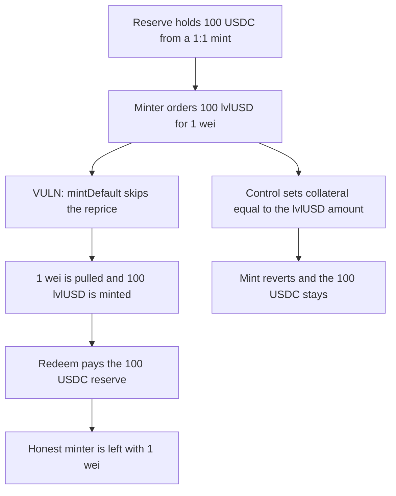

# Level: mintDefault does not reprice the order

> **Vulnerability classes:** `vuln/input-validation/missing` · `vuln/logic/missing-check`

<!-- non-defihacklabs -->
<!-- source-auditvault: https://github.com/Auditware/AuditVault/blob/main/findings/42042-missing-call-to-computecollateralorlvlusdamount-in-levelmint.md -->
<!-- date: 2024-09 -->

## Key info

| Field | Value |
|---|---|
| **Loss** | 100 USDC of reserve, taken for 1 wei of collateral |
| **Vulnerable contract** | `LevelMinting.mintDefault` |
| **Attacker EOA** | `0x1111111111111111111111111111111111111111` |
| **Attack contract** | `Exploit` |
| **Attack tx** | `Exploit.run()` |
| **Chain / block / date** | Ethereum model · block 0 · 2024-09 |
| **Compiler** | solc 0.8.27, cancun, via IR |
| **Bug class** | User-supplied lvlUSD and collateral amounts are minted as-is |

## TL;DR

`mintDefault` checks that the caller is the benefactor and then passes the order straight to `_mint`. It never calls `computeCollateralOrlvlUSDAmount`. A registered minter sets `lvlusd_amount` to 100 and `collateral_amount` to 1 wei, mints 100 unbacked lvlUSD, and redeems it against the 100 USDC another minter posted 1:1. The honest minter's later redeem is paid the remaining 1 wei.

## The vulnerable code

```solidity
function mintDefault(Order memory order) external onlyMinterWhenEnabled {
    if (msg.sender != order.benefactor) revert MsgSenderIsNotBenefactor();
    _mint(order); // @> VULN: lvlusd_amount is minted without computeCollateralOrlvlUSDAmount
}
```

`_mint` pulls `collateral_amount` and mints `lvlusd_amount`. The fix recomputes the order first. At a 1:1 quote, 100 lvlUSD requires 100 collateral. Cantina recorded the fix in commit `532771c9`.

## Preconditions

- The caller is an enabled minter and is the order's benefactor.
- Another minter has already minted 100 lvlUSD for 100 USDC. The contract holds that 100 USDC.
- Redeem pays collateral 1:1 until the balance is gone.

## Attack walkthrough

1. The order asks for 100 lvlUSD and offers 1 wei.
2. `mintDefault` pulls 1 wei and mints 100 lvlUSD. The reserve is 100 USDC plus 1 wei.
3. Redeeming 100 lvlUSD transfers 100 USDC to the caller.
4. The honest minter redeems 100 lvlUSD and receives the leftover 1 wei.
5. The caller's USDC balance went from 1 wei to 100 USDC.
6. The control path recomputes collateral to 100 and reverts, because the caller does not have 100 USDC. The reserve stays 100.

## Diagrams



## Impact

The minter spends 1 wei and receives the 100 USDC that backed the earlier mint. That depositor's lvlUSD redeems for 1 wei. The missing reprice is what lets the amounts diverge from the 1:1 quote.

## How to reproduce

```bash
cd 42042-missing-call-to-computecollateralorlvlusdamount-in-levelmint_exp
forge test -vv
```

`test_exploit_mints_unbacked_lvlusd_and_redeems_reserve` asserts the caller ends with 100 USDC. `test_control_recomputes_collateral` asserts the fixed mint reverts and the reserve is unchanged.

## Sources

- AuditVault finding: https://github.com/Auditware/AuditVault/blob/main/findings/42042-missing-call-to-computecollateralorlvlusdamount-in-levelmint.md
- Cantina report: https://cdn.cantina.xyz/reports/cantina_level_money_sep2024.pdf
- Fix commit noted by Cantina: `532771c9`
