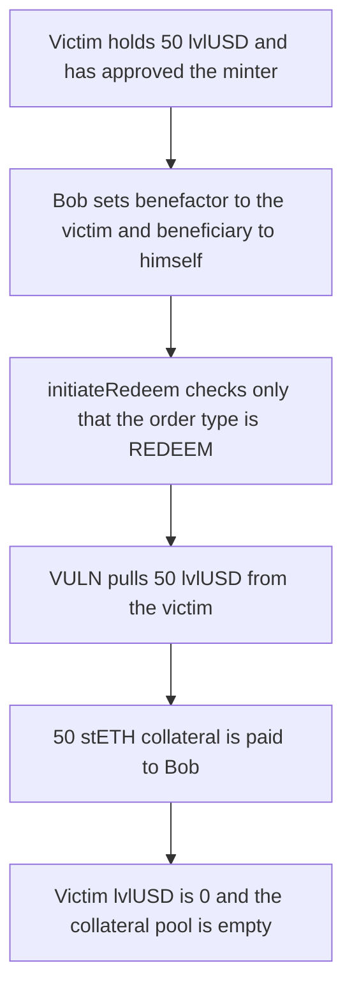

# Level Money: initiateRedeem pays a victim's stETH collateral to any caller

> **Vulnerability classes:** `vuln/access-control/missing-auth` · `vuln/logic/missing-check`

<!-- non-defihacklabs -->
<!-- source-auditvault: https://github.com/Auditware/AuditVault/blob/main/findings/42043-mint-initiateredeem-and-redeem-lack-access-control-cantina-n.md -->
<!-- date: 2024-09 -->

## Key info

| Field | Value |
|---|---|
| **Loss** | 50 stETH moved from the minting contract to Bob. The victim's 50 lvlUSD is taken with it |
| **Vulnerable contract** | `LevelMinting.initiateRedeem` |
| **Attacker EOA** | `0x1111111111111111111111111111111111111111` |
| **Attack contract** | `Exploit` |
| **Attack tx** | `Exploit.run()` |
| **Chain / block / date** | Ethereum model · block 0 · 2024-09 |
| **Compiler** | solc 0.8.27, cancun, via IR |
| **Bug class** | Redeem order uses `benefactor` and `beneficiary` with no check that the caller is the benefactor |

## TL;DR

`initiateRedeem` accepts an order whose `benefactor` and `beneficiary` are chosen by the caller. A user who has approved the minter for lvlUSD can be named as benefactor. Bob sets himself as beneficiary. The call pulls 50 lvlUSD from the victim and sends 50 stETH collateral to Bob. Requiring `order.benefactor == msg.sender` reverts that order and leaves both balances in place.

## Background

Cantina's September 2024 Level Money review, reported by Delvir0. The published proof sets the redeemer-role check off, then calls `initiateRedeem` with `benefactor` equal to the address that received lvlUSD and `beneficiary` equal to the attacker. The recommended fix, confirmed in commit `5afc1851`, is that `order.benefactor` must be `msg.sender`.

## The vulnerable code

```solidity
function initiateRedeem(Order calldata order) external {
    require(order.order_type == OrderType.REDEEM, "type");
    // @> VULN: lvlUSD is taken from order.benefactor, not msg.sender, and collateral is paid to order.beneficiary
    lvlusd.transferFrom(order.benefactor, address(this), order.lvlusd_amount);
    collateral.transfer(order.beneficiary, order.collateral_amount);
}
```

The only gate is the order type. `transferFrom` spends the benefactor's existing approval. `transfer` pays `collateral_amount` to `beneficiary`.

## Root cause

The order struct carries both the account that supplies lvlUSD and the account that receives collateral, and the function trusts both fields. An approval to the minter is enough. The caller does not have to be the benefactor.

## Preconditions

- The victim holds 50 lvlUSD and has approved `LevelMinting` for at least that amount.
- The minting contract holds 50 stETH collateral.
- Bob can call `initiateRedeem`. In the report this is the configuration where the redeemer-role check is not enforced.

## Attack walkthrough

1. Bob builds a REDEEM order with nonce 3, the victim as benefactor, and himself as beneficiary. Both amounts are 50.
2. `initiateRedeem` checks the order type and nothing else.
3. 50 lvlUSD is pulled from the victim.
4. 50 stETH is transferred to Bob.
5. The victim's lvlUSD balance is 0 and the collateral pool is empty.
6. The control uses the same order shape against a minting contract that requires `benefactor == msg.sender`. The theft reverts. A self-redeem by the token holder still pays that holder 50 stETH.

## Diagrams


