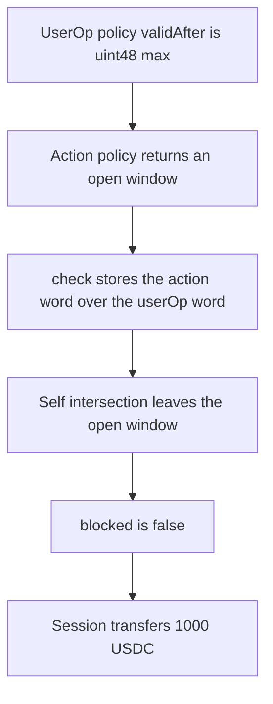

# SmartSession — a userOp time window is overwritten, so 1,000 USDC still moves

> **Vulnerability classes:** vuln/logic/wrong-condition · vuln/logic/incorrect-order-of-operations · vuln/auth/signature-validation

<!-- non-defihacklabs -->
<!-- source-auditvault: https://github.com/Auditware/AuditVault/blob/main/findings/42061-validationdata-not-always-intersected-properly-cantina-none.md -->
<!-- date: 2024-09 -->

## Key info

| Field | Value |
|---|---|
| **Loss** | 1,000 USDC transferred. The userOp `validAfter` is `uint48` max and should have blocked the call |
| **Vulnerable contract** | `SmartSession.check` |
| **Attacker EOA** | `0x1111111111111111111111111111111111111111` |
| **Attack contract** | `Exploit` |
| **Attack tx** | `Exploit.run()` |
| **Chain / block / date** | Ethereum model · block 0 · 2024-09 |
| **Compiler** | solc 0.8.27, cancun, via IR |
| **Bug class** | `ValidationData` is replaced and self-intersected instead of accumulated |

## TL;DR

`check` walks the policies and does `vd = validationDataFromPolicy`, then `vd = intersectValidationData(vd, vd)`. The second call does not combine this policy with the ones already seen. The first policy says `validAfter = uint48 max`, which is still in the future on this block, so the user operation must not run. The second policy is an open window. Because the first result is overwritten, `blocked()` is false and the session transfers 1,000 USDC. The fixed loop intersects each new policy into the accumulator. The same two policies revert `outside window` and the 1,000 USDC stays put.

## Background

Cantina reviewed Rhinestone SmartSessions for Biconomy from 3 September 2024 to 10 September 2024. Session validation is supposed to combine every policy's ERC-4337 `ValidationData` with `intersectValidationData`: the tightest `validAfter` and the earliest `validUntil`. `isFailed()` already reverts when a single policy fails, but a `validAfter` or `validUntil` on one policy can still be dropped when a later policy returns an open window. Rhinestone fixed the two overwrite sites in PR 60.

## The vulnerable code

```solidity
function check(uint256[] memory policyData) public pure returns (uint256 vd) {
    uint256 length = policyData.length;
    for (uint256 i; i < length; i++) {
        uint256 validationDataFromPolicy = policyData[i];
        vd = validationDataFromPolicy;
        // @> VULN: previous ValidationData is replaced, then intersected with itself
        vd = intersectValidationData(vd, vd);
    }
}
```

The packing matches EntryPoint: `validAfter` is the top 48 bits (`>> 208`), `validUntil` is the next 48 (`>> 160`), and a zero `validUntil` means forever. The userOp constant is `uint256(type(uint48).max) << 208`.

The fix accumulates:

```diff
-        vd = validationDataFromPolicy;
-        vd = intersectValidationData(vd, vd);
+        vd = intersectValidationData(vd, validationDataFromPolicy);
```

## Root cause

`intersectValidationData(vd, vd)` is the identity (aside from normalizing a zero `validUntil` to `uint48` max). It cannot restore a bound that the assignment on the previous line already threw away. With policy 0 restrictive and policy 1 open, the value that leaves the loop is policy 1. `execute` then treats that open window as permission to transfer.

## Preconditions

- The session holds 1,000 USDC.
- Policy 0 returns `validAfter = type(uint48).max` and an unbounded `validUntil`.
- Policy 1 returns the zero word, an open window.
- No `vm.warp`. `uint48` max is about year 8.9 million, so it is still in the future at Foundry's timestamp 1 and at the playground block.

## Attack walkthrough

1. `run` calls `execute` for 1,000 USDC.
2. `policyData[0]` is the userOp word. `policyData[1]` is the open action word.
3. The loop stores policy 0, self-intersects it, then stores policy 1 over that result and self-intersects again.
4. `blocked()` sees `validAfter == 0` and does not revert.
5. The session transfers 1,000 USDC. The kept `validAfter` is 0, while the userOp word's `validAfter` is still `uint48` max and `block.timestamp` is below it.

## Diagrams



## Impact

The recipient receives 1,000.000000 USDC. The userOp time window said the call was not valid yet. A correct intersection keeps `validAfter` at `uint48` max, `execute` reverts `outside window`, and the session still holds 1,000 USDC. The same shape is what `_enforcePolicies` does when it assigns the action-policy result over the userOp-policy result; this reduction shows it on the loop the report quotes first.

## PoC

```bash
cd 42061-validationdata-not-always-intersected-properly-cantina-none_exp
forge test -vv
```

`test_exploit_expired_userop_still_transfers` logs `usdc_moved: 1000000000`, `kept_valid_after: 0`, and the block timestamp. `test_control_intersects_and_blocks_the_transfer` expects `outside window` and asserts the recipient balance stays 0.

## Sources

- AuditVault finding: https://github.com/Auditware/AuditVault/blob/main/findings/42061-validationdata-not-always-intersected-properly-cantina-none.md
- Cantina report: https://cdn.cantina.xyz/reports/cantina_rhinestone_smartsessions_core_aug2024.pdf
- Session module: https://github.com/erc7579/smartsessions
