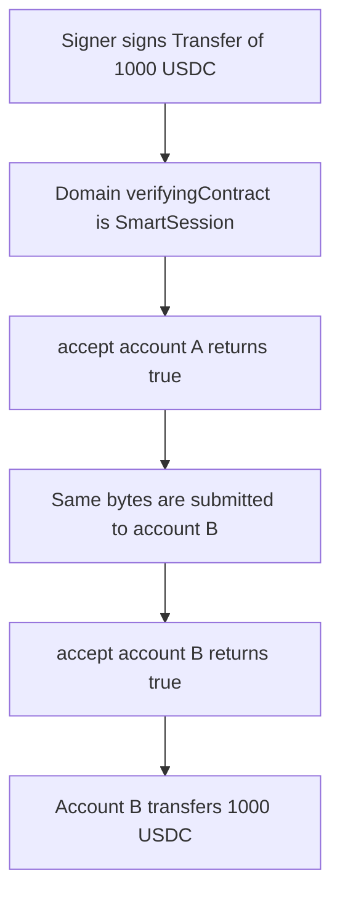

# SmartSession ERC-7739 — a signature for account A spends account B's 1,000 USDC

> **Vulnerability classes:** vuln/auth/signature-replay · vuln/auth/signature-validation · vuln/logic/wrong-condition

<!-- non-defihacklabs -->
<!-- source-auditvault: https://github.com/Auditware/AuditVault/blob/main/findings/42064-erc-7739-does-not-use-correct-verifyingcontract-address-cant.md -->
<!-- date: 2024-09 -->

## Key info

| Field | Value |
|---|---|
| **Loss** | 1,000 USDC moved from account B. The signature was accepted for account A because both hashes use the module address |
| **Vulnerable contract** | `SmartSession._typedDataSignFields` |
| **Attacker EOA** | `0x1111111111111111111111111111111111111111` |
| **Attack contract** | `Exploit` |
| **Attack tx** | `Exploit.run()` |
| **Chain / block / date** | Ethereum model · block 0 · 2024-09 |
| **Compiler** | solc 0.8.27, cancun, via IR |
| **Bug class** | ERC-7739 `verifyingContract` is the session module, so the digest is not account-bound |

## TL;DR

ERC-7739 is supposed to re-hash an ERC-1271 digest with `verifyingContract` set to the smart account, so two accounts that share a signer cannot replay each other's signatures. This module's `eip712Domain()` returns `address(this)`, the SmartSession contract, and the typed-data assembly stores that word. The signer `0xf39F…2266` signs one `Transfer` of 1,000 USDC to `0x3333…3333`. `accept` returns true for account A. The same bytes then pass on account B, and B transfers the 1,000 USDC. A fixed module puts the account address in the domain. The same signature reverts `sig` and B keeps the 1,000 USDC.

## Background

Cantina reviewed Rhinestone SmartSessions for Biconomy from 3 September 2024 to 10 September 2024. The ERC-7739 nested EIP-712 wrapper exists specifically so a signature cannot be replayed across smart accounts that share an owner or session signer. The report says the code sets `verifyingContract` to SmartSession rather than `msg.sender`, and the fix landed in PR 64 and PR 77. This reduction pins the domain chain id at 1 and precomputes the signature, because the playground cannot call `vm.sign`. The Foundry test signs the same digest with `vm.sign` after it checks that the assembly word equals `address(this)`.

## The vulnerable code

```solidity
address verifyingContract = address(this); // from eip712Domain()
assembly {
    // @> VULN: verifyingContract is SmartSession, not the account (msg.sender)
    mstore(add(m, 0xc0), shr(96, shl(96, verifyingContract)))
}
baked = address(uint160(uint256(word)));
```

The recommended change, which the control applies by hashing `account` instead of the module:

```diff
-    verifyingContract = address(this);
+    address verifyingContract = account; // msg.sender, the smart account
```

## Root cause

`_typedDataSignFields` loads `verifyingContract` from `eip712Domain()`, and that function returns `address(this)`. The `mstore` at offset `0xc0` writes that address into the typed-data image. `accept` ignores the account argument and recovers the signer from `digestFor(baked, to, amount)`. Account A and account B therefore present the same digest for the same transfer. A signature recovered against the module is a signature for every account.

## Preconditions

- Accounts A and B each hold 1,000 USDC and point at the same SmartSession.
- Both trust the same signer, `0xf39Fd6e51aad88F6F4ce6aB8827279cffFb92266` (Anvil account 0).
- The signature is over `Transfer(0x3333…3333, 1000000000)` with `verifyingContract` equal to the module and chain id 1.
- The playground installs that signature with `setReplaySig` before `run`. The Foundry test signs the live module address with `vm.sign`.

## Attack walkthrough

1. `accept(accountA, recipient, 1000 USDC, sig)` builds the domain from the module address and recovers the signer. It returns true.
2. Account B's `execute` calls `accept(accountB, …)` with the same bytes. The digest does not change.
3. B transfers 1,000 USDC to `0x3333…3333`.
4. A still holds 1,000 USDC. B holds 0. The recipient holds 1,000 USDC.

## Diagrams



## Impact

Account B loses 1,000.000000 USDC to the recipient. The signature was valid for account A and did not name B. The fixed module hashes `verifyingContract = account`, so the module-bound signature fails `ecrecover`, `execute` reverts `sig`, and the account still holds 1,000 USDC.

## PoC

```bash
cd 42064-erc-7739-does-not-use-correct-verifyingcontract-address-cant_exp
forge test -vv
```

`test_exploit_signature_for_a_pays_from_b` logs `usdc_from_b: 1000000000` and `left_on_a: 1000000000`, and asserts the assembly digest equals `digestFor(address(session))`. `test_control_binds_verifying_contract_to_the_account` asserts `accept` is false for the account-bound hash, the replay call returns failure, and the fixed account still holds 1,000 USDC.

## Sources

- AuditVault finding: https://github.com/Auditware/AuditVault/blob/main/findings/42064-erc-7739-does-not-use-correct-verifyingcontract-address-cant.md
- Cantina report: https://cdn.cantina.xyz/reports/cantina_rhinestone_smartsessions_core_aug2024.pdf
- Session module: https://github.com/erc7579/smartsessions
