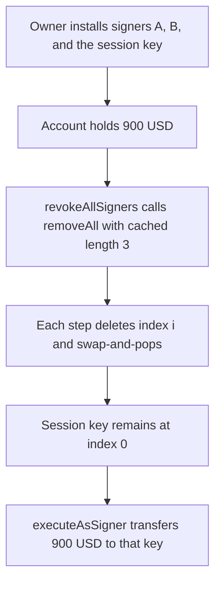

# Smart Sessions — forward removal leaves a signer who pulls 900 USD

> **Vulnerability classes:** vuln/logic/incorrect-state-transition · vuln/logic/wrong-order · vuln/access-control/broken-logic

<!-- non-defihacklabs -->
<!-- source-auditvault: https://github.com/Auditware/AuditVault/blob/main/findings/42065-arrays-are-not-properly-cleared-due-to-iteration-during-remo.md -->
<!-- date: 2024-08 -->

## Key info

| | |
|---|---|
| **Protocol** | Biconomy / Rhinestone Smart Sessions |
| **Finding** | Cantina array clear during iteration, AuditVault 42065 |
| **Vulnerable code** | `EnumerableSet._removeAll` |
| **Harm** | After a revoke of three signers, the session key is still authorized and pulls **900 USD**. The account ends at 0 |
| **Chain** | local synthetic |

## TL;DR

`_removeAll` caches the set length and deletes the value at index `i` on every step. `_remove` swap-and-pops, so a later signer moves into the slot that the next `i` skips. With signers A, B, and the session key, the call returns successfully and the session key is the one entry left. That key's `executeAsSigner` transfers the account's 900 USD. Removing from the tail clears the set, and the same pull reverts.

## The vulnerable code

Pre-fix `EnumerableSet4337._removeAll` (erc7579/smartsessions, before PR 65):

```solidity
function _removeAll(Set storage set, address account) internal {
    uint256 len = _length(set, account);
    for (uint256 i; i < len; i++) {
        // @> VULN: index i moves forward while _remove swap-and-pops, so the signer moved into this slot is never removed
        _remove(set, account, _at(set, account, i));
    }
}
```

`_at` follows the pre-fix `AssociatedArrayLib._get`: an index past the live length reads as zero instead of reverting. The third iteration therefore deletes nothing, and the transaction does not roll back. The same forward walk is in `onUninstall`, which reads `$enabledSessions.at` at the increasing index and then `removeSession`.

PR 65 walks the array backwards (`len - i`) and, in `onUninstall`, always removes index 0.

## Root cause

Swap-and-pop stores the tail at the deleted index and shrinks the length by one. A loop that both caches `len` and increments `i` never revisits that slot. Half of the entries are skipped. The value that lands at index 0 and is then jumped over stays in the set, with its position map still set, so `contains` is still true.

## Preconditions

The account holds 900 USD and has three authorized signers, added in order A, B, session key. The owner calls the revoke that is supposed to clear the signer set. No other privilege is required. The session key is just one of the signers the owner tried to remove.

## Attack walkthrough

1. The account is funded with 900 USD. Signer A, signer B, and the session key are installed. The set length is 3.
2. The owner calls `revokeAllSigners`, which calls `removeAll`.
3. Iteration 0 deletes A. The session key is swapped from index 2 into index 0. The set is `[key, B]`.
4. Iteration 1 deletes B, now at index 1. The set is `[key]`.
5. Iteration 2 reads index 2, which is past the live length, gets zero, and `_remove` of zero is a no-op.
6. Length is 1 and `contains(session key)` is true. A and B are gone.
7. The session key calls `pull`. `executeAsSigner` sees the key still authorized and transfers 900 USD to it. The account balance is 0.

The control uses the PR 65 direction: each step removes the current tail. The length is 0, `pull` reverts with `revoked`, and the 900 USD stays in the account.

## Diagrams



## Impact

The owner asked to revoke every signer. The call succeeds, but one signer is still authorized. That signer receives 900 USD and the account goes from 900 USD to 0. The other two signers are actually removed, so a partial clear looks like success. Reverse iteration empties the set. The same pull then reverts and the account still holds 900 USD.

## Remediation

Delete from the end of the array, as PR 65 does: `for (uint256 i = 1; i <= len; i++) { _remove(set, account, _at(set, account, len - i)); }`. For `onUninstall`, always read index 0, because each `removeSession` shifts the array down. Do not cache a forward index across a swap-and-pop.

## How to reproduce

```bash
cd 42065-arrays-are-not-properly-cleared-due-to-iteration-during-remo_exp
forge test -vv
```

## Sources

- AuditVault finding: https://github.com/Auditware/AuditVault/blob/main/findings/42065-arrays-are-not-properly-cleared-due-to-iteration-during-remo.md
- Cantina report: https://cdn.cantina.xyz/reports/cantina_rhinestone_smartsessions_core_aug2024.pdf
- Vulnerable loop: https://github.com/erc7579/smartsessions/blob/052cae3ab99ba64882e20eec61e55bcd33cb2993/contracts/utils/EnumerableSet4337.sol (`_removeAll`, 2024-08, before PR 65)
- Fix: https://github.com/erc7579/smartsessions/pull/65
