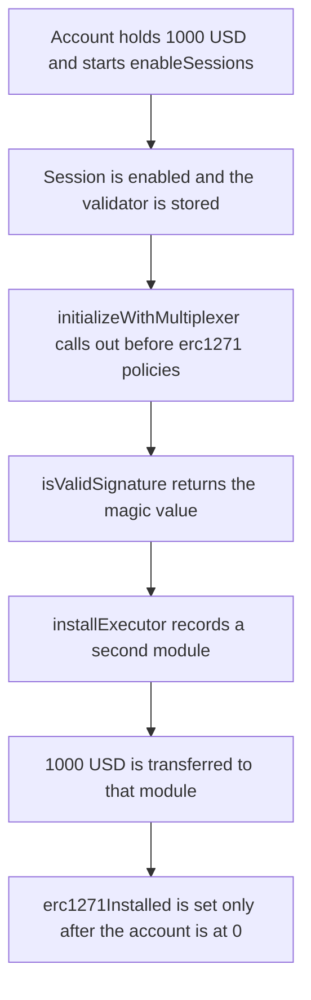

# Smart Sessions — enableSessions installs a second module and drains 1000 USD

> **Vulnerability classes:** vuln/reentrancy/single-function

<!-- non-defihacklabs -->
<!-- source-auditvault: https://github.com/Auditware/AuditVault/blob/main/findings/42067-installation-reentrancy-concerns-cantina-none-biconomy-pdf.md -->
<!-- date: 2024-08 -->

## Key info

| | |
|---|---|
| **Protocol** | Biconomy / Rhinestone Smart Sessions |
| **Finding** | Cantina installation reentrancy, AuditVault 42067 |
| **Vulnerable code** | `SmartSessionBase.enableSessions` |
| **Harm** | A second module is installed during the first session's setup and pulls **1000 USD**. The account ends at 0 |
| **Chain** | local synthetic |

## TL;DR

`enableSessions` marks the session enabled and installs the session validator before it installs erc1271 policies. The policy's `initializeWithMultiplexer` is an external call in that window. `isValidSignature` returns the ERC-1271 magic value because the restricting policy is not installed yet. The callback installs a second module, and that module transfers the account's 1000 USD to itself. Writing the erc1271 flag only after the call returns does not get the funds back.

## The vulnerable code

The audited order in `enableSessions` (erc7579/smartsessions, pre-PR 102) is `$enabledSessions.add`, then `$sessionValidators.enable`, then the policy enables. The external call is `initializeWithMultiplexer` inside the userOp policy enable:

```solidity
// $enabledSessions.add — session is live before any policy is installed.
sessionEnabled[smartAccount] = true;

// $sessionValidators.enable — validator accepts signatures before erc1271 policies exist.
validatorOf[smartAccount] = session.sessionValidator;
IValidator(session.sessionValidator).onEnable(smartAccount, permissionId);

// @> VULN: sessionEnabled and the validator are already set, erc1271Installed is still false, so isValidSignature returns MAGIC and the callee installs a second module that pulls the account's USD.
IPolicy(session.policy).initializeWithMultiplexer(smartAccount, permissionId, session.policyInit);

// $erc1271Policies.enable — too late. The drain already returned.
erc1271Installed[smartAccount] = true;
```

`isValidSignature` skips the policy check while `erc1271Installed` is false:

```solidity
if (!sessionEnabled[account]) return FAIL;
if (validatorOf[account] == address(0)) return FAIL;
if (erc1271Installed[account]) return FAIL;
return MAGIC;
```

PR 102 moves the session-enabled write and the validator enable to after the policy enables. The same callback then sees `sessionEnabled == false`, `installExecutor` reverts, and the 1000 USD stays in the account.

## Root cause

The two storage values that make `isValidSignature` succeed — the session is enabled, and a validator is set — are written before an external call. The storage value that would make it fail — the erc1271 policy — is written after that call. `initializeWithMultiplexer` is specified to run during installation, so a policy that calls out (or a non-malicious policy that forwards to an untrusted contract) runs with the signature gate already open.

## Preconditions

The account holds 1000 USD and already has the Smart Sessions module (moduleCount is 1). The user enables one session whose validator accepts the drain hash and whose userOp policy calls `initializeWithMultiplexer`. No separate privilege is required. The callback is just the policy init the installer itself invoked.

## Attack walkthrough

1. The account holds 1000 USD. A completed install with the erc1271 policy in place would reject the drain hash and leave that balance in place.
2. The account calls `enableSessions` for one session.
3. The validator's `onEnable` runs, and `validatorOf` is stored. `erc1271Installed` is still false.
4. `initializeWithMultiplexer` calls the policy. The policy calls `installExecutor` on the module encoded in its init data.
5. `isValidSignature` returns `0x1626ba7e`. The account sets `executor` to that module, sets `moduleCount` to 2, and `usd.transfer`s 1000 USD to it.
6. Only then does `enableSessions` set `erc1271Installed`. A second `installExecutor` for the same hash reverts. The module already holds the 1000 USD and the account holds 0.

The control uses the PR 102 order. The same policy callback runs, `installExecutor` reverts, `moduleCount` stays 1, and the account still holds 1000 USD.

## Diagrams



## Impact

The user asked to install one limited session. The transaction installs a second module and that module receives 1000 USD. The account balance goes from 1000 USD to 0. `moduleCount` goes from 1 to 2. After the outer call returns, the erc1271 policy is installed and a repeat of the same install reverts, but the 1000 USD is already in the module. Reordering the enable so the validator is installed last makes the callback revert. The account then keeps all 1000 USD and `moduleCount` stays 1.

## Remediation

Do what PR 102 does: run every policy `enable`, including `initializeWithMultiplexer`, before `$enabledSessions.add` and `$sessionValidators.enable`. While those two are unset, `isValidSignature` cannot succeed, so the callback cannot install a module. Policies should also avoid external calls inside `initializeWithMultiplexer`.

## How to reproduce

```bash
cd 42067-installation-reentrancy-concerns-cantina-none-biconomy-pdf_exp
forge test -vv
```

## Sources

- AuditVault finding: https://github.com/Auditware/AuditVault/blob/main/findings/42067-installation-reentrancy-concerns-cantina-none-biconomy-pdf.md
- Cantina report: https://cdn.cantina.xyz/reports/cantina_rhinestone_smartsessions_core_aug2024.pdf
- Vulnerable order: https://github.com/erc7579/smartsessions/blob/d8897e52fc/contracts/core/SmartSessionBase.sol (enableSessions, 2024-08, before PR 102)
- Fix: https://github.com/erc7579/smartsessions/pull/102
