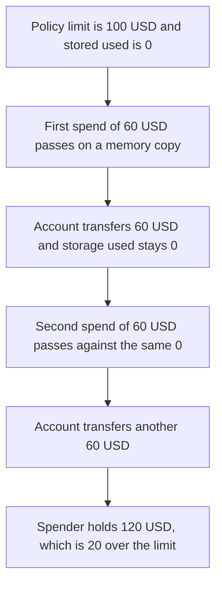

# UniActionPolicy — two spends move 120 USD through a 100 USD limit

> **Vulnerability classes:** vuln/logic/state-update · vuln/logic/wrong-condition · vuln/access-control/broken-logic

<!-- non-defihacklabs -->
<!-- source-auditvault: https://github.com/Auditware/AuditVault/blob/main/findings/42095-uniactionpolicy-does-not-persist-usages-cantina-none-biconom.md -->
<!-- date: 2024-08 -->

## Key info

| | |
|---|---|
| **Protocol** | Biconomy / Rhinestone Smart Sessions |
| **Finding** | Cantina UniActionPolicy usage not stored, AuditVault 42095 |
| **Vulnerable code** | `UniActionPolicy.check` |
| **Harm** | Two spends of 60 USD move **120 USD** through a **100 USD** limit. The excess is **20 USD**. Stored usage stays 0 |
| **Chain** | local synthetic |

## TL;DR

`check` takes `ParamRule memory` and is `view`. The line that adds the spend to `rule.usage.used` updates the copy and cannot write storage. The next call still reads `used == 0`. A limit of 100 USD therefore accepts 60 USD and then another 60 USD. The account sends 120 USD. Persisting `used` on the storage rule makes the second spend revert, and 60 USD stays in the account.

## The vulnerable code

Pre-fix `UniActionLib.check` (erc7579/smartsessions, before PR 76):

```solidity
function check(ParamRule memory rule, bytes calldata data) internal view returns (bool) {
    bytes32 param = bytes32(data[4 + rule.offset:4 + rule.offset + 32]);
    if (rule.isLimited) {
        if (rule.usage.used + uint256(param) > rule.usage.limit) {
            return false;
        }
        // @> VULN: rule is a memory copy and check is view, so this increment never lands in storage
        rule.usage.used += uint256(param);
    }
    return true;
}
```

`checkAction` loads the storage rule into that memory argument, then ignores the mutated copy. PR 76 changes the argument to `ParamRule storage` and drops `view`.

## Root cause

A usage limit is a value that has to survive the call. Adding into a memory struct inside a view function does not. The comparison `used + amount > limit` always starts from the stored 0, so every spend is judged alone against the full limit.

## Preconditions

The account holds 120 USD. The action policy is initialized with one limited rule: limit 100 USD, used 0, amount at calldata offset 32. The spender calls `spend(60)` twice. No other role is required.

## Attack walkthrough

1. The account is funded with 120 USD. The policy limit is set to 100 USD and stored usage is 0.
2. The first `spend(60)` builds a `transfer` payload. `check` reads amount 60. `0 + 60` is under 100, so it returns success. The memory `used` becomes 60 and is discarded.
3. The account transfers 60 USD to the spender. Storage `used` is still 0.
4. The second `spend(60)` does the same comparison against 0. It also returns success. The account transfers another 60 USD.
5. The spender holds 120 USD. The account holds 0. `120 - 100 = 20` USD moved past the limit. `used()` is still 0.

The control passes `ParamRule storage` and writes `used`. The first spend stores 60. The second spend hits `60 + 60 > 100`, `checkAction` returns failure, and `spend` reverts with `limit`. The spender holds 60 USD and the account still holds 60 USD.

## Diagrams



## Impact

The session was allowed to move at most 100 USD. It moves 120 USD, 20 USD more than the limit, and the usage slot that should have stopped the second call is still 0. Further spends of 60 USD would also pass. Writing `used` in storage stops the second spend. Only the first 60 USD leaves, and the other 60 USD stays in the account.

## Remediation

Accept `ParamRule storage` and remove `view`, which is what PR 76 does. The addition then updates the slot `checkAction` reads on the next call. Keep the comparison before the write so a spend over the remaining budget does not increase `used`.

## How to reproduce

```bash
cd 42095-uniactionpolicy-does-not-persist-usages-cantina-none-biconom_exp
forge test -vv
```

## Sources

- AuditVault finding: https://github.com/Auditware/AuditVault/blob/main/findings/42095-uniactionpolicy-does-not-persist-usages-cantina-none-biconom.md
- Cantina report: https://cdn.cantina.xyz/reports/cantina_rhinestone_smartsessions_external_policies_aug2024.pdf
- Vulnerable check: https://github.com/erc7579/smartsessions/blob/a6fc609c6357733e000a08705a99f613ce8841ed/contracts/external/policies/UniActionPolicy.sol (`check`, 2024-08, before PR 76)
- Fix: https://github.com/erc7579/smartsessions/pull/76
