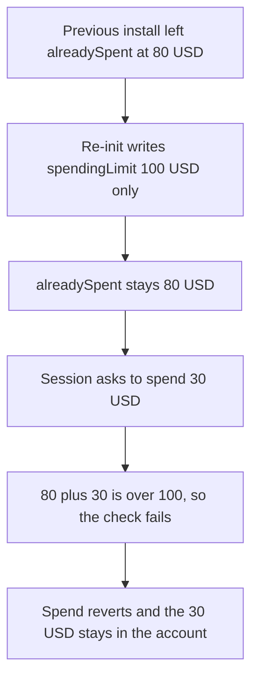

# ERC20 spending limit — a fresh 100 USD limit still locks a 30 USD spend

> **Vulnerability classes:** vuln/logic/state-update · vuln/logic/incorrect-state-transition · vuln/dos/frozen-funds

<!-- non-defihacklabs -->
<!-- source-auditvault: https://github.com/Auditware/AuditVault/blob/main/findings/42096-erc20spendinglimitpolicy-doesnt-clear-previous-data-cantina.md -->
<!-- date: 2024-08 -->

## Key info

| | |
|---|---|
| **Protocol** | Biconomy / Rhinestone Smart Sessions |
| **Finding** | Cantina ERC20SpendingLimitPolicy stale storage, AuditVault 42096 |
| **Vulnerable code** | `ERC20SpendingLimitPolicy.initializeWithMultiplexer` |
| **Harm** | A 30 USD spend that a new 100 USD limit allows reverts. **30 USD** stays in the account. Only **20 USD** of the new limit is usable, because **80 USD** of old usage was kept |
| **Chain** | local synthetic |

## TL;DR

Disabling a policy does not clear its storage. The enable path is supposed to overwrite that state. `initializeWithMultiplexer` writes `spendingLimit` and does not set `alreadySpent` to 0, and it does not touch tokens missing from the new list. After 80 USD was already counted, a fresh limit of 100 USD still has 80 USD used. `80 + 30` is over 100, so the 30 USD spend reverts and the 30 USD stays put. Clearing `alreadySpent` before the new limit is stored lets that same 30 USD spend succeed.

## The vulnerable code

The audited `initializeWithMultiplexer` (quoted in the Cantina finding, before `alreadySpent = 0`):

```solidity
function initializeWithMultiplexer(address account, bytes calldata initData) external {
    (address[] memory tokens, uint256[] memory limits) = abi.decode(initData, (address[], uint256[]));
    for (uint256 i; i < tokens.length; i++) {
        address token = tokens[i];
        uint256 limit = limits[i];
        if (token == address(0)) revert InvalidTokenAddress(token);
        if (limit == 0) revert InvalidLimit(limit);
        TokenPolicyData storage $ = data_[account][token];
        // @> VULN: spendingLimit is replaced and alreadySpent from the previous install is left in place
        $.spendingLimit = limit;
    }
}
```

`checkAction` then does `alreadySpent + amount > spendingLimit`. The enable comment in Smart Sessions says `initializeWithMultiplexer` must overwrite the current state, because disable does not clean it. PR 117 walks the tokens that were initialized before and zeroes `spendingLimit`, `alreadySpent`, and `approvedAmount`.

## Root cause

The new limit and the old counter live in the same struct. Replacing one field does not reset the other. The session looks like it has a fresh 100 USD budget, but the comparison still starts from the previous 80 USD. A token that is absent from the new list is not visited at all, so its old limit remains too.

## Preconditions

The account holds 30 USD. A previous install of this config stored `spendingLimit = 100 USD` and `alreadySpent = 80 USD` for that token. The owner re-enables the policy with the same token and a new limit of 100 USD. The session then tries to spend 30 USD. No other role is required.

## Attack walkthrough

1. The account is funded with 30 USD. That is the amount the new limit should allow.
2. The previous install is restored: limit 100 USD, already spent 80 USD.
3. `initializeWithMultiplexer` is called with the token and limit 100 USD.
4. The function stores `spendingLimit = 100`. `alreadySpent` is not written, so it stays 80. The remaining budget is `100 - 80 = 20` USD.
5. `spend(30)` calls `checkAction`. `80 + 30 = 110`, which is over 100, so the check returns failure.
6. The account reverts with `limit`. The transfer does not run.
7. The account still holds 30 USD. The spender holds 0. Only 20 USD of the new 100 USD limit can ever move.

The control zeroes every previously listed token's `spendingLimit` and `alreadySpent`, then writes the new limit and sets `alreadySpent` to 0. The same 30 USD spend succeeds. The spender receives 30 USD and the account holds 0.

## Diagrams



## Impact

The user set a new 100 USD limit and expected the old usage to be gone. A 30 USD spend, which fits in 100 USD, reverts. Those 30 USD stay in the account. Of the new allowance, 80 USD is dead and only 20 USD can be spent. The same stale slot blocks every later spend above that 20 USD until something else clears `alreadySpent`. Clearing the old data before the new limit is stored makes the 30 USD spend succeed.

## Remediation

On `initializeWithMultiplexer`, clear every previously initialized token's `spendingLimit`, `alreadySpent`, and `approvedAmount` before writing the new list, which is what PR 117 does with an `EnumerableSet`. Also set `alreadySpent = 0` on each token in the new list. Disable cannot be relied on to wipe the slot.

## How to reproduce

```bash
cd 42096-erc20spendinglimitpolicy-doesnt-clear-previous-data-cantina_exp
forge test -vv
```

## Sources

- AuditVault finding: https://github.com/Auditware/AuditVault/blob/main/findings/42096-erc20spendinglimitpolicy-doesnt-clear-previous-data-cantina.md
- Cantina report: https://cdn.cantina.xyz/reports/cantina_rhinestone_smartsessions_external_policies_aug2024.pdf
- Vulnerable init: https://github.com/erc7579/smartsessions/blob/2e281f9ff3f3beed866b2c57c404a54a4a8af5e2/contracts/external/policies/ERC20SpendingLimitPolicy.sol (the finding's quoted body omits `alreadySpent = 0`; PR 117 is the clear-all fix, 2024-08)
- Fix: https://github.com/erc7579/smartsessions/pull/117
