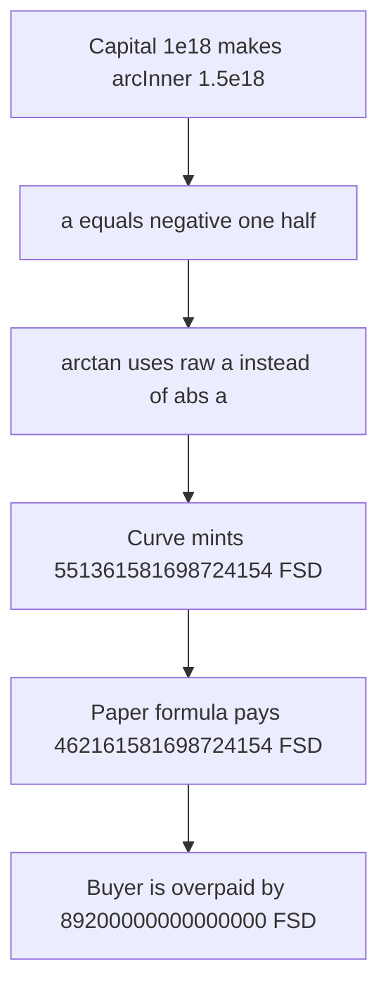

# FairSide — missing abs in arctan overpays 89200000000000000 FSD

> **Vulnerability classes:** vuln/logic/price-calculation · vuln/arithmetic/precision-loss

<!-- non-defihacklabs -->
<!-- source-auditvault: https://github.com/Auditware/AuditVault/blob/main/findings/42204-h-08-incorrect-implementation-of-arctan-in-the-contract-fair.md -->
<!-- date: 2021-05 -->

## Key info

| | |
|---|---|
| **Protocol** | FairSide |
| **Finding** | Code4rena H-08, AuditVault 42204 |
| **Vulnerable code** | `FairSideFormula._arctan` |
| **Harm** | At capital 1e18 the curve mints **551361581698724154** FSD. The paper's abs formula mints **462161581698724154**. The buyer is overpaid by **89200000000000000** FSD |
| **Chain** | local synthetic |

## TL;DR

`_arctan` implements `a * pi/4 - a * (a - 1) * (APPROX_A + APPROX_B * a)`. The paper, and the fix in the report, uses `abs(a)` in both `(a - 1)` and `APPROX_B * a`. `arcs` calls `arctan` with `a = 1 - arcInner`. When the capital pool makes `arcInner` larger than 1, `a` is negative and the two formulas diverge. For the reduced constants here, capital 1e18 gives `a = -0.5e18`. The buggy curve mints 551361581698724154 FSD. The corrected curve mints 462161581698724154 FSD.

## The vulnerable code

The report's corrected function is:

```solidity
function _arctan(int256 a) internal pure returns (int256) {
    int256 aa = a < 0 ? -a : a;
    return mul(a, PI_4) - mul(mul(a, aa - ONE), APPROX_A + mul(APPROX_B, aa));
}
```

The contract omits both `abs` calls:

```solidity
function _arctan(int256 a) internal pure returns (int256) {
    int256 linear = mul(a, PI_4);
    // @> VULN: (a - ONE) and APPROX_B * a use raw a; the paper uses abs(a), and this a is negative
    int256 wrong = mul(mul(a, a - ONE), APPROX_A + mul(APPROX_B, a));
    return linear - wrong;
}
```

`PI_4` is 785398163397448309, `APPROX_A` is 0.2447e18, `APPROX_B` is 0.0663e18. The original contract uses ABDKMathQuad; this reduction keeps the same algebra in 1e18 fixed point, which is what the report's expression evaluates to. On a positive `a` the two forms match. The bug is only the negative branch.

`arcs` builds `a` as `ONE - arcInner` with `arcInner = MULTIPLIER * x / fS3_4`. Here `MULTIPLIER` is 3e18 and `fS3_4` is 2e18, so capital `x = 1e18` gives `arcInner = 1.5e18` and `a = -0.5e18`.

## Root cause

The approximation is even in the quadratic part and odd in the leading `a * pi/4`. Taking `abs` only on the quadratic factor keeps the sign on the linear term and the shape on the correction. Using the signed `a` inside `(a - 1)` and `APPROX_B * a` changes the correction whenever `a` is negative, so `calculateDeltaOfFSD` mints or burns the wrong number of FSD.

## Preconditions

The buyer calls `buy` with capital 1e18. No role is required. The pool parameters above are the ones that push `arcInner` past 1. A smaller capital that keeps `a` positive does not show the gap.

## Attack walkthrough

1. `buy(1e18)` sets `arcInner = 3e18 * 1e18 / 2e18 = 1.5e18` and `a = -0.5e18`.
2. `_arctan` evaluates the form without `abs`. The signed result is -551361581698724154.
3. The curve mints the absolute value, 551361581698724154 FSD, to the buyer.
4. The corrected form, `a * pi/4 - a * (abs(a) - 1) * (APPROX_A + APPROX_B * abs(a))`, returns -462161581698724154. The fair payout is 462161581698724154 FSD.
5. The difference is 89200000000000000 FSD. That is the extra amount minted.

The control contract uses the report's `abs` form. `buy(1e18)` mints 462161581698724154 FSD and nothing more. For capital 0.5e18, where `a` stays positive, the buggy quote and the fair quote are equal.

## Diagrams



## Impact

The buyer receives 551361581698724154 FSD for a curve input whose fair payout is 462161581698724154 FSD. The protocol mints 89200000000000000 extra FSD. The same wrong delta is what `calculateDeltaOfFSD` would burn on the way down, so a negative capital move burns the wrong amount as well. The control mints exactly 462161581698724154, which is the report's corrected expression at this input.

## Remediation

Use the expression from the report: `a * abs(a)` is not required, but both `(a - ONE)` and `APPROX_B * a` must use `abs(a)`. Leave the leading `a * pi/4` signed. That is the change FairSide shipped in PR 4.

## How to reproduce

```bash
cd 42204-h-08-incorrect-implementation-of-arctan-in-the-contract-fair_exp
forge test -vv
```

## Sources

- AuditVault finding: https://github.com/Auditware/AuditVault/blob/main/findings/42204-h-08-incorrect-implementation-of-arctan-in-the-contract-fair.md
- Code4rena report: https://code4rena.com/reports/2021-05-fairside
- Finding: https://github.com/code-423n4/2021-05-fairside-findings/issues/73
- Contest source: https://github.com/code-423n4/2021-05-fairside (`FairSideFormula.sol` `_arctan`, May 2021)
- Fix: https://github.com/fairside-core/2021-05-fairside/pull/4
