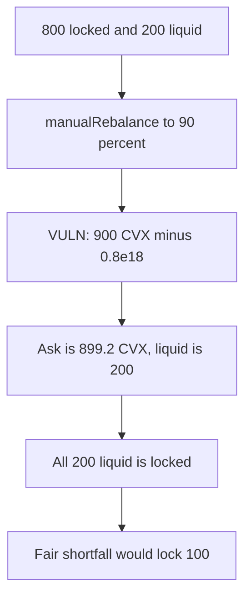

# Badger veCVX — manualRebalance locks the liquid balance

> **Vulnerability classes:** vuln/arithmetic/decimal-mismatch · vuln/logic/wrong-condition

<!-- non-defihacklabs -->
<!-- source-auditvault: https://github.com/Auditware/AuditVault/blob/main/findings/42292-h-01-vecvxstrategymanualrebalance-has-wrong-logic-code4rena.md -->
<!-- date: 2021-09 -->

## Key info

| | |
|---|---|
| **Protocol** | BadgerDAO veCVX |
| **Finding** | Code4rena, September 2021, AuditVault 42292 |
| **Vulnerable code** | `manualRebalance` subtracts `currentLockRatio` from `newLockRatio` |
| **Harm** | A 90 percent rebalance locks all 200 liquid CVX. The fair lock is 100. |
| **Chain** | local synthetic (audited Ethereum contracts) |

## TL;DR

`currentLockRatio = balanceInLock * 1e18 / totalCVXBalance` is a fraction with 18 decimals. Its maximum is `1e18`. `newLockRatio = totalCVXBalance * toLock / MAX_BPS` is a CVX amount.

With 800 locked, 200 liquid, and `toLock` 9000, the fraction is `0.8e18` and the target amount is 900 CVX. Subtracting them asks to lock 899.2 CVX. Only 200 is liquid, so the function locks all of it. Using `balanceInLock` as the current amount locks 100 and leaves 100 liquid.

Governance is the caller. The parameter is the 90 percent the function is documented to accept. The loss is the extra 100 locked, not a separate malicious setting.

## The vulnerable code

```solidity
uint256 currentLockRatio = balanceInLock * (10 ** 18) / totalCVXBalance;
uint256 newLockRatio = totalCVXBalance * toLock / MAX_BPS;
// @> VULN: newLockRatio is a CVX amount and currentLockRatio is a 1e18 percentage.
uint256 cvxToLock = newLockRatio - currentLockRatio;
```

The fair subtraction is `newLockAmount - balanceInLock`.

## Root cause

The two values are not in the same unit, and the later code treats both as CVX. Once `totalCVXBalance` is larger than 1 CVX, `newLockRatio` is almost always greater than `currentLockRatio`, so the lock branch is taken, and the amount is nearly the whole target rather than the shortfall against what is already locked. When that target exceeds the liquid balance, every liquid token is locked.

## Preconditions

800 CVX is already locked. 200 CVX sits on the strategy. `toLock` is 9000, which is within `MAX_BPS`. The caller is governance. One transaction.

## Attack walkthrough

1. Liquid balance is 200. Locked balance is 800. Total is 1000.
2. `manualRebalance(9000)`.
3. `cvxToLock` is `900e18 - 0.8e18` = 899.2 CVX.
4. That is above the 200 liquid, so `lastLocked` is 200.
5. The locker token balance goes from 800 to 1000. The strategy holds 0.

Control calls `manualRebalanceFixed(9000)` on the same starting balances. Locked balance becomes 900. Liquid left is 100.

## Diagrams



## Impact

Depositors lose 100 CVX of liquidity that the 90 percent target should have left unlocked. The locker holds 1000 instead of 900.

## Remediation

Subtract `balanceInLock` from the desired lock amount. Do not subtract the 1e18 ratio.

## How to reproduce

```bash
cd 42292-h-01-vecvxstrategymanualrebalance-has-wrong-logic-code4rena_exp
forge test -vv
```

## Sources

- AuditVault finding: https://github.com/Auditware/AuditVault/blob/main/findings/42292-h-01-vecvxstrategymanualrebalance-has-wrong-logic-code4rena.md
- Code4rena report: https://code4rena.com/reports/2021-09-bvecvx
- Vulnerable function: `code-423n4/2021-09-bvecvx` `veCVX/contracts/veCVXStrategy.sol` at `1d64bd58c7a4224cc330cef283561e90ae6a3cf5`, `manualRebalance`
