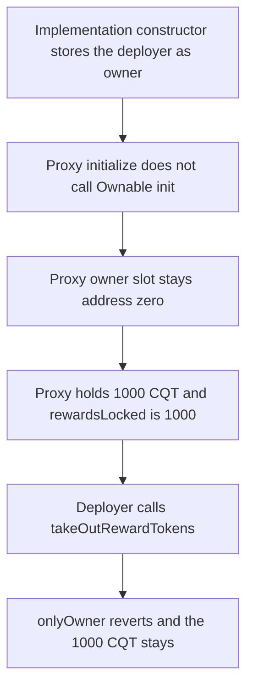

# Covalent staking — non-upgradeable Ownable leaves 1000 CQT stuck

> **Vulnerability classes:** vuln/dependency/upgradeable-contract · vuln/access-control/uninitialized-owner · vuln/dos/frozen-funds

<!-- non-defihacklabs -->
<!-- source-auditvault: https://github.com/Auditware/AuditVault/blob/main/findings/42307-h-01-usage-of-an-incorrect-version-of-ownbale-library-can-po.md -->
<!-- date: 2021-10 -->

## Key info

| | |
|---|---|
| **Protocol** | Covalent |
| **Finding** | Code4rena H-01, AuditVault 42307 |
| **Vulnerable code** | `DelegatedStaking` using `Ownable` instead of `OwnableUpgradeable` |
| **Harm** | The deployer's `takeOutRewardTokens` reverts. **1000 CQT** stays on the proxy. The proxy owner is `address(0)` |
| **Chain** | local synthetic |

## TL;DR

`DelegatedStaking` is initialized through a proxy, but it inherits the non-upgradeable `Ownable`. That constructor sets the owner on the implementation contract only. `initialize` never calls `__Ownable_init`, so the proxy's owner slot stays `address(0)`. `onlyOwner` then rejects the deployer. `takeOutRewardTokens(1000 CQT)` reverts and the 1000 CQT cannot be withdrawn. The upgradeable initializer writes the owner into proxy storage, and the same call sends the 1000 CQT to that owner.

## The vulnerable code

Audited `initialize` at `DelegatedStaking.sol` lines 62-63 of commit `ded3aeb` does not set an owner:

```solidity
function initialize(uint128 minStakedRequired) public initializer {
    validatorMinStakedRequired = minStakedRequired;
    rewardsLocked = minStakedRequired;
}
```

`takeOutRewardTokens` is `onlyOwner`. The modifier reads the proxy's slot, which the constructor never wrote:

```solidity
modifier onlyOwner() {
    // @> VULN: proxy storage never received the constructor write, so _owner is address(0) and the real owner is rejected
    require(msg.sender == _owner, "Ownable: caller is not the owner");
    _;
}
```

The report's fix is `OwnableUpgradeable` plus `__Ownable_init()` at the start of `initialize`.

## Root cause

A proxy `delegatecall`s the implementation, but it uses the proxy's storage. `Ownable`'s constructor runs only when the implementation is created, so it stores the deployer in the implementation's slot 0. The proxy's slot 0 stays zero. Every `onlyOwner` function, including `depositRewardTokens` and `takeOutRewardTokens`, reverts for every caller.

## Preconditions

The implementation is deployed behind an EIP-1967 proxy. `initialize` has been called and has recorded `rewardsLocked = 1000 CQT`. The proxy holds 1000 CQT. The deployer, who is the owner of the implementation contract, calls `takeOutRewardTokens` on the proxy. No other role exists.

## Attack walkthrough

1. 1000 CQT is minted to the proxy.
2. `initialize(1000 CQT)` runs via `delegatecall`. It stores the minimum stake and `rewardsLocked`. It does not write an owner.
3. `owner()` on the proxy returns `address(0)`. `owner()` on the implementation returns the deployer. Those are different slots.
4. The deployer calls `takeOutRewardTokens(1000 CQT)` on the proxy.
5. `onlyOwner` compares the deployer with `address(0)` and reverts. The transfer does not run.
6. The proxy still holds 1000 CQT. The deployer holds 0.

The control uses the upgradeable pattern: `initialize` sets `_owner = msg.sender` in proxy storage, then the same `takeOutRewardTokens` sends 1000 CQT to that owner and leaves the proxy at 0.

## Diagrams



## Impact

The address that deployed the staking contract cannot withdraw the 1000 CQT reward balance. `takeOutRewardTokens` reverts, and the other `onlyOwner` functions revert the same way, so the owner cannot deposit, add a validator, or change the emission. The 1000 CQT remains on the proxy. Writing the owner inside `initialize` makes this call succeed: the owner receives 1000 CQT and the proxy balance is 0.

## Remediation

Import `OwnableUpgradeable` and `Initializable` from the upgradeable package, and call `__Ownable_init()` as the first line of `initialize`. Do not rely on the `Ownable` constructor. That is the change Covalent shipped.

## How to reproduce

```bash
cd 42307-h-01-usage-of-an-incorrect-version-of-ownbale-library-can-po_exp
forge test -vv
```

## Sources

- AuditVault finding: https://github.com/Auditware/AuditVault/blob/main/findings/42307-h-01-usage-of-an-incorrect-version-of-ownbale-library-can-po.md
- Code4rena report: https://code4rena.com/reports/2021-10-covalent
- Vulnerable initialize: https://github.com/code-423n4/2021-10-covalent/blob/ded3aeb2476da553e8bb1fe43358b73334434737/contracts/DelegatedStaking.sol#L62-L63 (October 2021, `Ownable` not `OwnableUpgradeable`)
- Fix: https://github.com/code-423n4/2021-10-covalent/pull/23
