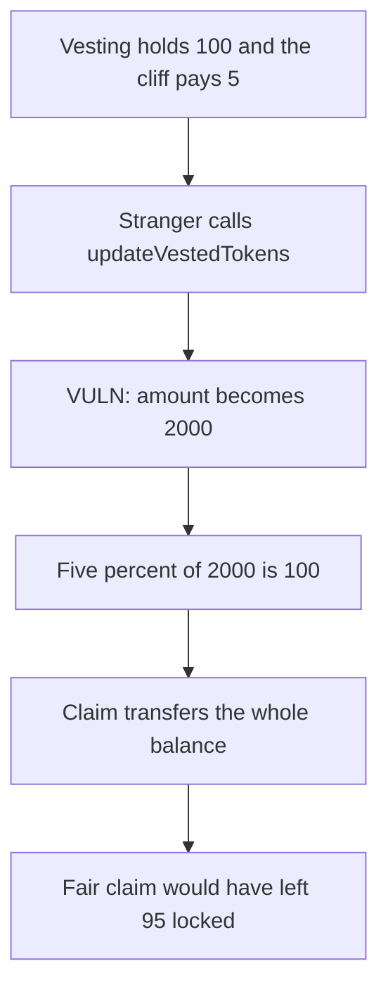

# FairSide — anyone can inflate FSDVesting and claim the balance

> **Vulnerability classes:** vuln/access-control/missing-auth · vuln/logic/reward-calculation

<!-- non-defihacklabs -->
<!-- source-auditvault: https://github.com/Auditware/AuditVault/blob/main/findings/42324-h-01-anyone-can-arbitrarily-call-fsdvestingupdatevestedtoken.md -->
<!-- date: 2021-11 -->

## Key info

| | |
|---|---|
| **Protocol** | FairSide |
| **Finding** | Code4rena, November 2021, AuditVault 42324 |
| **Vulnerable code** | `FSDVesting.updateVestedTokens` |
| **Harm** | The cliff pays 100 instead of 5. The vesting contract is emptied. |
| **Chain** | local synthetic (audited Ethereum contracts) |

## TL;DR

`updateVestedTokens(address _user, uint256 _amount)` checks `_user == beneficiary`. `_user` is chosen by the caller, and the caller is not required to be the FSD token. A stranger passes the beneficiary and 1900.

The schedule unlocks 5 percent at the cliff and the rest linearly over 18 months. On an amount of 100 the cliff pays 5. After the amount is 2000, 5 percent is 100, which is every token the contract holds. The claim transfers 100. The fair claim left 95 locked.

## The vulnerable code

```solidity
require(_user == beneficiary, "FSDVesting::updateVestedTokens: Only beneficiary can update the vested amount");
require(_amount != 0, "FSDVesting::updateVestedTokens: Amount cannot be zero");
// @> VULN: no onlyFsd, and _user is an argument, so any caller can inflate amount.
amount = amount + _amount;
```

The fix is the `onlyFsd` gate. A call from anyone else reverts and does not change `amount`.

## Root cause

The beneficiary check does not bind `msg.sender`. Each user has their own vesting contract, and the intended writer is `FSD`. Without that restriction the stored `amount` can be raised above the tokens actually deposited, and the cliff percentage then covers the whole balance.

## Preconditions

The contract was created with `amount` 100 and holds 100 tokens. The cliff has passed and the 18 month linear period has not meaningfully started, so the linear term is 0. The caller is not FSD. One transaction.

## Attack walkthrough

1. `calculateVestingClaim` is 5.
2. The transaction sender is not the beneficiary.
3. A stranger calls `updateVestedTokens(beneficiary, 1900)`. `amount` becomes 2000.
4. `claimVestedTokens` pays 100, the token balance.
5. The beneficiary holds 100. The vesting contract holds 0.
6. `updateGuarded` from that same non-FSD caller reverts.

Control, with no update, claims 5 and leaves 95 in the contract.

## Diagrams



## Impact

95 tokens that should still be vesting are withdrawn at the cliff. The contract that was supposed to hold them is empty.

## Remediation

Restrict `updateVestedTokens` to the FSD token, and stop taking the beneficiary as a caller-supplied argument.

## How to reproduce

```bash
cd 42324-h-01-anyone-can-arbitrarily-call-fsdvestingupdatevestedtoken_exp
forge test -vv
```

## Sources

- AuditVault finding: https://github.com/Auditware/AuditVault/blob/main/findings/42324-h-01-anyone-can-arbitrarily-call-fsdvestingupdatevestedtoken.md
- Code4rena report: https://code4rena.com/reports/2021-11-fairside
- `FSDVesting.updateVestedTokens` as quoted from `code-423n4/2021-11-fairside` `contracts/token/FSDVesting.sol`
