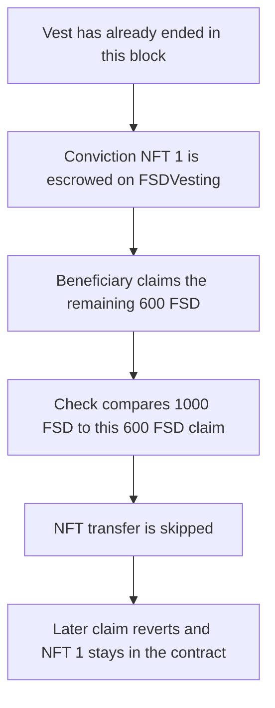

# FairSide FSDVesting — a fully vested beneficiary never receives the conviction NFT

> **Vulnerability classes:** vuln/logic/wrong-condition · vuln/locked-funds

<!-- non-defihacklabs -->
<!-- source-auditvault: https://github.com/Auditware/AuditVault/blob/main/findings/42326-h-03-beneficiary-cant-get-fairsideconviction-nft-unless-they.md -->
<!-- date: 2021-11 -->

## Key info

| Field | Value |
|---|---|
| **Loss** | Conviction NFT 1 stays in FSDVesting. The beneficiary is paid all 1000 FSD and holds 0 NFTs. A later claim reverts |
| **Vulnerable contract** | `FSDVesting.claimVestedTokens` |
| **Attacker EOA** | `0x1111111111111111111111111111111111111111` |
| **Attack contract** | `Exploit` (the beneficiary) |
| **Attack tx** | `Exploit.run()` |
| **Chain / block / date** | Ethereum model · block 0 · 2021-11 |
| **Compiler** | solc 0.8.27, cancun, via IR |
| **Bug class** | NFT release compares the original vest to this claim only |

## TL;DR

`claimVestedTokens` pays whatever `calculateVestingClaim` returns, then releases `fairSideConviction` only when `amount == tokenClaim`. `amount` is the original vest. `tokenClaim` is only the tokens paid by this call. A beneficiary who already claimed 400 of a 1000 FSD vest, and who is fully vested in this block, is paid the remaining 600 FSD. `1000 == 600` is false, so the NFT stays in the contract. The next claim reverts because nothing is left to pay. The fixed check is `amount == totalClaimed`, and that path mints the NFT to the beneficiary.

## Background

Code4rena reviewed FairSide in November 2021. WatchPug reported H-03 against `FSDVesting.claimVestedTokens`. The schedule is meant to hand the beneficiary a `fairSideConviction` NFT once every vested FSD has been claimed. The implementation tests the size of the current claim instead of the total claimed. The only successful case is a single claim, made after the vest has fully elapsed, for the entire original amount. Any earlier partial claim makes that equality impossible. The sponsor confirmed the behavior and disagreed with the severity.

The Playground replay uses one block whose timestamp is already past the vest end. The schedule is stored with `start = 0` and `duration = 1`, so `block.timestamp >= start + duration` is true at timestamp 1. Nothing in `run()` warps time.

## The vulnerable code

```solidity
function claimVestedTokens() external override onlyBeneficiary {
    uint256 tokenClaim = calculateVestingClaim();
    require(
        tokenClaim > 0,
        "FSDVesting::claimVestedTokens: Zero claimable tokens"
    );

    totalClaimed = totalClaimed.add(tokenClaim);
    lastClaimAt = block.timestamp;

    fsd.safeTransfer(msg.sender, tokenClaim);

    emit TokensClaimed(msg.sender, tokenClaim, block.timestamp);

    // @> VULN: amount is the original vest, tokenClaim is only this claim, so a prior claim never releases the NFT
    if (amount == tokenClaim) {
        uint256 tokenId = fsd.tokenizeConviction(0);
        fairSideConviction.transferFrom(address(this), msg.sender, tokenId);
    }
}
```

The fix compares the original vest to the total claimed, which already includes this call:

```diff
-    if (amount == tokenClaim) {
+    if (amount == totalClaimed) {
         uint256 tokenId = fsd.tokenizeConviction(0);
         fairSideConviction.transferFrom(address(this), msg.sender, tokenId);
     }
```

## Root cause

`tokenClaim` is the increment paid by the current call. `totalClaimed` is updated to `totalClaimed + tokenClaim` before the NFT check, but the check does not read `totalClaimed`. After any earlier claim, `tokenClaim` is strictly less than `amount` even when this call finishes the vest. The mint and the `transferFrom` sit inside that branch, so they never run. Once `totalClaimed` equals `amount`, a later call computes a zero claim and reverts on `tokenClaim > 0`. The NFT cannot be released by any later transaction.

## Preconditions

- The vest has already ended in this block. `calculateVestingClaim` takes the fully vested branch and returns `amount - totalClaimed`.
- `totalClaimed` is already 400 FSD from an earlier claim. This call's `tokenClaim` is 600 FSD.
- Conviction NFT 1 sits on the vesting contract. The vulnerable branch is the only code that transfers it.
- The caller is the beneficiary.

## Attack walkthrough

1. The exploit escrows conviction NFT 1 onto `FSDVesting`. The contract's NFT balance becomes 1.
2. `calculateVestingClaim` sees `block.timestamp >= start + duration` and returns 600 FSD, the unpaid remainder of the 1000 FSD vest.
3. `claimVestedTokens` adds 600 FSD to `totalClaimed` (now 1000 FSD) and transfers 600 FSD to the beneficiary. The beneficiary's FSD balance is 1000 FSD.
4. `amount == tokenClaim` is `1000 == 600`. `tokenizeConviction` and `transferFrom` do not run. NFT 1 stays on the vesting contract. The beneficiary's NFT balance stays 0.
5. A second `claimVestedTokens` computes 0 claimable FSD and reverts. The NFT is still on the contract.

## Diagrams



## Impact

The beneficiary is paid the full 1000 FSD and still does not hold the conviction NFT. NFT 1 remains owned by `FSDVesting` (balance 1). The follow-up claim reverts, so there is no later call that can take the missed branch. The control contract, with the same 400 FSD already claimed and the same fully vested remainder, calls `tokenizeConviction` and `transferFrom`. The beneficiary ends holding NFT 1 and the vesting contract's NFT balance is 0. The FSD payout is the same 1000 FSD either way. The difference is the NFT.

## PoC

```bash
cd 42326-h-03-beneficiary-cant-get-fairsideconviction-nft-unless-they_exp
forge test -vv
```

`test_exploit_fully_vested_claim_leaves_nft` asserts the vesting contract still owns NFT 1, the beneficiary owns 0 NFTs, the beneficiary holds 1000 FSD, `totalClaimed` is 1000 FSD, and the follow-up claim reverted. `test_control_mints_nft_to_beneficiary` asserts the fixed check mints NFT 1 to the beneficiary and leaves the vesting contract with 0 NFTs, with the same 1000 FSD paid.

## Sources

- AuditVault finding: https://github.com/Auditware/AuditVault/blob/main/findings/42326-h-03-beneficiary-cant-get-fairsideconviction-nft-unless-they.md
- Code4rena report: https://code4rena.com/reports/2021-11-fairside
- Reviewed source: https://github.com/code-423n4/2021-11-fairside/blob/20c68793f48ee2678508b9d3a1bae917c007b712/contracts/token/FSDVesting.sol
