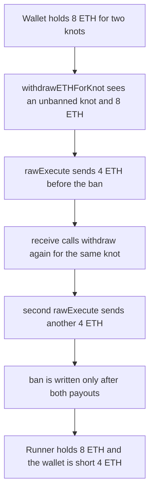

# Stakehouse LiquidStakingManager — withdrawETHForKnot pays 4 ETH before the knot is banned

> **Vulnerability classes:** vuln/reentrancy/single-function · vuln/logic/incorrect-order-of-operations

<!-- non-defihacklabs -->
<!-- source-auditvault: https://github.com/Auditware/AuditVault/blob/main/findings/43028-h-05-reentrancy-in-liquidstakingmanagersolwithdrawethforknow.md -->
<!-- date: 2022-11 -->

## Key info

| | |
|---|---|
| **Protocol** | Stakehouse |
| **Finding** | Code4rena H-05, AuditVault 43028 |
| **Vulnerable code** | `LiquidStakingManager.withdrawETHForKnot` |
| **Harm** | One knot is entitled to a 4 ETH refund. The call pays 8 ETH. The smart wallet, which held 8 ETH for two knots, ends at 0 and is short 4 ETH |
| **Chain** | local synthetic |

## TL;DR

`withdrawETHForKnot` sends 4 ETH with `rawExecute` and only afterwards writes `bannedBLSPublicKeys`. The node runner is a contract. Its `receive()` calls `withdraw` again while the knot is still unbanned and the wallet still holds the other knot's 4 ETH. The same knot is paid twice. The runner holds 8 ETH. The wallet holds 0. The second knot stays registered and unbacked.

## The vulnerable code

The audited function checks the ban, the node runner, a 4 ETH balance, and `INITIALS_REGISTERED`, then pays, then bans:

```solidity
// @> VULN: rawExecute pays 4 ETH before bannedBLSPublicKeys is written, so receive() can re-enter and take another 4 ETH
IOwnableSmartWallet(associatedSmartWallet).rawExecute(
    _recipient,
    "",
    4 ether
);

// update the mapping
bannedBLSPublicKeys[_blsPublicKeyOfKnot] = associatedSmartWallet;
```

`rawExecute` is a full-gas `call`, not a 2300-gas stipend, so `receive()` can re-enter. The report's fix writes the ban first:

```solidity
bannedBLSPublicKeys[_blsPublicKeyOfKnot] = associatedSmartWallet;

IOwnableSmartWallet(associatedSmartWallet).rawExecute(
    _recipient,
    "",
    4 ether
);
```

## Root cause

The refund and the "this knot has already withdrawn" flag are in the wrong order. The balance check uses the wallet's live ETH balance, which is 8 ETH for two knots and is still 4 ETH after the first send. Nothing else stops a second entry for the same public key until `bannedBLSPublicKeys` is written, and that write is after the external call. `withdrawETHForKnot` is also not `nonReentrant`, unlike `claimRewardsAsNodeRunner` on the same contract.

## Preconditions

The caller is the node runner for the smart wallet. The knot's lifecycle is `INITIALS_REGISTERED` and it is not banned. The wallet holds at least 8 ETH, so the `balance >= 4 ether` check still passes after the first 4 ETH leaves. The recipient is the node-runner contract, so the ETH hits `receive()`. In the audited `registerBLSPublicKeys`, a contract representative fails `Address.isContract` except during its own constructor, when `extcodesize` is 0. The report registers there. This replay starts from that registered state: two knots, `publicKeys1` and `publicKeys2`, one wallet, 8 ETH already in it.

## Attack walkthrough

1. The smart wallet already custodies 8 ETH, 4 ETH for each knot. A fair `withdrawETHForKnot` on `publicKeys1` refunds 4 ETH and must leave 4 ETH for `publicKeys2`.
2. The node runner calls `withdraw`. The knot is not banned, the caller owns the wallet, the balance is 8 ETH, and the lifecycle is `INITIALS_REGISTERED`.
3. `rawExecute` sends 4 ETH to the runner. The ban has not been written.
4. `receive()` sets a flag and calls `this.withdraw()`. That external call is the node runner again, so `msg.sender` still matches the wallet.
5. The second entry sees a balance of exactly 4 ETH and the same unbanned knot. `rawExecute` sends another 4 ETH. `secondPayout` is that 4 ETH.
6. Only then does the inner call write `bannedBLSPublicKeys` for `publicKeys1`. The outer call writes the same key again. `publicKeys2` is never banned.
7. The runner holds 8 ETH. The wallet holds 0. It is short the 4 ETH that should still back `publicKeys2`.

The control bans the knot before `rawExecute`. The same `receive()` re-enters, the second entry reverts with `BLS public key has already withdrawn or not a part of LSD network`, and the runner keeps only the fair 4 ETH. The wallet still holds 4 ETH.

## Diagrams



## Impact

The node runner is entitled to 4 ETH for one unstaked knot. The transaction pays 8 ETH. The smart wallet started at 8 ETH and finishes at 0, so it is short 4 ETH. `publicKeys2` is still registered at `INITIALS_REGISTERED` and is not banned, but the ETH that should back it is gone. Banning the key before the send makes the second entry revert. The runner then receives only 4 ETH and the wallet keeps the other 4 ETH.

## Remediation

Write `bannedBLSPublicKeys` before `rawExecute`, which is the diff in the report. `nonReentrant` on `withdrawETHForKnot` stops the callback as well. Either change makes the second entry revert. The control uses the ban-first order.

## How to reproduce

```bash
cd 43028-h-05-reentrancy-in-liquidstakingmanagersolwithdrawethforknow_exp
forge test -vv
```

## Sources

- AuditVault finding: https://github.com/Auditware/AuditVault/blob/main/findings/43028-h-05-reentrancy-in-liquidstakingmanagersolwithdrawethforknow.md
- Code4rena report: https://code4rena.com/reports/2022-11-stakehouse
- Audited function: https://github.com/code-423n4/2022-11-stakehouse/blob/4b6828e9c807f2f7c569e6d721ca1289f7cf7112/contracts/liquid-staking/LiquidStakingManager.sol#L435 (2022-11)
