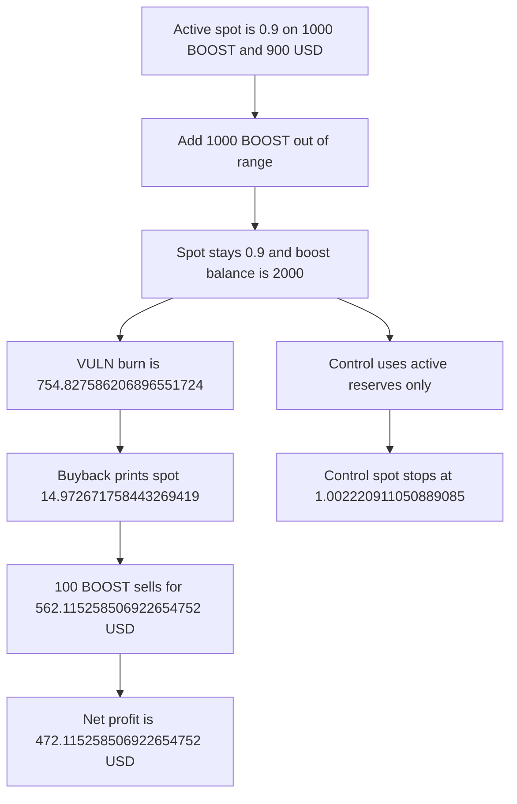

# AXION: out-of-range BOOST makes the buyback burn past the peg

> **Vulnerability classes:** `vuln/logic/price-calculation` · `vuln/oracle/price-manipulation`

<!-- non-defihacklabs -->
<!-- source-auditvault: https://github.com/Auditware/AuditVault/blob/main/findings/43530-h-1-boost-buyback-burns-incorrect-amount-of-liquidity-sherlo.md -->
<!-- date: 2024-10 -->

## Key info

| Field | Value |
|---|---|
| **Loss** | Attacker nets 472.115258506922654752 USD. Spot is pushed from 0.9 to 14.972671758443269419 |
| **Vulnerable contract** | `V3Amo.unfarmBuyBurn` |
| **Attacker EOA** | `0x1111111111111111111111111111111111111111` |
| **Attack contract** | `Exploit` |
| **Attack tx** | `Exploit.run()` |
| **Chain / block / date** | Ethereum model · block 0 · 2024-10 |
| **Compiler** | solc 0.8.27, cancun, via IR |
| **Bug class** | Liquidity to burn is computed from token balances on a V3 pool |

## TL;DR

`_unfarmBuyBurn` sets the burn to `totalLiquidity * (boostBalance - usdBalance) / (boostBalance + usdBalance)`, then multiplies by `LIQUIDITY_COEFF / FACTOR` (`995000 / 1_000_000`, from `V3AMO` and `MasterAMO`). On a V3 pool, single-sided BOOST increases `balanceOf` and `liquidity()` without moving the spot. The active pool is 1,000 BOOST and 900 USD, spot 0.9. Adding 1,000 BOOST out of range makes the formula burn `754.827586206896551724` instead of `52.368421052631578946`. The buyback prints a spot of `14.972671758443269419`. Selling 100 BOOST that cost 90 USD returns `562.115258506922654752` USD. Net profit is `472.115258506922654752` USD. Sizing the burn from the active reserves stops at spot `1.002220911050889085`.

## Background

Sherlock's October 2024 AXION contest, issue 114, in `V3AMO._unfarmBuyBurn`. The report says single-sided BOOST inflates the burn, the protocol buys BOOST with its own USD, and a buyer who holds BOOST can sell after the price is forced above the peg. The constants are the ones in the contest source. The pool here keeps active reserves separate from out-of-range BOOST so the spot can stay put while `balanceOf` changes, which is the V3 fact the formula ignores. The suggested fix is `quoteSwap` until the target price. The control uses the same formula on the active reserves only.

## The vulnerable code

```solidity
uint256 totalLiquidity = pool.liquidity();
uint256 boostBalance = boost.balanceOf(address(pool));
uint256 usdBalance = usd.balanceOf(address(pool));
require(boostBalance > usdBalance, "PriceNotInRange");
lastLiquidity = (totalLiquidity * (boostBalance - usdBalance)) / (boostBalance + usdBalance); // @> VULN: balances count out-of-range BOOST, so the burn is not the distance to peg
lastLiquidity = (lastLiquidity * LIQUIDITY_COEFF) / FACTOR;
```

`usdBalance` in the contest source is `toBoostAmount` of the USD balance. Both tokens here have 18 decimals, so that scale is 1.

## Root cause

V3 balances are not the spot. Out-of-range BOOST is inside `boost.balanceOf` and inside `liquidity()`, and the formula treats that as a discount to the peg. The AMO then burns its in-range position and buys BOOST until the spot is far above 1.

## Preconditions

- The active spot is below the peg: 1,000 BOOST and 900 USD.
- Anyone can add BOOST-only liquidity. That add does not move the spot.
- `unfarmBuyBurn` is public, as in the report.

## Attack walkthrough

1. The pool is seeded at spot 0.9.
2. The attacker adds 1,000 BOOST out of range. Spot is still 0.9. `boost.balanceOf` is 2,000.
3. `unfarmBuyBurn` reads those balances and schedules `754.827586206896551724` liquidity.
4. The buyback swaps the USD taken from the position back into BOOST. Spot becomes `14.972671758443269419`.
5. The attacker sells 100 BOOST, bought earlier at 0.9, for `562.115258506922654752` USD.
6. After paying the 90 USD cost, `472.115258506922654752` USD remains.
7. The control burns `52.368421052631578946` and stops at spot `1.002220911050889085`.

## Diagrams



## Impact

The AMO spends its USD to push BOOST from 0.9 through the peg to about 14.97. The attacker, who bought 100 BOOST at 0.9, receives `562.115258506922654752` USD and keeps `472.115258506922654752` after the 90 USD cost. That USD came out of the pool the AMO had just filled. The control does not pay that profit.

## Remediation

Size the burn with `quoteSwap` against the pool's spot, as issue 114 recommends. Do not derive it from `balanceOf` on a concentrated-liquidity pool.

## How to reproduce

```bash
cd 43530-h-1-boost-buyback-burns-incorrect-amount-of-liquidity-sherlo_exp
forge test -vv
```

`test_exploit_side_boost_pushes_the_buyback_through_the_peg` asserts the burn, the spot, the sale, and the net profit. `test_control_active_reserves_stop_at_the_peg` asserts a burn of `52368421052631578946` and a spot of `1002220911050889085`.

## Sources

- AuditVault finding: https://github.com/Auditware/AuditVault/blob/main/findings/43530-h-1-boost-buyback-burns-incorrect-amount-of-liquidity-sherlo.md
- Sherlock issue 114: https://github.com/sherlock-audit/2024-10-axion-judging/issues/114
- Formula: https://github.com/sherlock-audit/2024-10-axion/blob/main/liquidity-amo/contracts/V3AMO.sol
- `LIQUIDITY_COEFF = 995000`, `FACTOR = 10 ** 6` in `V3AMO` and `MasterAMO`
