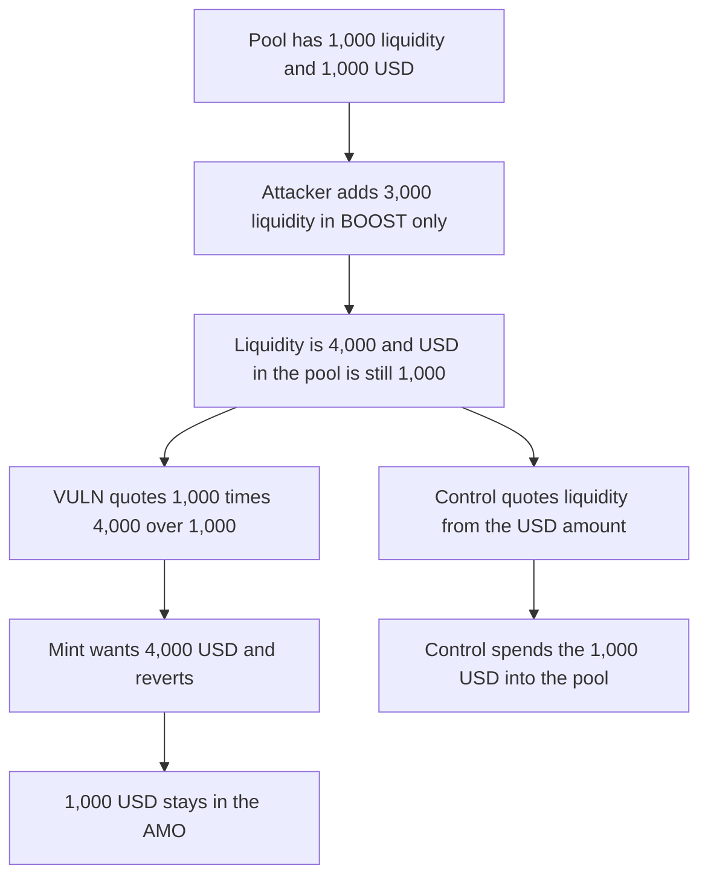

# An unbalanced LP position makes the AMO quote 4,000 liquidity for 1,000 USD, and the USD stays put

> **Vulnerability classes:** vuln/logic/price-calculation · vuln/dos/frozen-funds

<!-- non-defihacklabs -->
<!-- source-auditvault: https://github.com/Auditware/AuditVault/blob/main/findings/43533-h-4-liquidity-is-incorrectly-calculated-during-addliquidity.md -->
<!-- date: 2024-10 -->

## Key info

| Field | Value |
|---|---|
| **Loss** | 1,000 USD remains in the AMO. The mint reverts because the quote is 4,000 liquidity |
| **Vulnerable contract** | `SolidlyV3AMO._addLiquidity` |
| **Attacker EOA** | `0x423368f94e1bf9c72919ca9777b548aaf6352d26` (any LP) |
| **Attack contract** | `Exploit` |
| **Attack tx** | `Exploit.run()` |
| **Chain / block / date** | Ethereum model · block 0 · 2024-10 |
| **Compiler** | solc 0.8.27, cancun, via IR |
| **Bug class** | Liquidity is scaled by in-range liquidity over the USD balance, which a one-sided position can inflate |

## TL;DR

`_addLiquidity` sets `liquidity = usdAmount * pool.liquidity() / usd.balanceOf(pool)`. The pool starts at 1,000 liquidity and 1,000 USD. A one-sided BOOST position adds 3,000 liquidity and no USD. The quote for a 1,000 USD add becomes 4,000. The mint charges 1 USD per liquidity, asks for 4,000 USD, and reverts. The 1,000 USD is still in the AMO. `getLiquidityForAmount1` quotes 1,000, the mint succeeds, and the pool's USD balance rises from 1,000 to 2,000.

## Background

Sherlock's October 2024 Axion contest, issue 280 (H-4), reported by pkqs90 and others. Solidly V3 uses the Uniswap V3 liquidity definition. `pool.liquidity()` is the in-range liquidity, not the USD inventory. Anyone can mint a position. The report's mitigation is Uniswap's `LiquidityAmounts.getLiquidityForAmounts`.

## The vulnerable code

```solidity
uint128 currentLiquidity = pool.liquidity();
// @> VULN: liquidity is scaled by in-range liquidity over the USD balance, so a one-sided position inflates the quote
liquidity = (usdAmount * currentLiquidity) / usd.balanceOf(address(pool));
quotedLiquidity = liquidity;
try pool.mint(address(this), -100, 100, uint128(liquidity), 0, 0, deadline) returns (uint256 amount0, uint256 amount1) {
```

The catch sets `mintReverted`. Nothing in this contract moves the USD out by any other path.

## Root cause

Dividing by the USD balance treats that balance as if it backed all in-range liquidity. A position near the USD edge adds liquidity for BOOST and almost no USD, so the ratio `liquidity / usdBalance` jumps. The quote then asks for more liquidity than `usdAmount` can pay at the pool's price.

## Preconditions

- The pool has 1,000 in-range liquidity and 1,000 USD. One unit of liquidity costs 1 USD.
- An LP adds 3,000 liquidity with BOOST only. Liquidity is 4,000. USD in the pool is still 1,000.
- The AMO is given 1,000 USD and calls `addLiquidity`.

## Attack walkthrough

1. Mint 3,000 BOOST and call `mintUnbalanced`. Pool liquidity is 4,000. Pool USD is 1,000.
2. Mint 1,000 USD to the AMO and call `addLiquidity`.
3. The quote is `1000 * 4000 / 1000 = 4000`.
4. The mint tries to pull 4,000 USD. The AMO approved 1,000. The pull reverts and the catch records it.
5. The AMO still holds 1,000 USD. The pool still holds 1,000 USD.
6. The control quotes 1,000 liquidity. The mint spends the 1,000 USD and the pool holds 2,000.

## Diagrams



## Impact

The 1,000 USD that was funded for the peg add cannot enter the pool. `addLiquidity` is the AMO's spend path, and the same one-sided liquidity makes every later quote too large. The peg inventory sits in the AMO until the quote is fixed or the extra liquidity is removed.

## Remediation

Quote liquidity with the Uniswap V3 amount formula from the current sqrt price and the position's tick range, and take the minimum of the token0 and token1 results. Do not scale by `pool.liquidity() / usd.balanceOf(pool)`.

## How to reproduce

```bash
cd 43533-h-4-liquidity-is-incorrectly-calculated-during-addliquidity_exp
forge test -vv
```

`test_exploit_inflated_quote_locks_1000_usd` asserts a quote of 4,000 and 1,000 USD left in the AMO. `test_control_amount1_quote_deploys_the_1000_usd` asserts the fair mint moves that 1,000 into the pool. Captured output is `output.txt`.

## Sources

- AuditVault finding: https://github.com/Auditware/AuditVault/blob/main/findings/43533-h-4-liquidity-is-incorrectly-calculated-during-addliquidity.md
- Sherlock issue 280: https://github.com/sherlock-audit/2024-10-axion-judging/issues/280
