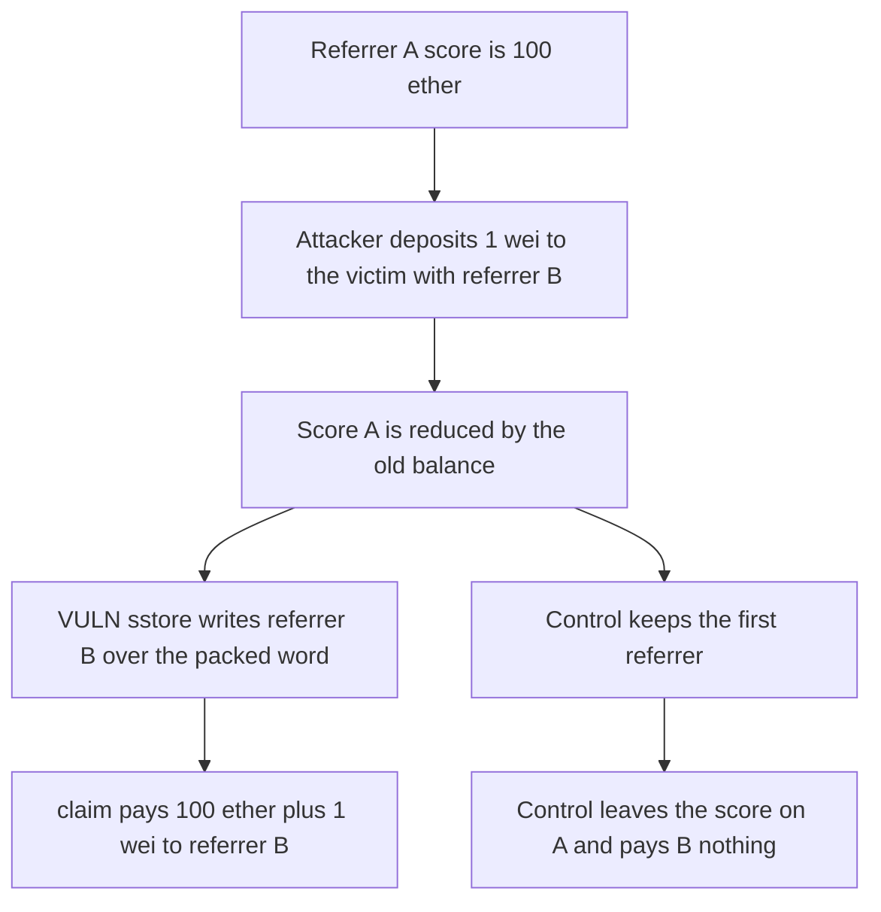

# A 1 wei deposit moves a 100 ether referrer score and claims the rewards

> **Vulnerability classes:** vuln/logic/state-update · vuln/logic/reward-calculation

<!-- non-defihacklabs -->
<!-- source-auditvault: https://github.com/Auditware/AuditVault/blob/main/findings/43540-c-01-any-referrer-can-steal-others-scores-pashov-audit-group.md -->
<!-- date: 2024-08 -->

## Key info

| Field | Value |
|---|---|
| **Loss** | 100 ether of referral rewards, plus the 1 wei mint, paid to referrer B. Referrer A's score goes to 0 |
| **Vulnerable contract** | `BunniToken._mint` |
| **Attacker EOA** | `0x1111111111111111111111111111111111111111` |
| **Attack contract** | `Exploit` |
| **Attack tx** | `Exploit.run()` |
| **Chain / block / date** | Ethereum model · block 0 · 2024-08 |
| **Compiler** | solc 0.8.27, cancun, via IR |
| **Bug class** | Every mint overwrites the recipient's referrer in the packed balance word |

## TL;DR

`_mint` writes `or(toLocked, or(referrer, updatedToBalance))` on every mint. Depositing 1 wei to an existing holder with a new referrer subtracts their whole balance from the old score and adds it to the new one. Referrer A falls from 100 ether to 0. Referrer B claims 100 ether plus 1 wei from the reward pot. The fixed mint keeps the first referrer, so the dust stays on A and B's score stays 0.

## Background

Pashov Audit Group's Bunni v2 review, August 2024, finding C-01. `BunniHub.deposit` forwards the caller's `referrer` into `BunniToken`, which inherits `ERC20Referrer._mint`. The judging PoC shows referrer A's score drop to 0 after a dust deposit aimed at user A's address, and referrer B's score become the sum.

## The vulnerable code

```solidity
if (oldBalance > 0) {
    scoreOf[oldReferrer] -= oldBalance;
}
scoreOf[referrer] += updatedBalance;
// @> VULN: the mint stores the caller-chosen referrer over the holder's existing referrer
assembly {
    sstore(slot, or(toLocked, or(referrer, updatedToBalance)))
}
```

The low 24 bits of the balance word are the referrer. They are replaced on every mint, including a mint of 1 wei to somebody else's address.

## Root cause

The referrer is not sticky. The depositor chooses it, and the score accounting moves the holder's existing balance onto that id before the `sstore`.

## Preconditions

- The victim already has 100 ether of shares minted with referrer `0xA`.
- The reward pot holds 100 ether plus 1 wei, one reward token per score unit.
- The attacker is the payee for referrer `0xB` and has 1 wei of the deposit asset.

## Attack walkthrough

1. Referrer A's score is 100 ether.
2. `hub.deposit(victim, 1, 0xB)` pulls 1 wei and mints it to the victim.
3. The mint subtracts 100 ether from A and adds 100 ether plus 1 wei to B.
4. The assembly `sstore` writes referrer B into the victim's balance word.
5. `claim(0xB)` transfers 100 ether plus 1 wei to the attacker.

## Diagrams



## Impact

Referrer A can no longer claim. The attacker receives the 100 ether of rewards that were attached to the victim's shares, and spends 1 wei of the deposit asset to do it. The fixed mint ignores a later referrer, so the same 1 wei increases A's score and B stays at 0.

## Remediation

Set the referrer only when the holder does not already have one. Later mints must add score to the stored referrer.

## How to reproduce

```bash
cd 43540-c-01-any-referrer-can-steal-others-scores-pashov-audit-group_exp
forge test -vv
```

`test_exploit_dust_mint_steals_referrer_score` asserts A's score goes from 100 ether to 0 and the attacker is paid 100 ether plus 1 wei. `test_control_existing_referrer_is_kept` asserts a second mint with referrer B leaves B's score at 0. Captured output is `output.txt`.

## Sources

- AuditVault finding: https://github.com/Auditware/AuditVault/blob/main/findings/43540-c-01-any-referrer-can-steal-others-scores-pashov-audit-group.md
- Pashov report: https://github.com/pashov/audits/blob/master/team/md/Bunni-security-review-August.md
