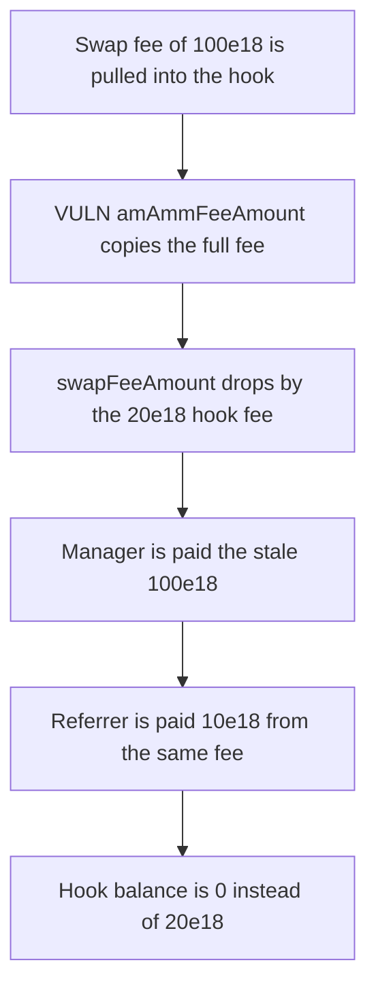

# Bunni: amAmmFeeAmount keeps the hook fee and the referrer is paid again

> **Vulnerability classes:** `vuln/defi/fee-manipulation`

<!-- non-defihacklabs -->
<!-- source-auditvault: https://github.com/Auditware/AuditVault/blob/main/findings/43541-c-02-fund-loss-because-of-wrong-amamm-fee-amount-pashov-audi.md -->
<!-- date: 2024-08 -->

## Key info

| Field | Value |
|---|---|
| **Loss** | amAmm receives 100e18. The referrer receives 10e18. The hook, which should have kept 20e18, ends at 0 |
| **Vulnerable contract** | `BunniHook.beforeSwap` |
| **Attacker EOA** | `0x1111111111111111111111111111111111111111` |
| **Attack contract** | `Exploit` |
| **Attack tx** | `Exploit.run()` |
| **Chain / block / date** | Ethereum model · block 0 · 2024-08 |
| **Compiler** | solc 0.8.27, cancun |
| **Bug class** | amAmm fee is snapshotted before the hook fee is removed |

## TL;DR

On a 1000e18 output with a 10 percent swap fee, the fee is 100e18 and the hook fee is 20e18. The code sets `amAmmFeeAmount = swapFeeAmount` and then subtracts the hook fee from `swapFeeAmount` only. The manager is paid 100e18. A referrer is also paid 10e18 out of the hook fee. The hook started with 10e18 of prior protocol fees plus the new 100e18 and finishes at 0.

## The vulnerable code

```solidity
amAmmFeeAmount = swapFeeAmount; // @> VULN: snapshot includes the hook fee that is subtracted next
hookFeesAmount = swapFeeAmount * hookFeeModifier / MODIFIER_BASE;
swapFeeAmount -= hookFeesAmount;
token.transfer(manager, amAmmFeeAmount);
```

```diff
- amAmmFeeAmount = swapFeeAmount;
  hookFeesAmount = swapFeeAmount * hookFeeModifier / MODIFIER_BASE;
  swapFeeAmount -= hookFeesAmount;
+ amAmmFeeAmount = swapFeeAmount;
```
Or subtract the referrer reward as well, which is the report's second option.

## Root cause

`amAmmFeeAmount` is a copy taken before the hook fee leaves `swapFeeAmount`, and nothing writes it again. The later transfer uses the stale copy. The referrer payment spends hook-fee tokens that are still inside that stale amount, so the same units are promised twice.

## Preconditions

- Swap fee is 10 percent of 1000e18, so 100e18 is pulled into the hook.
- Hook fee modifier is 20 percent, so the hook fee is 20e18. Referrer modifier is half of that, 10e18.
- The hook already holds 10e18 of prior protocol fees.

## Attack walkthrough

1. The swapper's 100e18 fee is pulled in. The hook holds 110e18.
2. `amAmmFeeAmount` is set to 100e18.
3. `swapFeeAmount` falls to 80e18. `amAmmFeeAmount` does not.
4. The manager transfer sends 100e18.
5. The referrer transfer sends 10e18.
6. The hook balance is 0. Fair accounting left 20e18 there and paid the manager 80e18.

## Diagrams



## Impact

The amAmm manager receives the protocol's 20e18 hook fee on top of the 80e18 swap fee, and the referrer is paid 10e18 that was not removed from the manager's amount. The hook's 10e18 of prior fees is consumed. The protocol is left with nothing from this swap.

## How to reproduce

```bash
cd 43541-c-02-fund-loss-because-of-wrong-amamm-fee-amount-pashov-audi_exp
forge test -vv
```

`output.txt` is the captured passing run. The control test checks the recommended fix.

## Sources

- AuditVault finding: https://github.com/Auditware/AuditVault/blob/main/findings/43541-c-02-fund-loss-because-of-wrong-amamm-fee-amount-pashov-audi.md
- Report: https://github.com/pashov/audits/blob/master/team/md/Bunni-security-review-August.md
- Provenance: Pashov Bunni August review, report added 2024-11-05. BunniHookLogic.beforeSwap as quoted in the finding. timeless-fi/bunni-v2 commits 7faae471 and 95f4270a.
