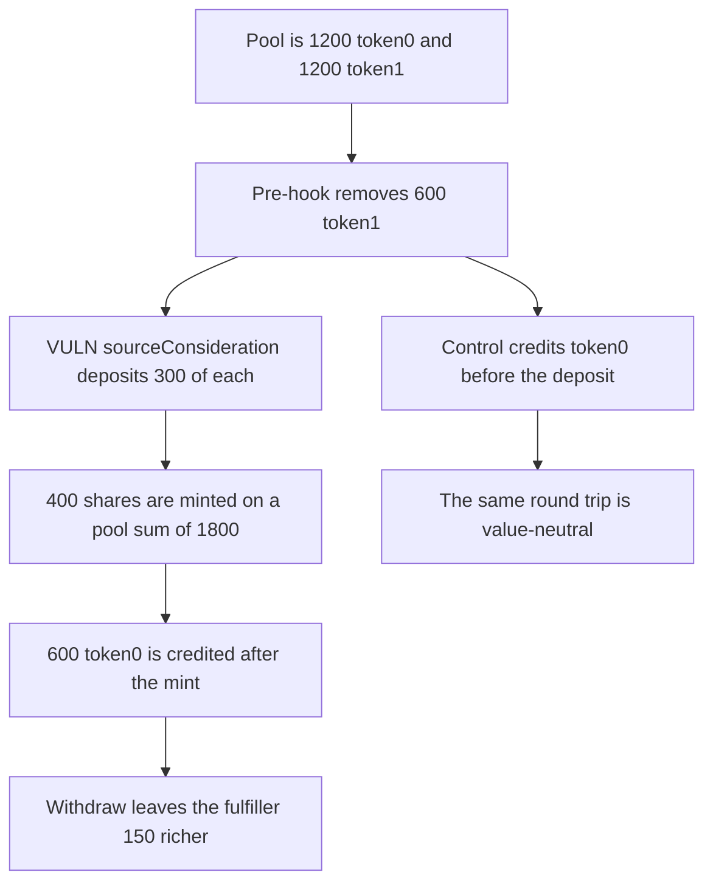

# A Bunni rebalance fulfiller mints shares before tokenOut is credited and extracts 150

> **Vulnerability classes:** vuln/reentrancy/cross-function · vuln/logic/price-calculation

<!-- non-defihacklabs -->
<!-- source-auditvault: https://github.com/Auditware/AuditVault/blob/main/findings/43542-c-03-fulfiller-can-arbitrate-the-rebalancing-process-interac.md -->
<!-- date: 2024-08 -->

## Key info

| Field | Value |
|---|---|
| **Loss** | 225 token0 gained and 75 token1 given up. Portfolio value rises by 150. The same deposit after both reserves move is value-neutral |
| **Vulnerable contract** | `BunniPool.fulfillOrder` |
| **Attacker EOA** | `0x1111111111111111111111111111111111111111` |
| **Attack contract** | `Exploit` at `0x15452ec016c4dc8c549e7fe6ff4b26324ea8b7a4` |
| **Attack tx** | `Exploit.run()` |
| **Chain / block / date** | Ethereum model · block 0 · 2024-08 |
| **Compiler** | solc 0.8.27, cancun, via IR |
| **Bug class** | `sourceConsideration` runs while tokenIn is gone and tokenOut is not yet in reserves |

## TL;DR

Flood's `fulfillOrder` removes tokenIn, calls the fulfiller, and only then pulls tokenOut. The fulfiller deposits 300 of each token while the pool sum is 1800 instead of 2400 and is minted 400 shares instead of 300. After the 600 token0 leg lands, withdrawing those shares is worth 150 more than the starting portfolio. Doing the deposit after both reserves move leaves the portfolio at its starting value.

## Background

Pashov Audit Group's August 2024 Bunni review, finding C-03. A rebalance order is fulfilled through FloodPlain. `rebalanceOrderPreHook` has already decreased tokenIn. `sourceConsideration` runs before `rebalanceOrderPostHook` records tokenOut. The amAMM manager, who is not a fully trusted admin, can be the fulfiller and can call `BunniHub.deposit` in that window. The report's own trace showed a positive token0 difference on the round trip.

## The vulnerable code

```solidity
r1 -= amountIn;
require(t1.transfer(fulfiller, amountIn), "tokenIn");
// @> VULN: sourceConsideration runs while tokenOut is still absent from reserves, so a deposit inside it mints against a depressed pool
uint256 minted = IFulfiller(fulfiller).sourceConsideration(amountOut);
require(minted > 0, "mint");
require(t0.transferFrom(fulfiller, address(this), amountOut), "tokenOut");
r0 += amountOut;
```

Shares are `(a0 + a1) * totalShares / (r0 + r1)`. At the callback, r0 is 1200 and r1 is 600. A 600 deposit mints `600 * 1200 / 1800 = 400` shares. After tokenOut is added the same 600 would mint 300.

`BunniPoolFixed.rebalance` credits tokenOut before any deposit. The control's portfolio sum is unchanged.

## Root cause

The pool's recorded value is not the value it will have at the end of the rebalance. Share minting uses the live reserves. Nothing locks `deposit` between the pre-hook and the post-hook, so the fulfiller prices against the half-updated pool.

## Preconditions

- A pool with 1200 of each token and 1200 shares.
- A rebalance that sells 600 token1 for 600 token0.
- The fulfiller can be called from `fulfillOrder`. In Bunni that is a whitelisted filler or the amAMM manager. This run is that fulfiller.
- The fulfiller hedges the 600 token1 1:1 into token0 so the consideration is funded, and deposits 300 of each token inside the callback.

## Attack walkthrough

1. `fulfillOrder` drops r1 by 600 and sends that token1 to the fulfiller.
2. `sourceConsideration` swaps the 600 token1 for 600 token0 at the desk, then deposits 300/300.
3. The mint uses sum 1800 and issues 400 shares.
4. The pool pulls 600 token0 and adds it to r0.
5. `withdraw` pays 525 token0 and 225 token1.
6. token0 is up 225 from the 900 the fulfiller held after seeding. token1 is down 75 from 300. Combined value is up 150.
7. The control rebalances first, then deposits. Combined value is unchanged and token0 is up only the fair 120 that offsets the token1 decrease.

## Diagrams



## Impact

Liquidity providers fund the extra shares. The fulfiller's token0 balance rises by 225 and their combined token0 plus token1 balance rises by 150, taken from the pool. The post-hook ordering does not produce that gain.

## Remediation

Lock `BunniHub` between the rebalance pre-hook and post-hook so `deposit` cannot run in the callback, which is the change the report recommends. Crediting tokenOut before any deposit, as the control does, removes the value gain.

## How to reproduce

```bash
cd 43542-c-03-fulfiller-can-arbitrate-the-rebalancing-process-interac_exp
forge test -vv
```

`test_exploit_deposit_during_rebalance_extracts_150` asserts token0 is 225 higher and the portfolio is 150 higher. `test_control_deposit_after_both_reserves_move_is_neutral` asserts the portfolio sum is unchanged. Captured output is `output.txt`.

## Sources

- AuditVault finding: https://github.com/Auditware/AuditVault/blob/main/findings/43542-c-03-fulfiller-can-arbitrate-the-rebalancing-process-interac.md
- Pashov report: https://github.com/pashov/audits/blob/master/team/md/Bunni-security-review-August.md
