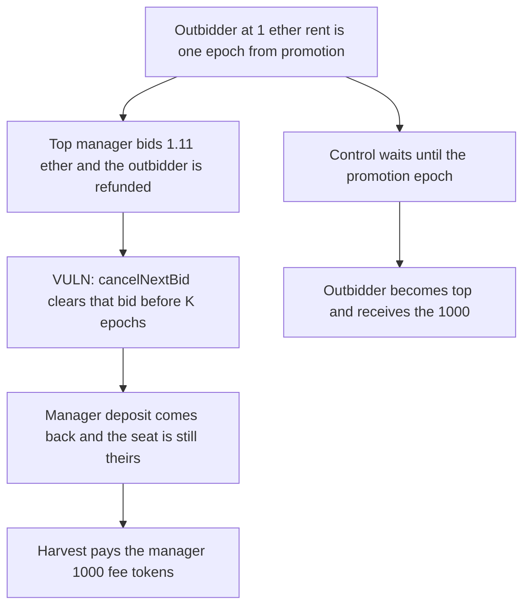

# The top bid cancels the next bid before K epochs and harvests the fees

> **Vulnerability classes:** vuln/dos/griefing · vuln/logic/missing-check

<!-- non-defihacklabs -->
<!-- source-auditvault: https://github.com/Auditware/AuditVault/blob/main/findings/43543-c-04-top-bid-can-lock-rent-indefinitely-by-clearing-the-next.md -->
<!-- date: 2024-08 -->

## Key info

| Field | Value |
|---|---|
| **Loss** | 1000 fee tokens paid to the manager who cleared a higher bid at no cost |
| **Vulnerable contract** | `AmAmm.cancelNextBid` |
| **Attacker EOA** | `0x1111111111111111111111111111111111111111` |
| **Attack contract** | `Exploit` |
| **Attack tx** | `Exploit.run()` |
| **Chain / block / date** | Ethereum model · block 0 · 2024-08 |
| **Compiler** | solc 0.8.27, cancun, via IR |
| **Bug class** | Next bid can be replaced and cancelled before its K-epoch promotion |

## TL;DR

An outbidder has posted 1 ether rent and is one epoch away from replacing a top bid that pays only 100. The top manager submits 1.11 ether rent, which refunds the outbidder, then `cancelNextBid` in the same transaction. The top deposit still covers K epochs, so the cancel is allowed and the manager's own deposit comes back. The manager is still top and harvests 1000 fee tokens. If the outbid is left in place until K epochs, `poke` promotes that bidder and the same 1000 is paid to them.

## Background

Pashov Audit Group's August 2024 Bunni review, finding C-04. In the am-AMM a next bid is promoted only after K epochs and only if its rent beats the top by more than 10 percent. `cancelNextBid` is allowed whenever `top.deposit / top.rent >= K`. The top manager can therefore insert a bid of their own and cancel it before the challenger's K epochs elapse. The challenger is refunded. The manager keeps the seat.

## The vulnerable code

```solidity
refund = nextBid.deposit;
// @> VULN: cancel clears the next bid before its K-epoch promotion, so the higher bidder never takes the seat
nextBid.manager = address(0);
nextBid.deposit = 0;
nextBid.rent = 0;
require(bidToken.transfer(recipient, refund), "refund");
```

The outbidder was already removed when the manager's higher bid replaced `nextBid`. Cancelling that replacement leaves no next bid.

## Root cause

Promotion is delayed by K epochs, and cancellation is permissioned only by the top bid still having K epochs of deposit. Those two rules together let the incumbent delete a challenger before the delay expires, then take the cancellation refund, so the deletion is free.

## Preconditions

- The top bid's deposit covers at least K epochs. Here rent is 100 and the deposit is `365 * 24 * 100`.
- A next bid of 1 ether rent is waiting. Its promotion epoch is current epoch plus one. Current epoch is 100.
- 1000 fee tokens sit in the contract and `harvest` pays them to `topBid.manager`.

## Attack walkthrough

1. The manager bids 1.11 ether rent with a deposit of 24 times that rent. The check `currentEpoch < next.epoch + K` passes, so the outbidder is not promoted.
2. The outbidder is refunded 24 ether. The manager's bid becomes `nextBid`.
3. `cancelNextBid` sees `top.deposit / top.rent >= K` and clears the next bid. The manager's deposit is returned. Their bid-token balance is unchanged.
4. `getTopManager` is still the manager. `getNextManager` is `address(0)`.
5. `harvest` pays the 1000 fee tokens to the manager.
6. The control constructs the same bids with the epoch already at the promotion point. `poke` makes the outbidder the top manager and `harvest` pays them the 1000.

## Diagrams



## Impact

The outbidder never takes the manager seat. Their 24 ether deposit is refunded, so they are not robbed of principal, but the 1000 fee tokens that `harvest` pays to the current manager go to the incumbent. The control pays those 1000 tokens to the outbidder.

## Remediation

Remove `cancelNextBid`, which is the first fix in the report, or keep an ordered list of bids and refund a bidder only when that bidder cancels their own bid. Do not let a fresh next bid displace a challenger and then disappear before K epochs.

## How to reproduce

```bash
cd 43543-c-04-top-bid-can-lock-rent-indefinitely-by-clearing-the-next_exp
forge test
```

`test_exploit_cancel_next_bid_keeps_fees` asserts the manager still holds the seat, the next bid is empty, the outbidder was refunded 24 ether, and the manager received 1000 fee tokens. `test_control_k_epochs_promotes_outbidder_and_pays_fees` asserts the outbidder receives the 1000. Captured output is `output.txt`.

## Sources

- AuditVault finding: https://github.com/Auditware/AuditVault/blob/main/findings/43543-c-04-top-bid-can-lock-rent-indefinitely-by-clearing-the-next.md
- Report: https://github.com/pashov/audits/blob/master/team/md/Bunni-security-review-August.md
