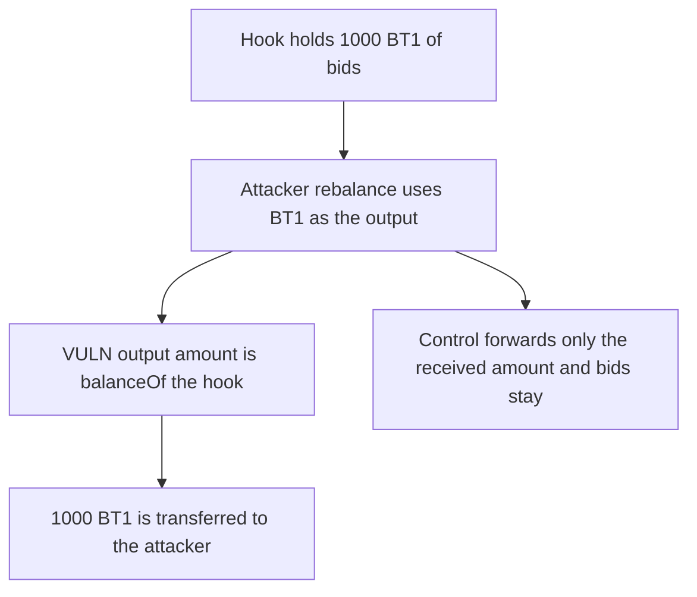

# BunniHook rebalance sends managers' bids to the attacker's pool

> **Vulnerability classes:** `vuln/logic/missing-check`

<!-- non-defihacklabs -->
<!-- source-auditvault: https://github.com/Auditware/AuditVault/blob/main/findings/43544-c-05-attacker-can-steal-bids-and-rent-tokens-from-bunnihook.md -->
<!-- date: 2024-11 -->

## Key info

| Field | Value |
|---|---|
| **Loss** | 1000 BT1 of bids and rents |
| **Vulnerable contract** | `BunniHook.rebalanceOrderPostHook` |
| **Attacker EOA** | `0x1111111111111111111111111111111111111111` |
| **Attack contract** | `Exploit` |
| **Attack tx** | `Exploit.run()` |
| **Chain / block / date** | Ethereum model · block 0 · 2024-11 |
| **Compiler** | solc 0.8.27, cancun, via IR |
| **Bug class** | Post-hook forwards the whole balance |

## TL;DR

BunniHook holds 1000 BT1 that managers posted as am-AMM bids. `rebalanceOrderPostHook` treats `balanceOf(this)` as the amount just bought and transfers all of it to the hub of the pool being rebalanced. The attacker points that hub at themselves and receives the 1000 BT1. `rebalanceReceived`, which forwards only the amount the swap actually delivered, leaves the 1000 BT1 on the hook when that amount is 0.

## Background

Pashov Audit Group's Bunni v2 review, published 5 November 2024, finding C-05. The report shows `orderOutputAmount = args.currency.balanceOfSelf()` inside `rebalanceOrderPostHook`, and describes an attacker pool whose output currency is the victim BunniToken.

## The vulnerable code

```solidity
orderOutputAmount = token.balanceOf(address(this)); // @> VULN: full balance, not the amount this swap just received
// FIX: orderOutputAmount = balanceAfter - balanceBefore
```

The change that removes the harm:

```diff
- orderOutputAmount = token.balanceOf(address(this));
+ orderOutputAmount = balanceAfter - balanceBefore;
```

## Root cause

The hook does not snapshot its balance before the swap. Every token already held, including bids and rents, is indistinguishable from swap output and is pushed to the hub.

## Preconditions

- The hook's BT1 balance is 1000 ether of bids.
- The attacker can cause a rebalance whose output currency is that same BT1.
- The hub argument is the attacker's address.

## Attack walkthrough

1. The hook's balance is read as 1000 BT1.
2. The post-hook sets the output to that balance.
3. The hook transfers 1000 BT1 to the attacker.
4. The hook balance is 0.
5. The control forwards a received amount of 0 and the bids stay.

## Diagrams



## Impact

Managers lose 1000 BT1. The attacker holds it. The control path does not move the bids.

## Remediation

Transfer only the tokens received during this rebalance, which is the balance increase, not `balanceOf` of the hook.

## How to reproduce

```bash
cd 43544-c-05-attacker-can-steal-bids-and-rent-tokens-from-bunnihook_exp
forge test -vv
```

`test_exploit` is the harm. The control test is the guarded path. Captured output is `output.txt`.

## Sources

- AuditVault finding: https://github.com/Auditware/AuditVault/blob/main/findings/43544-c-05-attacker-can-steal-bids-and-rent-tokens-from-bunnihook.md
- Pashov report: https://github.com/pashov/audits/blob/master/team/md/Bunni-security-review-August.md
