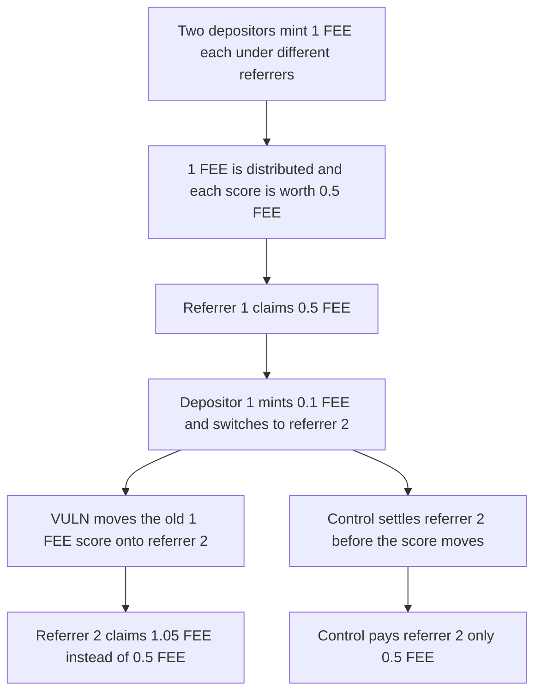

# Bunni: switching referrer pays the old score a second time

> **Vulnerability classes:** vuln/logic/reward-calculation

<!-- non-defihacklabs -->
<!-- source-auditvault: https://github.com/Auditware/AuditVault/blob/main/findings/43545-c-06-double-counting-of-referral-scores-leading-to-over-clai.md -->
<!-- date: 2024-08 -->

## Key info

| Field | Value |
|---|---|
| **Loss** | 0.55 FEE stolen from the referral reserve. Referrer 2 is paid 1.05 FEE after a 1 FEE distribution |
| **Vulnerable contract** | `BunniToken.mint` |
| **Attacker EOA** | `0x0000000000000000000000000000000000043545` |
| **Attack contract** | `Exploit` |
| **Attack tx** | `Exploit.run()` |
| **Chain / block / date** | Ethereum model · block 0 · 2024-08 |
| **Compiler** | solc 0.8.27, cancun, via IR |
| **Bug class** | Score moves to the new referrer before rewards are settled |

## TL;DR

`ERC20Referrer._mint(to, amount, referrer)` subtracts a depositor's existing balance from the old referrer's score and adds that balance plus the new mint to the new referrer. It does not settle the new referrer's rewards first. After a 1 FEE distribution, referrer 1 claims the fair 0.5 FEE. Depositor 1 then mints 0.1 FEE more and names referrer 2. Referrer 2's score becomes 2.1 FEE and `claimReferralRewards` pays 1.05 FEE. The fair claim is 0.5 FEE. The extra 0.55 FEE is the score that was already paid.

## Background

Pashov Audit Group's August 2024 review of timeless-fi/bunni-v2, finding C-06. The published report is `Bunni-security-review-August`, added to the audits repo on 5 Nov 2024. The blamed function is `ERC20Referrer._mint(address,uint256,uint24)`. When the stored referrer differs from the new one and the account already has a balance, the assembly subtracts `toBalance` from the old score and adds `updatedToBalance` to the new score. Referral rewards are `score * acc - rewardDebt`, and debt is only written on claim.

## The vulnerable code

```solidity
if (toBalance != 0) {
    // @> VULN: the depositor's existing score is taken off the old referrer and given to the new one before that referrer's rewards are settled
    scoreOf[toReferrer] -= toBalance;
    totalScore -= toBalance;
    scoreOf[referrer] += updatedToBalance;
    totalScore += updatedToBalance;
}
```

`updatedToBalance` is the old balance plus the new mint. Referrer 2 already had 1 FEE of score. After the switch the score is 2.1 FEE and `rewardDebt` is still 0, so the whole 2.1 FEE earns the already-distributed index.

## Root cause

Moving the score does not process the destination referrer's pending rewards. The recommendation in C-06 is to settle the referrer who will receive the score before the score is transferred, so the moved balance does not earn rewards that were already paid to the previous referrer.

## Preconditions

- Two depositors mint 1 FEE of LP each, one under referrer 1 and one under referrer 2.
- 1 FEE of referral rewards is distributed, so each score of 1 FEE is worth 0.5 FEE.
- Referrer 1 claims before depositor 1 changes referrer.
- The reward contract holds the extra 0.55 FEE that the second claim pulls.

## Attack walkthrough

1. Depositor 1 mints 1 ether with referrer 1. Referrer 1's score is 1 ether.
2. Depositor 2 mints 1 ether with referrer 2. Referrer 2's score is 1 ether.
3. `distributeReferralRewards(1 ether)` sets the index to 0.5 ether per 1 ether of score.
4. Referrer 1 claims 0.5 ether. That payment goes to a sink.
5. Depositor 1 mints 0.1 ether and passes referrer 2. The old 1 ether score is subtracted from referrer 1 and 1.1 ether is added to referrer 2.
6. Referrer 2's score is 2.1 ether. The claim pays 1.05 ether. The fair amount is 0.5 ether.

## Diagrams



## Impact

Referrer 2 receives 1.05 FEE. Referrer 1 was already paid 0.5 FEE for the same score. The extra 0.55 FEE comes out of the referral reserve. The control, which increases `rewardDebt` by the incoming score times the index before the score is added, pays referrer 2 exactly 0.5 FEE.

## Remediation

Before adding `updatedToBalance` to the new referrer, set that referrer's `rewardDebt` so the incoming score does not earn the current index. The same settlement should run for the old referrer when its score is reduced.

## How to reproduce

```bash
cd 43545-c-06-double-counting-of-referral-scores-leading-to-over-clai_exp
forge test -vv
```

`test_exploit_referrer2_claims_moved_score_twice` asserts a 1.05 FEE claim and a 2.1 FEE score on referrer 2. `test_control_settle_before_score_move_pays_half` asserts the settled path pays 0.5 FEE. Captured output is `output.txt`.

## Sources

- AuditVault finding: https://github.com/Auditware/AuditVault/blob/main/findings/43545-c-06-double-counting-of-referral-scores-leading-to-over-clai.md
- Report: https://github.com/pashov/audits/blob/master/team/md/Bunni-security-review-August.md
- Blamed function: `ERC20Referrer._mint(address,uint256,uint24)` in timeless-fi/bunni-v2 at `7faae4718eecda1b33dc3abd894431ed2d16c929`
