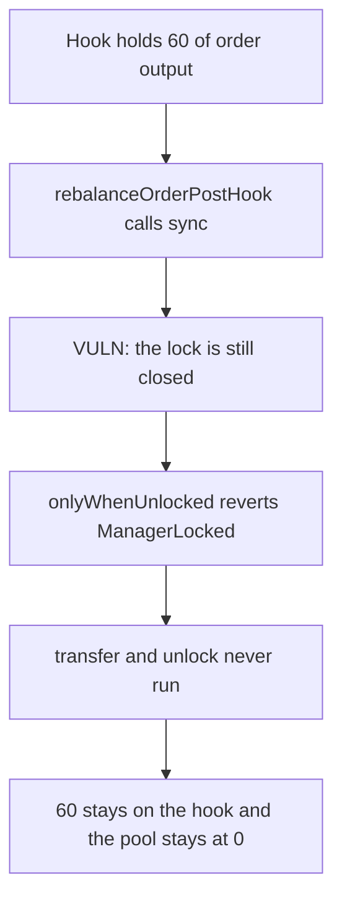

# Bunni: rebalanceOrderPostHook calls poolManager.sync before unlock and the 60 output stays in the hook

> **Vulnerability classes:** `vuln/logic/incorrect-order-of-operations` · `vuln/dos/griefing`

<!-- non-defihacklabs -->
<!-- source-auditvault: https://github.com/Auditware/AuditVault/blob/main/findings/43546-h-01-function-poolmanagersync-called-before-the-unlock-proce.md -->
<!-- date: 2024-08 -->

## Key info

| Field | Value |
|---|---|
| **Loss** | 60 of order output stays in the hook. The pool balance stays 0. The post-hook reverts |
| **Vulnerable contract** | `BunniHook.rebalanceOrderPostHook` |
| **Attacker EOA** | `0x1111111111111111111111111111111111111111` |
| **Attack contract** | `Exploit` |
| **Attack tx** | `Exploit.run()` |
| **Chain / block / date** | Ethereum model · block 0 · 2024-08 |
| **Compiler** | solc 0.8.27, cancun, optimizer 200 |
| **Bug class** | `sync` requires an open lock, and `unlock` is the next call |

## TL;DR

Uniswap v4 `PoolManager.sync` is `onlyWhenUnlocked`. `rebalanceOrderPostHook` calls `sync`, then transfers the order output, then `unlock`. The lock is still closed, so `sync` reverts `ManagerLocked`. The transfer and the unlock never run. 60 of output that the post-hook was supposed to settle stays on the hook. The pool's synced currency stays unset and its balance stays 0.

## Background

Pashov Audit Group's August 2024 Bunni review, finding H-01. The report cites `BunniHook` lines 501 and 505: `poolManager.sync` before `poolManager.unlock`. The current `Bunniapp/bunni-v2` hook checks `poolManager.isUnlocked()` and only calls `unlock` when the lock is closed, which is the shape of the recommended move. This reduction keeps the reported order.

## The vulnerable code

```solidity
function rebalanceOrderPostHook() external {
    poolManager.sync(address(token)); // @> VULN: sync runs before unlock, and sync requires the lock to be open
    if (address(token) != address(0)) {
        token.transfer(address(poolManager), orderOutputAmount);
    }
    poolManager.unlock(abi.encode(orderOutputAmount));
}
```

`PoolManager.sync` hits:

```solidity
if (!unlocked) revert ManagerLocked();
```

The report moves `sync` and the transfer into the `REBALANCE_POSTHOOK` callback, which runs only after `unlock` has set `unlocked`.

## Root cause

The two calls are in the wrong order. `sync` is not legal until `unlock` has opened the lock, and `unlock` is sequenced after `sync`. The post-hook cannot complete.

## Preconditions

- The hook holds the order output. Here that is 60 tokens.
- `PoolManager.unlocked` is false, which is the normal state outside a callback.
- Someone calls `rebalanceOrderPostHook`.

## Attack walkthrough

1. 60 tokens are minted to the hook and recorded as `orderOutputAmount`.
2. `rebalanceOrderPostHook` calls `sync`.
3. `onlyWhenUnlocked` reverts `ManagerLocked`.
4. The hook still holds 60. The pool holds 0. `rebalanced` is false.

## Diagrams



## Impact

The rebalance that should push the order output into the pool reverts. The 60 tokens sit on the hook. Pool reserves are not updated, which is the unbalanced-pool outcome in the report. There is no second path in this function that settles the currency.

## Remediation

Call `unlock` first and run `sync` plus the transfer inside the unlock callback, while `unlocked` is true.

## How to reproduce

```bash
cd 43546-h-01-function-poolmanagersync-called-before-the-unlock-proce_exp
forge test -vv
```

`test_sync_before_unlock_reverts_and_sticks_output` asserts the revert, `rebalanced == false`, `syncedCurrency == address(0)`, 60 ether on the hook, and 0 on the pool.

## Sources

- AuditVault finding: https://github.com/Auditware/AuditVault/blob/main/findings/43546-h-01-function-poolmanagersync-called-before-the-unlock-proce.md
- Report: https://github.com/pashov/audits/blob/master/team/md/Bunni-security-review-August.md
- Report commit: https://github.com/pashov/audits/blob/cf8d94c/team/md/Bunni-security-review-August.md
- Current hook, which branches on `isUnlocked`: https://github.com/Bunniapp/bunni-v2/blob/main/src/BunniHook.sol
- `PoolManager.sync` onlyWhenUnlocked: https://github.com/Uniswap/v4-core/blob/18b223cab19dc778d9d287a82d29fee3e99162b0/src/PoolManager.sol#L280
