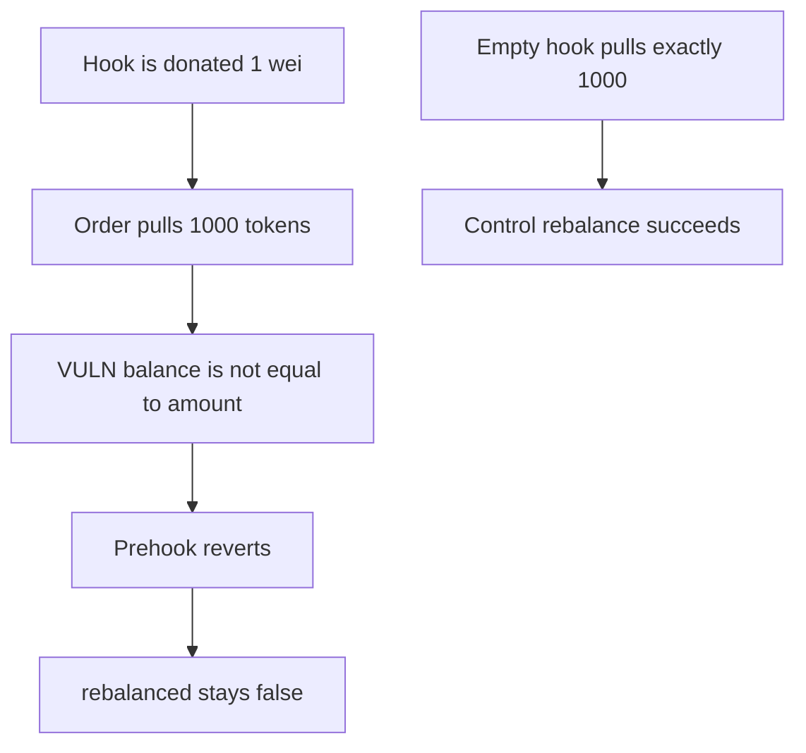

# Bunni: a 1 wei donation makes rebalanceOrderPreHook revert

> **Vulnerability classes:** `vuln/dos/frozen-funds` · `vuln/logic/missing-check`

<!-- non-defihacklabs -->
<!-- source-auditvault: https://github.com/Auditware/AuditVault/blob/main/findings/43549-h-04-attacker-can-dos-the-rebalance-mechanism-pashov-audit-g.md -->
<!-- date: 2024-08 -->

## Key info

| Field | Value |
|---|---|
| **Loss** | The 1000-token rebalance order cannot execute. `rebalanced` stays false |
| **Vulnerable contract** | `BunniHook.rebalanceOrderPreHook` |
| **Attacker EOA** | `0x1111111111111111111111111111111111111111` |
| **Attack contract** | `Exploit` |
| **Attack tx** | `Exploit.run()` |
| **Chain / block / date** | Ethereum model · block 0 · 2024-08 |
| **Compiler** | solc 0.8.27, cancun, via IR |
| **Bug class** | Absolute balance check instead of a balance delta |

## TL;DR

The August review's prehook requires `currency.balanceOfSelf() == args.amount`. Donating 1 wei first makes the balance `amount + 1` after the order pull. The hook reverts with `BunniHook__PrehookPostConditionFailed`. A pull of exactly `amount` onto an empty hook succeeds.

## The vulnerable code

```solidity
if (currency.balanceOfSelf() != amount) { // @> VULN: the whole balance must equal the order amount, so a 1 wei donation makes the check fail
    revert BunniHook__PrehookPostConditionFailed();
}
```

The review says to compare the increase in balance with `args.amount`, not the total balance. `balanceOfSelf` is the v4 Currency helper, inlined into the hook.

## Root cause

The hook can already hold manager fees when am-AMM is on, and anyone can transfer the order token to the hook. Either residue breaks an equality check against the order size.

## Preconditions

- The order amount is 1000 tokens.
- The hook's token balance is 1 wei before the pull.
- The prehook pulls `amount` and then compares the whole balance.

## Attack walkthrough

1. Donate 1 wei to the hook.
2. Call the prehook with amount 1000 tokens.
3. The pull would make the balance 1000 tokens plus 1 wei.
4. The equality reverts. `rebalanced` is false.
5. The control, with an empty hook, sets `rebalanced` and holds exactly 1000 tokens.

## Diagrams



## Impact

Autonomous rebalancing does not run. The order cannot be filled while any unexpected token balance sits on the hook. One wei is enough. The same revert happens when am-AMM manager fees are already on the hook.

## Remediation

Measure the balance before the pull and require that the increase equals `args.amount`. Do not require the total balance to equal `args.amount`.

## How to reproduce

```bash
cd 43549-h-04-attacker-can-dos-the-rebalance-mechanism-pashov-audit-g_exp
forge test -vv
```

Captured output is `output.txt`.

## Sources

- AuditVault finding: https://github.com/Auditware/AuditVault/blob/main/findings/43549-h-04-attacker-can-dos-the-rebalance-mechanism-pashov-audit-g.md
- Pashov Bunni August review: https://github.com/pashov/audits/blob/master/team/md/Bunni-security-review-August.md
- Repo: https://github.com/timeless-fi/bunni-v2
- The finding file has no genome frontmatter. The report rates Impact Medium and Likelihood High. AuditVault records impact HIGH.

