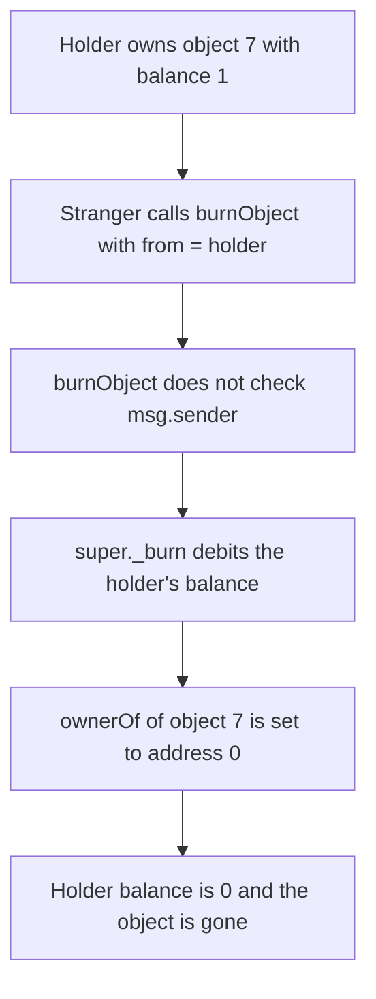

# PHI MaterialObject — anyone can burn another user's object

> **Vulnerability classes:** vuln/access-control/missing-auth · vuln/logic/missing-check

<!-- non-defihacklabs -->
<!-- source-auditvault: https://github.com/Auditware/AuditVault/blob/main/findings/43697-h-01-anyone-can-burn-any-nfts-of-other-users-in-the-material.md -->
<!-- date: 2023-07 -->

## Key info

| | |
|---|---|
| **Protocol** | PHI (Phimaterial) |
| **Finding** | Shieldify H-01, AuditVault 43697 |
| **Vulnerable code** | `MaterialObject.burnObject` |
| **Harm** | A stranger burns the holder's object 7. `ownerOf(7)` becomes `address(0)` and the balance goes from 1 to 0 |
| **Chain** | local synthetic |

## TL;DR

`burnObject(from, tokenid, amount)` and `burnBatchObject` forward to `_burn` / `_burnBatch` with no check that `msg.sender` is `from` and no operator approval. Any caller can pass any holder's address. For object 7 the holder starts as owner with balance 1. After the stranger's call, `ownerOf(7)` is `address(0)` and the balance is 0. Requiring `msg.sender == from` makes that call revert, and the holder keeps the object.

## The vulnerable code

The audited functions take an arbitrary `from` and burn it:

```solidity
// Function to burn an object
function burnObject(address from, uint256 tokenid, uint256 amount) external {
    // @> VULN: no check that msg.sender is `from` or an approved operator. super._burn destroys any holder's object and ownerOf becomes address(0).
    super._burn(from, tokenid, amount);
}

// Function to burn a batch of objects
function burnBatchObject(address from, uint256[] memory tokenids, uint256[] memory amounts) external {
    // @> VULN: same missing owner check on the batch path. Any caller can pass any `from`.
    super._burnBatch(from, tokenids, amounts);
}
```

`_burn` decrements `balanceOf[from][tokenid]` and, when that hits 0, writes `ownerOf[tokenid] = address(0)`.

The report's fix for an externally callable burn is to drop `from` and pass `msg.sender`. The control keeps `from` but reverts unless `msg.sender == from`.

## Root cause

The burn entry points were written so craft logic could name the account to debit, and that parameter was left callable by anyone. Nothing ties `from` to `msg.sender` or to an approval. The debit and the owner clear both trust the caller-supplied address.

## Preconditions

Object 7 has been minted to the holder with amount 1, so `ownerOf(7)` is the holder and `balanceOf(holder, 7)` is 1. The caller is any other address. No craft-logic role, signature, or approval is required.

## Attack walkthrough

1. Object 7 is minted to the holder. `ownerOf(7)` is the holder and the balance is 1.
2. The attacker calls `burnObject(holder, 7, 1)`. The attacker is not the holder.
3. `super._burn` does not look at `msg.sender`. It debits the holder's balance from 1 to 0.
4. Because the balance is now 0 and the owner was the holder, `ownerOf(7)` is set to `address(0)`.
5. The holder reads back balance 0 and owner `address(0)`. One object was destroyed.

The control uses the same mint and the same caller. `burnObject` reverts with `owner`. `ownerOf(7)` is still the holder and the balance is still 1.

## Diagrams



## Impact

The holder loses object 7. `ownerOf(7)` changes from the holder to `address(0)`, and `balanceOf(holder, 7)` changes from 1 to 0. The attacker does not need to own the object or be approved. The same missing check is on `burnBatchObject`. A burn that requires `msg.sender == from` reverts for this caller, and the holder still owns object 7 with balance 1.

## Remediation

If `burnObject` is called by users, delete the `from` argument and pass `msg.sender` to `_burn`. If it is only called by craft logic, gate it with that role and have craft logic pass the user as `from`. Apply the same check to `burnBatchObject`, or remove the batch function if craft logic does not call it. That is the fix the report recommended and the team applied.

## How to reproduce

```bash
cd 43697-h-01-anyone-can-burn-any-nfts-of-other-users-in-the-material_exp
forge test -vv
```

## Sources

- AuditVault finding: https://github.com/Auditware/AuditVault/blob/main/findings/43697-h-01-anyone-can-burn-any-nfts-of-other-users-in-the-material.md
- Shieldify report: https://github.com/solodit/solodit_content/blob/main/reports/Shieldify/2023-07-27-PHIMaterial.md
