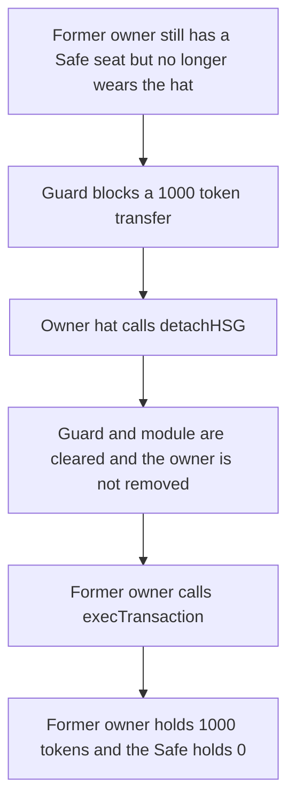

# Hats Signer Gate — detaching the gate leaves a former hat owner in control of the Safe

> **Vulnerability classes:** vuln/access-control/missing-owner-check · vuln/logic/missing-check

<!-- non-defihacklabs -->
<!-- source-auditvault: https://github.com/Auditware/AuditVault/blob/main/findings/43738-h-1-detaching-hsg-when-theres-non-unregistered-owners-who-no.md -->
<!-- date: 2024-11 -->

## Key info

| Field | Value |
|---|---|
| **Loss** | 1000 tokens moved out of the Safe by an address that no longer wears the signer hat |
| **Vulnerable contract** | `HatsSignerGate.detachHSG` |
| **Attacker EOA** | `0x1111111111111111111111111111111111111111` |
| **Attack contract** | `Exploit` (owner-hat wearer) |
| **Attack tx** | `Exploit.run()` |
| **Chain / block / date** | Ethereum model · block 0 · 2024-11 |
| **Compiler** | solc 0.8.27, cancun, via IR |
| **Bug class** | Detach does not unregister owners who dropped the hat |

## TL;DR

`detachHSG` removes HatsSignerGate as the Safe's guard and as its module. It does not look at the Safe's owners. An address that used to wear the signer hat, and that is still a Safe owner, cannot execute while the guard is attached. After detach, the same address calls `execTransaction` and transfers 1000 tokens from the Safe to itself. The fixed detach unregisters every owner who is not wearing the signer hat. The same transfer then reverts with `Safe: not owner`, and the 1000 tokens stay in the Safe.

## Background

Sherlock reviewed Hats Protocol in November 2024. bughuntoor reported H-1 on `HatsSignerGate.detachHSG`. While the gate is attached, `checkTransaction` only counts signers who still wear their registered hat, but losing the hat does not remove the address from the Safe. Detach deletes the guard that was enforcing that rule and leaves the owner set unchanged. The address is then an ordinary Safe owner.

This reduction keeps `detachHSG` verbatim. The Safe and the hat check are minimal stand-ins for Safe and `isValidSigner`. The gate's `checkTransaction` is reduced to the hat-wearer require the real function enforces before it counts a signature. No time warp is used.

## The vulnerable code

```solidity
function detachHSG() public {
    _checkUnlocked();
    _checkOwner();
    ISafe s = safe; // save SLOAD

    // first remove as guard, then as module
    // @> VULN: owners who no longer wear the signer hat stay owners of the Safe
    s.execRemoveHSGAsGuard();
    s.execDisableHSGAsOnlyModule();
    emit Detached();
}
```

The fix walks the Safe owners and unregisters anyone who is not wearing the signer hat before the gate is removed:

```diff
     ISafe s = safe; // save SLOAD
+    address[] memory owners = s.getOwners();
+    for (uint256 i; i < owners.length; ++i) {
+        if (!isValidSigner(owners[i])) s.removeOwner(owners[i]);
+    }
     // first remove as guard, then as module
     s.execRemoveHSGAsGuard();
```

## Root cause

`removeSigner` is a separate function, and it refuses to remove an address that still wears the hat. `detachHSG` never calls it. The two calls it does make only clear `guard` and `module` on the Safe. Owner storage is untouched. Once `guard` is the zero address, `execTransaction` skips `checkTransaction`, so `isOwner` is the only check left.

## Preconditions

- The former wearer is a Safe owner. Threshold is one owner, so that address can execute alone.
- The signer hat has been moved to another address in this same block. `isWearerOfHat` is false for the former owner.
- The caller of `detachHSG` wears the owner hat, and the gate is unlocked.
- The Safe holds 1000 tokens.

## Attack walkthrough

1. The signer hat moves from the former owner to `0x2222`. The former owner is still `isOwner` on the Safe.
2. The former owner calls `pull` for 1000 tokens. `checkTransaction` reverts because the signer does not wear the hat. The Safe balance stays 1000.
3. The owner-hat wearer calls `detachHSG`. `execRemoveHSGAsGuard` sets `guard` to zero. `execDisableHSGAsOnlyModule` clears the module. No owner is removed.
4. The former owner calls `pull` again. `isOwner` passes and there is no guard. The token contract moves 1000 tokens from the Safe to the former owner. The Safe balance is 0.

## Diagrams



## Impact

The former hat owner receives 1000 tokens that were sitting in the Safe. Before detach, the same call reverts. After detach, it succeeds, and the address is still a Safe owner. The control path unregisters that address during detach. `pull` then reverts with `Safe: not owner`. The Safe still holds 1000 tokens and the former owner holds 0.

## PoC

```bash
cd 43738-h-1-detaching-hsg-when-theres-non-unregistered-owners-who-no_exp
forge test -vv
```

`test_exploit_former_owner_transfers_after_detach` asserts the former owner holds 1000 tokens, the Safe holds 0, the former owner is still an owner, the hat is gone, and the pre-detach attempt was blocked. `test_control_unregisters_former_and_transfer_reverts` asserts the fixed detach clears the owner and the transfer reverts, leaving 1000 tokens in the Safe.

## Sources

- AuditVault finding: https://github.com/Auditware/AuditVault/blob/main/findings/43738-h-1-detaching-hsg-when-theres-non-unregistered-owners-who-no.md
- Sherlock judging: https://github.com/sherlock-audit/2024-11-hats-protocol-judging/issues/4
- Reviewed source: https://github.com/sherlock-audit/2024-11-hats-protocol/blob/main/hats-zodiac/src/HatsSignerGate.sol
