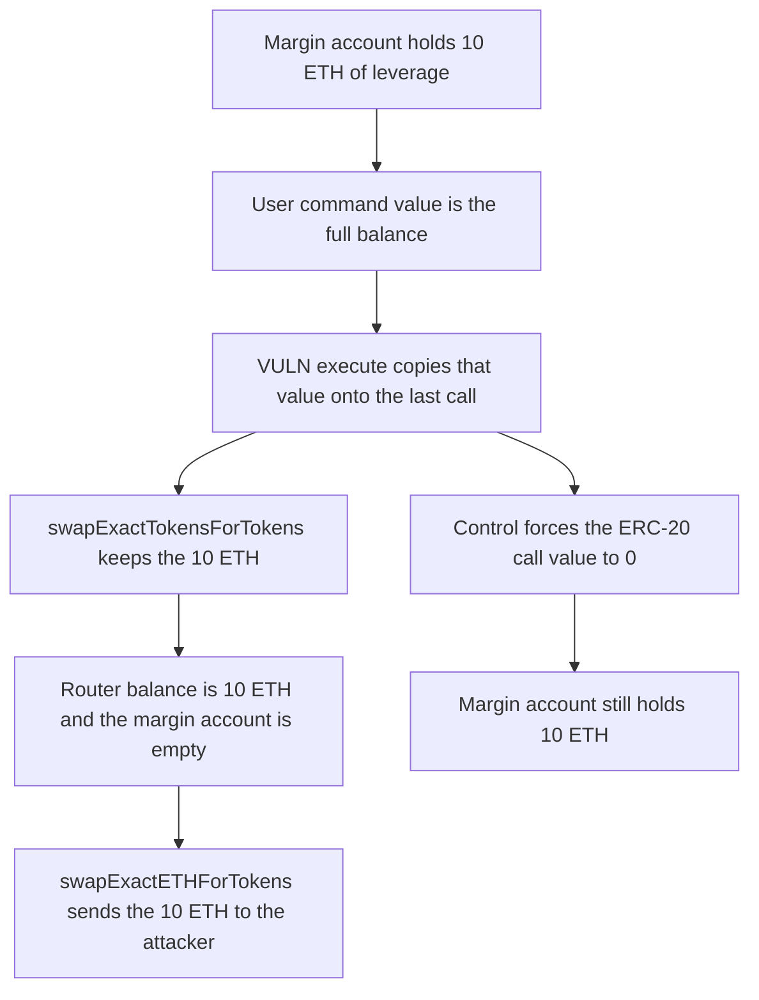

# Arkis: a margin command forwards its ETH value into an ERC-20 swap

> **Vulnerability classes:** `vuln/logic/missing-validation` · `vuln/defi/fee-manipulation`

<!-- non-defihacklabs -->
<!-- source-auditvault: https://github.com/Auditware/AuditVault/blob/main/findings/43794-native-tokens-may-be-drained-from-margin-accounts-via-lack-o.md -->
<!-- date: 2024-12 -->

## Key info

| Field | Value |
|---|---|
| **Loss** | 10 ETH leaves the margin account and is swept from the router to the attacker |
| **Vulnerable contract** | `MarginAccount.execute` |
| **Attacker EOA** | `0x1111111111111111111111111111111111111111` |
| **Attack contract** | `Exploit` |
| **Attack tx** | `Exploit.run()` |
| **Chain / block / date** | Ethereum model · block 0 · 2024-12 |
| **Compiler** | solc 0.8.27, cancun, via IR |
| **Bug class** | User command value is forwarded with no check that the call spends ETH |

## TL;DR

`execute` decodes the command list and writes the user command's `value` onto the last call. The payload is `swapExactTokensForTokens`, which is payable and does not refund `msg.value`. The margin account holds 10 ETH of leverage. The call sends all 10 ETH to the router and leaves it there. `swapExactETHForTokens` then sends the router's balance to the attacker. Forcing the ERC-20 call's value to 0 leaves the 10 ETH in the margin account.

## Background

Trail of Bits, Arkis DeFi Prime Brokerage review, December 2024, "Native tokens may be drained from margin accounts via lack of value validation." The quoted `CommandSafeExecutor.execute` assigns `_cmd.value` onto the last command and calls it. The report's second step is an ERC-20 swap whose value is the margin account's native balance. The third step, outside the account, sweeps the router.

## The vulnerable code

```solidity
Command[] memory cmdsToExecute = abi.decode(_encodedCmds, (Command[]));
uint256 n = cmdsToExecute.length;
// @> VULN: the user command's value is forwarded. An ERC-20 swap does not refund it.
cmdsToExecute[n - 1].value = _cmd.value;
// FIX: compliance must reject a non-zero value on a call that does not spend native ETH.
address target = cmdsToExecute[n - 1].target;
uint256 value = cmdsToExecute[n - 1].value;
bytes memory data = cmdsToExecute[n - 1].data;
(bool ok,) = target.call{value: value}(data);
```

The router:

```solidity
function swapExactTokensForTokens(uint256, uint256, address[] calldata, address, uint256)
    external
    payable
    returns (uint256[] memory amounts)
{
    amounts = new uint256[](2);
}
```

## Root cause

The value that travels with the call is taken from the user command. The executor does not ask whether that call's function spends ETH. A payable ERC-20 swap keeps whatever it is sent.

## Preconditions

- The margin account holds 10 ETH. In this run that balance is funded before `run()`.
- The router is an allowed target, matching the report's assumption that a Uniswap-like router is an authorized operator.
- `swapExactTokensForTokens` accepts ETH and does not refund it.
- A later call can send the router's ETH balance to an arbitrary recipient.

## Attack walkthrough

1. The margin account's balance is 10 ETH.
2. The command list's last value is 0. The outer command value is 10 ETH. `execute` overwrites the call value with 10 ETH.
3. The router receives 10 ETH and returns without moving it.
4. The margin account balance is 0. The router balance is 10 ETH.
5. `swapExactETHForTokens` sends that 10 ETH to `0x1111111111111111111111111111111111111111`.
6. The control writes 0 instead of the user value. The same payload leaves the 10 ETH in the margin account and the router at 0.

## Diagrams



## Impact

The attacker receives 10 ETH. The margin account and the router both end at 0. That 10 ETH was the account's native leverage balance, which the report describes as funds a user can exfiltrate through an authorized router. The control keeps all 10 ETH in the margin account.

## Remediation

Do not copy `_cmd.value` onto a call unless compliance has allowed that value for that target and selector. An ERC-20 swap should be called with value 0.

## How to reproduce

```bash
cd 43794-native-tokens-may-be-drained-from-margin-accounts-via-lack-o_exp
forge test -vv
```

`test_exploit_margin_eth_is_swept_from_the_router` deals 10 ETH to the margin account, then asserts the attacker gained 10 ETH. `test_control_zero_value_leaves_the_eth` asserts the margin account still holds 10 ETH. Captured output is `output.txt`.

## Sources

- AuditVault finding: https://github.com/Auditware/AuditVault/blob/main/findings/43794-native-tokens-may-be-drained-from-margin-accounts-via-lack-o.md
- Trail of Bits review: https://github.com/trailofbits/publications/blob/master/reviews/2024-12-arkis-defi-prime-brokerage-securityreview.pdf
