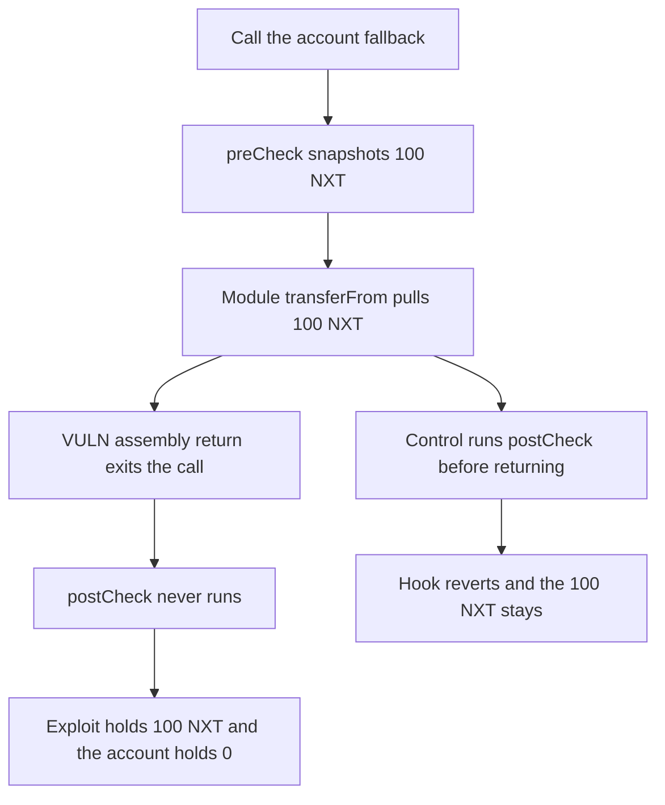

# Nexus: fallback's assembly return skips the hook and the module keeps 100 tokens

> **Vulnerability classes:** vuln/logic/missing-check

<!-- non-defihacklabs -->
<!-- source-auditvault: https://github.com/Auditware/AuditVault/blob/main/findings/43809-fallback-logic-prevents-hooks-postcheck-from-getting-execute.md -->
<!-- date: 2024-10 -->

## Key info

| Field | Value |
|---|---|
| **Loss** | 100 NXT moved off the account. The hook's postCheck, which reverts a balance drop, never runs |
| **Vulnerable contract** | `NexusAccount.fallback` |
| **Attacker EOA** | `0x0000000000000000000000000000000000043809` |
| **Attack contract** | `Exploit` |
| **Attack tx** | `Exploit.run()` |
| **Chain / block / date** | Ethereum model · block 0 · 2024-10 |
| **Compiler** | solc 0.8.27, cancun, via IR |
| **Bug class** | `return` in assembly exits before `withHook`'s postCheck |

## TL;DR

Every Nexus function is wrapped in `withHook`, which calls `preCheck`, runs the body, then calls `postCheck`. `fallback` does the module call in assembly and finishes with `return(0, returndatasize())`. That opcode ends the call frame. `postCheck` is never reached. A module that `transferFrom`s 100 NXT off the account succeeds. The hook recorded the balance in `preCheck` and would have reverted the drop. The fixed fallback caches the return data, runs `postCheck`, and the whole call reverts, so the 100 NXT stays on the account.

## Background

Spearbit's October 2024 review of Biconomy Nexus. The finding is that `withHook` was added to every entry point, including `fallback`, but the `CALLTYPE_SINGLE` and `CALLTYPE_STATIC` branches return from assembly. The recommended shape is the one in ZeroDev Kernel: copy the returndata out, run the post-check, then return the cached bytes from a later assembly block. Biconomy fixed it in PR 183.

## The vulnerable code

```solidity
modifier withHook() {
    address hook_ = hook;
    if (hook_ == address(0)) {
        _;
    } else {
        bytes memory hookData = IHook(hook_).preCheck(msg.sender, msg.value, msg.data);
        _;
        IHook(hook_).postCheck(hookData);
    }
}

// @> VULN: assembly return ends the call, so withHook's postCheck never runs
assembly {
    return(0, returndatasize())
}
```

`postCheck` requires `token.balanceOf(account) >= snap`. The module has already moved the 100 NXT, so the check would revert. It does not run.

## Root cause

Solidity runs the modifier's trailing statements after the function body. An assembly `return` does not return from the function. It returns from the call. Nothing after it in the modifier executes. The module's token transfer is already in the same frame, so skipping the revert commits the transfer.

## Preconditions

- The account has a hook and a `CALLTYPE_SINGLE` fallback handler.
- The account holds 100 NXT and has approved the handler for that amount.
- The hook's `postCheck` reverts if the account's balance falls below the `preCheck` snapshot.

## Attack walkthrough

1. `run` calls the account with empty calldata. `fallback` enters `withHook`.
2. `preCheck` stores `snap = 100 ether` and sets `preRan`.
3. The fallback `call`s the handler. The handler `transferFrom`s 100 NXT to the exploit.
4. `return(0, returndatasize())` ends the call. `postRan` stays false.
5. The exploit's balance is 100 NXT. The account's balance is 0.
6. The fixed account runs `postCheck` before returning. The call reverts and both balances are unchanged.

## Diagrams



## Impact

The account loses 100 NXT. The hook was installed to reject that transfer and it does reject it when `postCheck` is actually invoked. Because the assembly return skips the hook, the module keeps the tokens. Any constraint the hook enforces only in `postCheck` — spending limits, session keys, allowlists — is skipped on every successful fallback module call.

## Remediation

Do not `return` from inside the fallback assembly. Copy `returndata` to memory, call `postCheck`, then return the copied bytes. The review points at Kernel.sol lines 178-215 for that shape. Biconomy applied it in PR 183.

## How to reproduce

```bash
cd 43809-fallback-logic-prevents-hooks-postcheck-from-getting-execute_exp
forge test -vv
```

`test_exploit_fallback_return_skips_postcheck_and_drains` asserts a 100 NXT balance on the exploit, an empty account, `preRan`, and not `postRan`. `test_control_postcheck_reverts_and_tokens_stay` asserts the call fails and the account still holds 100 NXT. Captured output is `output.txt`.

## Sources

- AuditVault finding: https://github.com/Auditware/AuditVault/blob/main/findings/43809-fallback-logic-prevents-hooks-postcheck-from-getting-execute.md
- Report: Biconomy-Spearbit-Security-Review-October-2024
