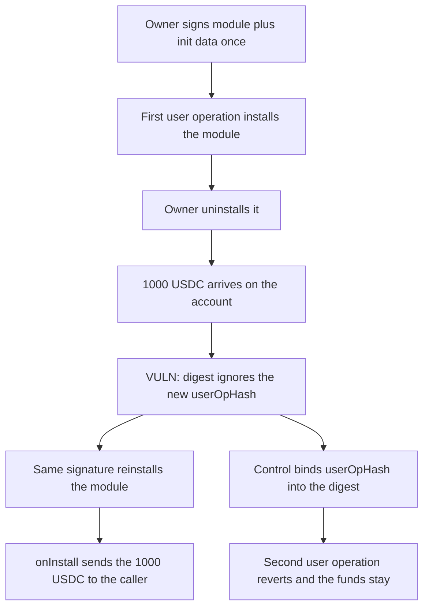

# Biconomy Nexus: enable-mode signature can be replayed

> **Vulnerability classes:** `vuln/auth/signature-replay`

<!-- non-defihacklabs -->
<!-- source-auditvault: https://github.com/Auditware/AuditVault/blob/main/findings/43810-enable-mode-signature-can-be-replayed-spearbit-none-biconomy.md -->
<!-- date: 2024-10 -->

## Key info

| Field | Value |
|---|---|
| **Loss** | 1000 USDC pulled from the account after the owner uninstalled the module |
| **Vulnerable contract** | `Account._getEnableModeDataHash` |
| **Attacker EOA** | `0x1111111111111111111111111111111111111111` |
| **Attack contract** | `Exploit` |
| **Attack tx** | `Exploit.run()` |
| **Chain / block / date** | Ethereum model · block 0 · 2024-10 |
| **Compiler** | solc 0.8.27, cancun, via IR |
| **Bug class** | Enable-mode digest omits userOpHash |

## TL;DR

The enable-mode digest is `keccak256(abi.encode(MODULE_ENABLE_MODE_TYPE_HASH, module, keccak256(initData)))`. It does not include the user operation hash. The owner signs that digest once. After they uninstall the module, a second user operation with a different hash still validates, reinstalls the module, and the module's `onInstall` transfers the 1000 USDC that arrived in between.

## The vulnerable code

```solidity
digest = _hashTypedData(
    keccak256(abi.encode(MODULE_ENABLE_MODE_TYPE_HASH, module, keccak256(initData))) // @> VULN: userOpHash is not in the enable-mode digest, so one signature installs the module again
);
```

The type string is `ModuleEnableMode(address module,bytes32 initDataHash)`, matching the pre-fix Nexus hash. The recommended fix adds `userOpHash` (and the module type) to the struct, so the entry-point nonce that already binds a user operation also binds the enable-mode signature.

## Preconditions

- The owner has installed a validator that accepts a digest it has signed.
- The signed payload names a module whose `onInstall` calls `execute` and sends the account's tokens to a fixed recipient.
- The owner uninstalls that module. Later, 1000 USDC is credited to the account.
- A bundler submits a new user operation that carries the old enable-mode signature and a different userOpHash.

## Attack walkthrough

1. The owner signs the digest of the module and the recipient init data. The signature is used once.
2. The first enable installs the module. The account is empty, so nothing moves. The owner uninstalls it.
3. 1000 USDC is minted to the account.
4. The same signature and init data are submitted with a new userOpHash. The digest is unchanged, so the validator still accepts it.
5. The module is installed again and `execute` sends the 1000 USDC to the caller.
6. The control hashes `userOpHash` into the struct. The second user operation reverts and the 1000 USDC stays on the account.

## Diagrams



## Impact

The account owner removed the module and then received 1000 USDC. The old enable-mode signature installs that module again and the module transfers all 1000 USDC to the caller. The owner did not sign the second user operation.

## How to reproduce

```bash
cd 43810-enable-mode-signature-can-be-replayed-spearbit-none-biconomy_exp
forge test -vv
```

`test_exploit_replays_enable_mode_signature` asserts the module is reinstalled and the account balance is 0. `test_control_user_op_hash_stops_replay` asserts the bound digest rejects the second hash and the attacker is paid nothing.

## Sources

- AuditVault finding: https://github.com/Auditware/AuditVault/blob/main/findings/43810-enable-mode-signature-can-be-replayed-spearbit-none-biconomy.md
- Spearbit report: https://github.com/spearbit/portfolio/blob/master/pdfs/Biconomy-Spearbit-Security-Review-October-2024.pdf
- Pre-fix hash: https://github.com/Cyfrin/2024-07-biconomy/blob/d2adadc0f3105eb789329eb3c958472638692a2d/contracts/base/ModuleManager.sol
