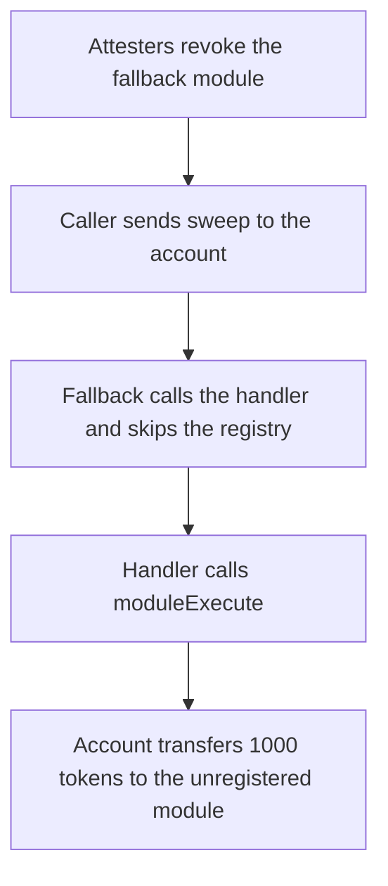

# Biconomy Nexus — a fallback call skips the ERC-7484 registry and an unregistered module moves the tokens

> **Vulnerability classes:** vuln/access-control/missing-modifier · vuln/logic/missing-check

<!-- non-defihacklabs -->
<!-- source-auditvault: https://github.com/Auditware/AuditVault/blob/main/findings/43812-erc-7484-registry-checks-missing-on-calls-to-modules-spearbi.md -->
<!-- date: 2024-10 -->

## Key info

| Field | Value |
|---|---|
| **Loss** | 1000 tokens moved from the account to a fallback module whose attestation was revoked |
| **Vulnerable contract** | `NexusAccount._fallback` |
| **Attacker EOA** | `0x1111111111111111111111111111111111111111` |
| **Attack contract** | `Exploit` |
| **Attack tx** | `Exploit.run()` |
| **Chain / block / date** | Ethereum model · block 0 · 2024-10 |
| **Compiler** | solc 0.8.27, cancun, via IR |
| **Bug class** | Module execution skips `withRegistry` |

## TL;DR

Nexus checks the ERC-7484 registry when a fallback module is installed and when an executor calls `executeFromExecutor`. It does not check the registry when a call falls through to an installed handler. After attesters revoke that handler, a sweep selector still reaches `handler.call`. The handler calls back into the account and the account transfers 1000 tokens to the handler. The fixed fallback calls `_checkRegistry` first. The same sweep reverts with `ERC7484: threshold not met`, and the 1000 tokens stay on the account.

## Background

Spearbit reviewed Biconomy Nexus in October 2024. The account lets the owner opt in to an ERC-7484 registry. `withRegistry` calls `_checkRegistry`, which calls `registry.check` and reverts when the attestation threshold is not met. That modifier is on module installation and on `executeFromExecutor`. `ModuleManager._fallback` looks up the handler for `msg.sig` and calls it. There is no registry check on that path, or on the hook and validator execution paths the report names.

This reduction keeps the handler call and `_checkRegistry`. The hook `preCheck` and the ERC-2771 calldata suffix from the production `_fallback` are omitted. They do not decide whether the registry is consulted. The registry is set, so the missing check is not the "registry address is zero" skip inside `_checkRegistry`.

## The vulnerable code

```solidity
function _fallback(bytes calldata callData) internal {
    bool success;
    bytes memory result;
    address handler = fallbacks[msg.sig];
    if (handler != address(0)) {
        // @> VULN: handler is called with no _checkRegistry(handler, MODULE_TYPE_FALLBACK)
        (success, result) = handler.call(callData);
        if (!success) {
            assembly {
                revert(add(result, 0x20), mload(result))
            }
        }
    }
}
```

The check the executor path already uses, and that the fallback should use before the call:

```solidity
function _checkRegistry(address module, uint256 moduleType) internal view {
    IERC7484 moduleRegistry = registry;
    if (address(moduleRegistry) != address(0)) {
        // this will revert if attestations / threshold are not met
        moduleRegistry.check(module, moduleType);
    }
}
```

```diff
     address handler = fallbacks[msg.sig];
     if (handler != address(0)) {
+        _checkRegistry(handler, MODULE_TYPE_FALLBACK);
         (success, result) = handler.call(callData);
```

## Root cause

Installation and executor entry go through `withRegistry`. Fallback dispatch does not. Revoking an attestation updates the registry only. The account's `fallbacks` map still holds the module, and `_fallback` treats a non-zero handler as sufficient. `moduleExecute` then trusts `msg.sender == fallbackHandler` and transfers tokens. That trust was supposed to be re-checked against the registry on every use.

## Preconditions

- The account's `registry` is set. The owner opted in.
- The handler was attested at install time. In this block the registry revokes it before the sweep.
- `fallbacks[sweep.selector]` is still the handler.
- The account holds 1000 tokens.

## Attack walkthrough

1. `registry.revoke` clears the handler's attestation.
2. The exploit calls the account with `sweep(token, 1000 ether)`. The account has no such function, so `fallback` runs.
3. `_fallback` loads the handler and calls it. `_checkRegistry` does not run.
4. The handler's `sweep` calls `moduleExecute` on the account. The account transfers 1000 tokens to the handler.
5. The handler holds 1000 tokens. The account holds 0. The handler is still unattested.

## Diagrams



## Impact

The unregistered module receives 1000 tokens that were held by the account. The registry was configured and the module was not attested, which is exactly the condition `registry.check` rejects. The control account runs `_checkRegistry` before the same `handler.call`. The sweep reverts with `ERC7484: threshold not met`. The account still holds 1000 tokens and the module holds 0.

## PoC

```bash
cd 43812-erc-7484-registry-checks-missing-on-calls-to-modules-spearbi_exp
forge test -vv
```

`test_exploit_unregistered_module_moves_tokens` asserts the handler holds 1000 tokens, the account holds 0, and the handler is not attested. `test_control_registry_check_reverts` asserts the fixed fallback reverts with `ERC7484: threshold not met` and both balances are unchanged.

## Sources

- AuditVault finding: https://github.com/Auditware/AuditVault/blob/main/findings/43812-erc-7484-registry-checks-missing-on-calls-to-modules-spearbi.md
- Spearbit report: https://github.com/spearbit/portfolio/blob/master/pdfs/Biconomy-Spearbit-Security-Review-October-2024.pdf
- Reviewed source: https://github.com/bcnmy/nexus/blob/main/contracts/base/ModuleManager.sol
