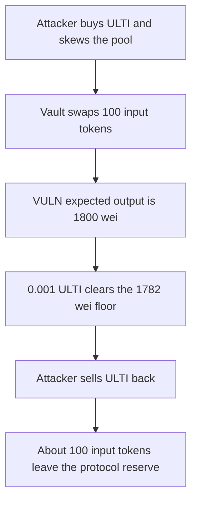

# ULTI: slippage floor is scaled by 18 instead of 1e18

> **Vulnerability classes:** `vuln/arithmetic/precision-loss` · `vuln/defi/slippage`

<!-- non-defihacklabs -->
<!-- source-auditvault: https://github.com/Auditware/AuditVault/blob/main/findings/43910-c-01-critical-precision-loss-in-slippage-protection-calculat.md -->
<!-- date: 2024-11 -->

## Key info

| Field | Value |
|---|---|
| **Loss** | About 100 input tokens taken from the protocol reserve. The swap returned 0.001 ULTI |
| **Vulnerable contract** | `UltiVault.swapInputForUlti` |
| **Attacker EOA** | `0x1111111111111111111111111111111111111111` |
| **Attack contract** | `Exploit` |
| **Attack tx** | `Exploit.run()` |
| **Chain / block / date** | Ethereum model · block 0 · 2024-11 |
| **Compiler** | solc 0.8.27, cancun, via IR |
| **Bug class** | Slippage minimum scaled by 18 instead of 1e18 |

## TL;DR

`_swapInputTokenForUlti` computes the expected ULTI as `inputAmount * 18 / twap`. The review says the scale is `1e18`. On a 100 token swap at a 1e18 TWAP the expected output is 1800 wei. `MAX_SWAP_SLIPPAGE_BPS` is `3 * 33` = 99, so the internal floor is 1782 wei. After the attacker buys ULTI out of the pool, the vault's 100 token reserve swaps for 0.001 ULTI and the check passes. Selling the ULTI back returns about 100 input tokens to the attacker. The `1e18` scale reverts that swap.

## Background

Pashov Audit Group's ULTI November review, finding C-01. The published fix on the token replaces `18` with `1e18`. The constant comment in the review is "Maximum allowed slippage for swaps in basis points (0.99%)" and the code is `3 * ULTI_NUMBER` with `ULTI_NUMBER` of 33.

## The vulnerable code

```solidity
uint256 expectedUltiAmountWithoutSlippage = inputAmountToSwap * 18 / twap; // @> VULN
uint256 minUltiAmountInternal = (expectedUltiAmountWithoutSlippage * (10000 - MAX_SWAP_SLIPPAGE_BPS)) / 10000;
uint256 effectiveMinUltiAmount = minUltiAmount > minUltiAmountInternal ? minUltiAmount : minUltiAmountInternal;
```

The fix is `inputAmountToSwap * 1e18 / twap`. For this swap that floor is 99.01 ULTI, and the pool only returns 0.001.

## Root cause

A whole number `18` is used where the TWAP's 18-decimal scale belongs. The minimum collapses by 1e18 / 18, which for any normal size is dust, so the internal slippage guard no longer rejects a manipulated fill.

## Preconditions

- The vault holds 100 input tokens and the TWAP is 1e18. The caller sets `minUltiAmount` to 1.
- The pool starts at 10000 input and 10000 ULTI. The attacker can buy ULTI before the vault swap.

## Attack walkthrough

1. The attacker swaps a large input amount and leaves the pool with a few dozen ULTI.
2. The vault swaps its 100 token reserve. Expected output is 1800 wei and the floor is 1782 wei.
3. The pool pays 0.001 ULTI, which is above 1782 wei, so the swap stands.
4. The attacker sells the ULTI back and is ahead by about 100 input tokens.
5. The control uses `1e18`. The same pool state reverts with `slippage`.

## Diagrams



## Impact

The protocol reserve loses 100 input tokens and the caller receives 0.001 ULTI. The attacker's input balance rises by 99999999999999999582 wei, just under 100 tokens. The corrected scale refuses the swap and the reserve stays put.

## How to reproduce

```bash
cd 43910-c-01-critical-precision-loss-in-slippage-protection-calculat_exp
forge test -vv
```

`test_exploit_slippage_floor_is_1782_wei` logs the extracted amount and asserts the 1782 wei floor. `test_control_1e18_scale_reverts` asserts the fixed scale reverts. Output is `output.txt`.

## Sources

- AuditVault finding: https://github.com/Auditware/AuditVault/blob/main/findings/43910-c-01-critical-precision-loss-in-slippage-protection-calculat.md
- Report: https://github.com/pashov/audits/blob/master/team/md/ULTI-security-review-November.md
