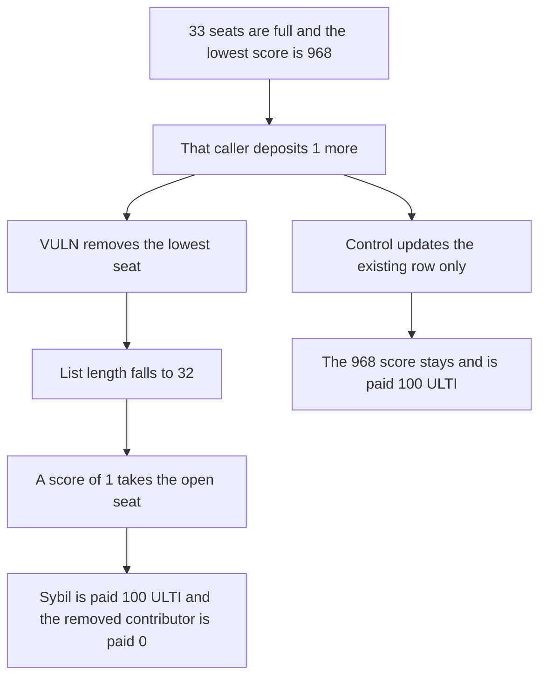

# ULTI: an existing top contributor kicks the lowest seat

> **Vulnerability classes:** `vuln/logic/missing-check` · `vuln/logic/reward-calculation`

<!-- non-defihacklabs -->
<!-- source-auditvault: https://github.com/Auditware/AuditVault/blob/main/findings/43911-c-02-the-lowest-contributor-of-the-top-contributors-list-can.md -->
<!-- date: 2024-11 -->

## Key info

| Field | Value |
|---|---|
| **Loss** | A sybil with score 1 takes the seat of a contributor with score 968 and is paid that seat's 100 ULTI. The removed contributor is paid 0 |
| **Vulnerable contract** | `_updateTopContributors` |
| **Attacker EOA** | `0x1111111111111111111111111111111111111111` |
| **Attack contract** | `Exploit` |
| **Attack tx** | `Exploit.run()` |
| **Chain / block / date** | Ethereum model · block 0 · 2024-11 |
| **Compiler** | solc 0.8.27, cancun, via IR |

## TL;DR

When the top-contributor list already holds 33 entries, a later deposit still removes the lowest contributor and then `set`s the caller. If the caller is already on the list, `set` only updates that row, so the list shrinks from 33 to 32 and the lowest score is gone. A new account depositing 1 then fits in the freed seat. The bonus pays 100 ULTI to every remaining seat. The sybil receives 100. The removed contributor, whose score is 968, receives 0.

## The vulnerable code

```solidity
if (updated > minContribution) {
    address doomed = minContributor;
    if (fixedMode) {
        bool added = _insert(who, updated);
        if (added) _remove(doomed);
    } else {
        _remove(doomed); // @> VULN: lowest is removed even though `who` is already on the list
        values[who] = updated;
        kicked = doomed;
    }
}
```

The review only removes the minimum when the caller was not already present:

```diff
 if (updatedContribution > minContribution) {
-    _topContributors.remove(minContributor);
-    _topContributors.set(contributorAddress, updatedContribution);
+    if (_topContributors.set(contributorAddress, updatedContribution)) {
+        _topContributors.remove(minContributor);
+    }
 }
```

`MAX_TOP_CONTRIBUTORS` is 33, the same cap as the reviewed contract.

## Root cause

`remove` runs before the code knows whether `set` will insert a key. An update of an existing key does not insert, so the removal is not balanced by an addition. The length drops by one. The next depositor, at any positive score, takes the open seat because the length check is `< 33` and no longer compares against the contributor who was just deleted.

## Preconditions

- The list is full. The caller is on it with a score of 1,000,000. Thirty-two other scores fill the rest. The lowest is address 32 at 968.
- The bonus pool holds 3300 ULTI, 100 per seat.
- The caller then deposits 1 more, and a second account deposits 1.

## Attack walkthrough

1. The first 33 deposits fill the list. The minimum is address 32 at 968.
2. The same caller deposits 1. The score is still the highest on the list.
3. The unfixed branch removes address 32 and writes the caller's updated score. `kicked` is address 32. Length is 32.
4. The sybil deposits 1. Length is below 33, so the sybil is inserted.
5. `pay` sends 100 ULTI to each of the 33 keys. The sybil's balance is 100. Address 32's balance is 0.
6. The control updates the existing row in place, leaves address 32 seated, refuses the sybil, and pays address 32 the 100 ULTI.

## Diagrams



## Impact

The contributor with score 968 loses the 100 ULTI seat bonus and is no longer in the set the review says is used for the pump and for top-distributor rewards. The replacement score is 1. The caller's own second deposit is what creates the hole. No other contributor has to cooperate.

## How to reproduce

```bash
cd 43911-c-02-the-lowest-contributor-of-the-top-contributors-list-can_exp
forge test -vv
```

`test_exploit_sybil_takes_the_kicked_seat` asserts the victim is gone, the sybil is seated, the sybil received 100 ULTI, and the victim received 0. `test_control_existing_depositor_does_not_kick` asserts the victim stays, the sybil is excluded, and the victim is paid 100 ULTI.

## Sources

- AuditVault finding: https://github.com/Auditware/AuditVault/blob/main/findings/43911-c-02-the-lowest-contributor-of-the-top-contributors-list-can.md
- Pashov review: https://github.com/pashov/audits/blob/master/team/md/ULTI-security-review-November.md
- Reviewed tree: `ulti-org/ulti-protocol-contract` at `2024dbadc12f6c4efea1d5ec29e6d994c6bc6636`
