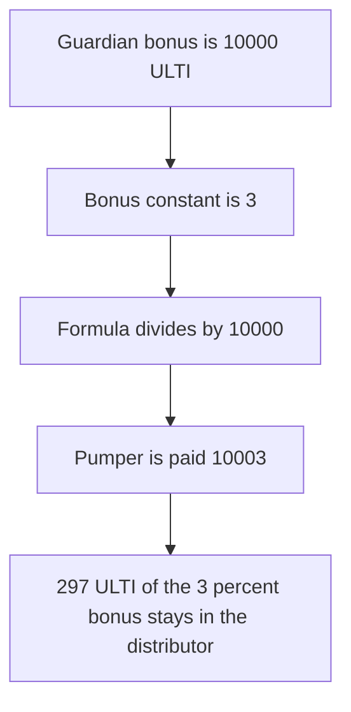

# ULTI: the active-pumper bonus is 0.03 percent instead of 3 percent

> **Vulnerability classes:** `vuln/logic/reward-calculation` · `vuln/arithmetic/precision-loss`

<!-- non-defihacklabs -->
<!-- source-auditvault: https://github.com/Auditware/AuditVault/blob/main/findings/43912-h-01-wrong-active-pumper-bonus-calculation-pashov-audit-grou.md -->
<!-- date: 2024-11 -->

## Key info

| Field | Value |
|---|---|
| **Loss** | Pumper is paid 10003 ULTI instead of 10300; 297 ULTI stays in the distributor |
| **Vulnerable contract** | `Distributor.payActivePumper` |
| **Attacker EOA** | `0x1111111111111111111111111111111111111111` |
| **Attack contract** | `Exploit` |
| **Attack tx** | `Exploit.run()` |
| **Chain / block / date** | Local synthetic · 2024-11 |
| **Compiler** | solc 0.8.27, cancun, via IR |
| **Bug class** | A 3 percent bonus is divided by 10000 |

## TL;DR

The whitepaper pays active pumpers 3% of the guardian bonus. `ACTIVE_PUMPERS_BONUS_PERCENTAGE` is 3, and the code multiplies by `(10000 + 3) / 10000`. On a 10000 ULTI guardian bonus the pumper receives 10003. The intended payment is 10300. 297 ULTI remains in the distributor.

## The vulnerable code

```solidity
uint256 paid = guardianBonus * (10000 + ACTIVE_PUMPERS_BONUS_PERCENTAGE) / 10000;
```

`ACTIVE_PUMPERS_BONUS_PERCENTAGE` is `ULTI_NUMBER / 10`, which is 3. Dividing by 100 treats that 3 as 3%. Dividing by 10000 treats it as 0.03%.

## Root cause

The bonus constant is a percent, and the formula scales it as basis points.

## Preconditions

- The guardian bonus is 10000 ULTI.
- The active-pumper percentage constant is 3.

## Attack walkthrough

1. The distributor holds the guardian bonus plus room for the 3% add-on.
2. The payout multiplies by 10003/10000.
3. The pumper receives 10003 ULTI.
4. 297 ULTI stays in the distributor. That is the missing 3% minus the 0.03% that was paid.

## Diagrams



## Impact

Every active pumper is underpaid by almost the entire advertised bonus. This run short-pays 297 ULTI on a 10000 ULTI guardian bonus.

## How to reproduce

```bash
cd 43912-h-01-wrong-active-pumper-bonus-calculation-pashov-audit-grou_exp
forge test -vv
```

## Sources

- AuditVault finding: https://github.com/Auditware/AuditVault/blob/main/findings/43912-h-01-wrong-active-pumper-bonus-calculation-pashov-audit-grou.md
- Pashov review: https://github.com/pashov/audits/blob/master/team/md/ULTI-security-review-November.md
