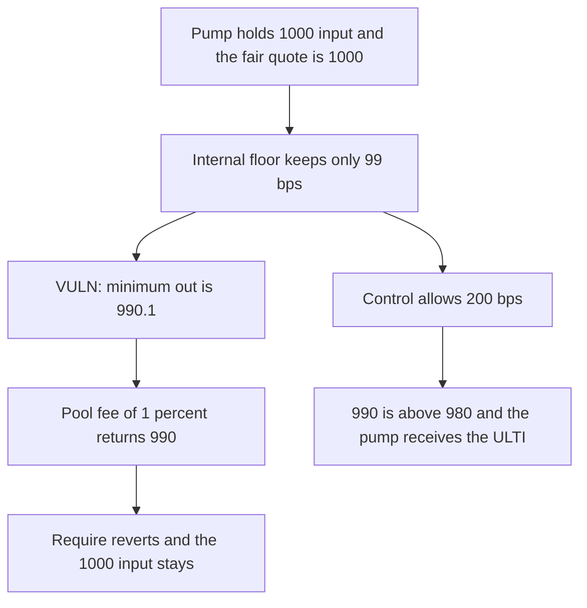

# ULTI: 99 bps of slippage cannot cover the 1 percent pool fee

> **Vulnerability classes:** `vuln/defi/slippage` · `vuln/dos/griefing`

<!-- non-defihacklabs -->
<!-- source-auditvault: https://github.com/Auditware/AuditVault/blob/main/findings/43913-h-02-dos-on-the-pump-function-due-to-excessively-low-slippag.md -->
<!-- date: 2024-11 -->

## Key info

| Field | Value |
|---|---|
| **Loss** | pump reverts. 1000 of input stays unsold and no ULTI is bought |
| **Vulnerable contract** | `UltiPump._swapInputTokenForUlti` |
| **Attacker EOA** | `0x1111111111111111111111111111111111111111` |
| **Attack contract** | `Exploit` |
| **Attack tx** | `Exploit.run()` |
| **Chain / block / date** | Ethereum model · block 0 · 2024-11 |
| **Compiler** | solc 0.8.27, cancun, via IR |
| **Bug class** | MAX_SWAP_SLIPPAGE_BPS is 99 while the pool fee is 100 bps |

## TL;DR

`MAX_SWAP_SLIPPAGE_BPS` is `3 * ULTI_NUMBER`. With `ULTI_NUMBER` at 33 that is 99 bps, and the report states the same 99 bps figure. The internal minimum is the fair quote times 0.9901. A pool that charges a 1 percent fee returns 0.99 of the quote even when the TWAP equals the spot and the swap is small. 990 is below 990.1, so `pump` reverts. The report notes that a sibling bug, multiplying the quote by 18 instead of 1e18, hides this until that quote is corrected. This run uses the corrected 1e18 quote, which is when the 99 bps cap denies the swap.

## The vulnerable code

```solidity
uint256 public constant ULTI_NUMBER = 33;
uint256 public constant MAX_SWAP_SLIPPAGE_BPS = 3 * ULTI_NUMBER;
uint256 minUltiAmountInternal = (expectedUltiAmountWithoutSlippage * (10000 - MAX_SWAP_SLIPPAGE_BPS)) / 10000; // @> VULN: 99 bps of room is below the pool's 1% fee, so a fair quote is rejected
```

On 1000 of expected output the floor is 990.1. The mock pool returns `expected * (10000 - 100) / 10000`, which is 990. The require `ultiAmount >= effectiveMinUltiAmount` reverts and the input transfer reverts with it.

## Preconditions

- The pump contract holds 1000 of the input token.
- TWAP equals spot, so the fair quote is 1000 ULTI.
- The caller's own minimum is 1, so the internal floor is the one that binds.
- The pool fee is 1 percent and there is no extra price impact.

## Attack walkthrough

1. Approve the pool to pull the pump's input.
2. The internal floor is `1000 * 9901 / 10000` = 990.1.
3. `pump` asks the pool to swap. The pool would return 990.
4. 990 is below 990.1. The require reverts.
5. The pump still holds 1000 of input and 0 ULTI.
6. The control uses a 200 bps cap. The floor is 980, the pool returns 990, and the pump receives 990 ULTI.

## Diagrams



## Impact

`pump` cannot run once the quote is scaled by 1e18. The 1000 of input that the contract holds for the swap is not sold, and no ULTI is bought. The protocol's pump step is stuck on a fee the slippage constant does not cover.

## How to reproduce

```bash
cd 43913-h-02-dos-on-the-pump-function-due-to-excessively-low-slippag_exp
forge test -vv
```

`test_exploit_99_bps_rejects_one_percent_fee` asserts the revert, the 990.1 floor, and the unsold input. `test_control_200_bps_covers_the_pool_fee` asserts the swap returns 990.

## Sources

- AuditVault finding: https://github.com/Auditware/AuditVault/blob/main/findings/43913-h-02-dos-on-the-pump-function-due-to-excessively-low-slippag.md
- Pashov review: https://github.com/pashov/audits/blob/master/team/md/ULTI-security-review-November.md
- Reviewed tree: https://github.com/ulti-org/ulti-protocol-contract/tree/2024dbadc12f6c4efea1d5ec29e6d994c6bc6636
