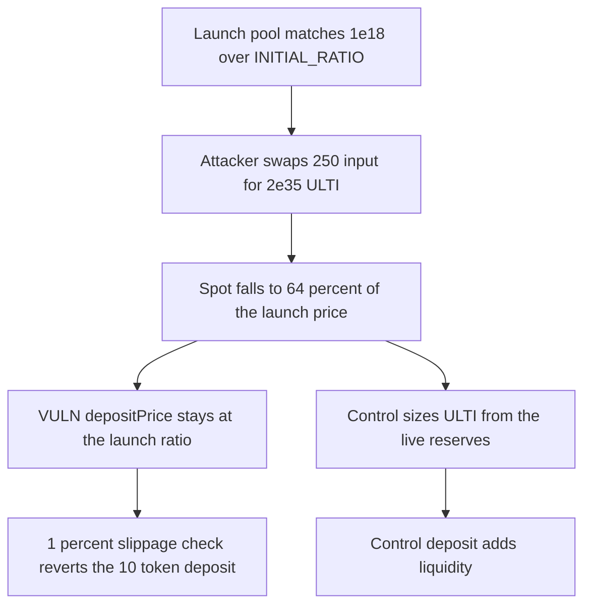

# ULTI: a fixed early-bird price reverts deposits after a 250 token swap

> **Vulnerability classes:** `vuln/logic/price-calculation` · `vuln/defi/slippage`

<!-- non-defihacklabs -->
<!-- source-auditvault: https://github.com/Auditware/AuditVault/blob/main/findings/43914-h-03-dos-on-deposits-during-the-early-bird-period-pashov-aud.md -->
<!-- date: 2024-11 -->

## Key info

| Field | Value |
|---|---|
| **Loss** | Deposits revert for the early-bird day. The swap extracts 2e35 ULTI and the 10 token deposit is refused |
| **Vulnerable contract** | `Ulti.deposit` |
| **Attacker EOA** | `0x1111111111111111111111111111111111111111` |
| **Attack contract** | `Exploit` |
| **Attack tx** | `Exploit.run()` |
| **Chain / block / date** | Ethereum model · block 0 · 2024-11 |
| **Compiler** | solc 0.8.27, cancun, via IR |
| **Bug class** | `depositPrice` stays `1e18 / INITIAL_RATIO` while spot moves past the 1 percent slippage band |

## TL;DR

For one day after launch, `deposit` sizes the ULTI added as liquidity from `1e18 / INITIAL_RATIO` instead of the pool spot. `INITIAL_RATIO` is 1e15, so the price is 1000 and the launch pool matches it. A 250 token swap then pays the caller 2e35 ULTI and drops spot to 64 percent of that price. The 1 percent `MAX_ADD_LP_SLIPPAGE_BPS` check reverts the following 10 token deposit, and those input tokens are not taken. Pricing the same deposit from the live reserves lets it add liquidity.

## Background

Pashov Audit Group's November 2024 ULTI review, published 11 December 2024. During `EARLY_BIRD_PRICE_DURATION` the deposit price is the initial pool ratio. Liquidity adds revert when desired amounts differ from spot by more than `MAX_ADD_LP_SLIPPAGE_BPS`.

## The vulnerable code

```solidity
// @> VULN: early-bird depositPrice is the launch ratio, so a moved spot fails the slippage check
uint256 depositPrice = 1e18 / INITIAL_RATIO;
if (block.timestamp >= launchTimestamp + EARLY_BIRD_PRICE_DURATION) {
    depositPrice = pool.spotUltiPerInput() / 1e18;
}
```

`ultiForLP` is `inputTokenForLP * 1e18 / depositPrice`. After the swap the pool's ULTI-per-input is no longer that fixed ratio, so `addLiquidity` hits `Price slippage check`.

## Root cause

The early-bird branch ignores reserves. The slippage check still compares the resulting ULTI amount with the live pool, so any spot move beyond 100 bps bricks deposits until the day ends.

## Preconditions

- `launchTimestamp` is this block, so the call is inside the early-bird day. No time warp is required.
- The pool starts at 1000 input and 1e36 ULTI, matching `INITIAL_RATIO`.
- `MAX_ADD_LP_SLIPPAGE_BPS` is 100. The attacker can swap before the deposit.

## Attack walkthrough

1. Spot starts at the launch ratio.
2. Swap 250 input. The pool pays `2e35` ULTI. Spot falls by more than 1 percent.
3. The early-bird check is still true, so `depositPrice` stays 1000.
4. A 10 token deposit is quoted from that fixed price and `addLiquidity` reverts.
5. The caller still holds the 10 input tokens and the 2e35 ULTI from the swap.
6. The control sizes `ultiForLP` from `inputReserve / ultiReserve` and the same deposit adds liquidity.

## Diagrams



## Impact

While the early-bird window is open, a single swap past the slippage band makes `deposit` revert for every caller. The attacker keeps the 2e35 ULTI bought in that swap. Honest deposits cannot enter at the launch price.

## Remediation

During the early-bird window, set `depositPrice` from the pool's current reserves the same way the fixed contract does: `1e18 * inputReserve / ultiReserve`.

## How to reproduce

```bash
cd 43914-h-03-dos-on-deposits-during-the-early-bird-period-pashov-aud_exp
forge test -vv
```

`test_exploit_early_bird_deposit_reverts_after_swap` asserts the deposit call fails, the swap output is `2e35`, and the 10 input tokens stay with the caller. `test_control_spot_price_deposit_succeeds_after_swap` asserts the spot-priced deposit adds liquidity. Captured output is `output.txt`.

## Sources

- AuditVault finding: https://github.com/Auditware/AuditVault/blob/main/findings/43914-h-03-dos-on-deposits-during-the-early-bird-period-pashov-aud.md
- Pashov review: https://github.com/pashov/audits/blob/master/team/md/ULTI-security-review-November.md
