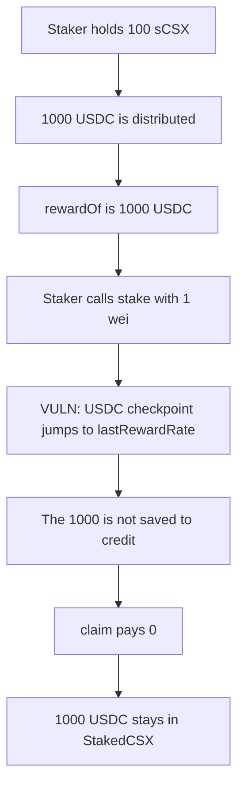

# CSX — a second stake wipes 1,000 USDC of unclaimed rewards

> **Vulnerability classes:** vuln/logic/reward-calculation · vuln/logic/incorrect-state-transition

<!-- non-defihacklabs -->
<!-- source-auditvault: https://github.com/Auditware/AuditVault/blob/main/findings/44005-h-01-unclaimed-user-staking-rewards-are-going-to-get-lost-on.md -->
<!-- date: 2023-11 -->

## Key info

| | |
|---|---|
| **Protocol** | CSX |
| **Finding** | Shieldify CSX security review H-01, AuditVault 44005 |
| **Vulnerable code** | `StakedCSX.stake` |
| **Harm** | Staker loses 1,000 USDC; claim pays 0 |
| **Chain** | local synthetic |

## TL;DR

`stake()` calls `_updateRewardRate` for WETH, USDC, and USDT. That function sets the caller's checkpoint to `lastRewardRate` and does not first save the pending reward into `credit`. The staker is owed 1,000 USDC. Staking 1 more wei of CSX makes `rewardOf` return 0. `claim` pays 0. The 1,000 USDC stays in `StakedCSX`.

## The vulnerable code

```solidity
function stake(uint256 _amount) external {
    if (_amount == 0) {
        revert AmountMustBeGreaterThanZero();
    }
    _updateRewardRate(msg.sender, address(TOKEN_WETH));
    // @> VULN: moves the USDC checkpoint to lastRewardRate and drops the unclaimed reward
    _updateRewardRate(msg.sender, address(TOKEN_USDC));
    _updateRewardRate(msg.sender, address(TOKEN_USDT));
    _mint(msg.sender, _amount);
    TOKEN_CSX.transferFrom(msg.sender, address(this), _amount);
}

function _updateRewardRate(address _to, address _token) private {
    rewardRate[_token][_to] = lastRewardRate[_token];
}
```

`unStake` calls `_claimToCredit` first, which writes the pending amount into `credit` and only then moves the checkpoint. `stake` skips that step. The index gap `lastRewardRate - rewardRate` becomes 0, and nothing is stored in its place.

The control calls `_claimToCredit` at the start of `stake`. The same second stake keeps the 1,000 USDC in `credit`, and `claim` pays it to the staker.

## Root cause

Pending rewards are `balance * (lastRewardRate - rewardRate) / 1e33`, plus `credit`. `_updateRewardRate` assigns `rewardRate = lastRewardRate`. Without a prior write to `credit`, the difference that was the user's reward is discarded. The global index still accounts for the USDC, so the tokens remain in the contract, but this user can no longer claim them.

## Preconditions

The user already has an sCSX balance and an older USDC checkpoint. A dividend has been distributed, so `lastRewardRate` is ahead of that checkpoint. The user then calls `stake` again. Here the first stake is 100 CSX, the dividend is 1,000 USDC, and the second stake is 1 wei.

## Attack walkthrough

1. 1,000 USDC is deposited and distributed. `lastRewardRate` for USDC increases. The staker's checkpoint stays at the pre-dividend value.
2. `rewardOf` is 1,000 USDC. That is `100e18 * indexGap / 1e33`.
3. The staker calls `stake(1)`.
4. `_updateRewardRate` for USDC sets the checkpoint equal to `lastRewardRate`. The 1,000 is not copied into `credit`.
5. `rewardOf` is now 0. `claim` pays 0.
6. The staker's USDC balance is 0. `StakedCSX` still holds the 1,000 USDC.

The control stakes again only after `_claimToCredit`. `rewardOf` is still 1,000 USDC, `claim` transfers 1,000 USDC to the staker, and the staking contract's USDC balance ends at 0.

## Diagrams



## Impact

The staker loses 1,000 USDC of rewards that had already been distributed to their balance. The tokens are not paid to anyone else by this call. They sit in `StakedCSX` with this user's claim at 0. Every later `stake` repeats the wipe for whatever has accrued since the previous checkpoint. WETH and USDT use the same three calls, so a dividend in those tokens is wiped the same way.

## Remediation

Replace the three `_updateRewardRate` calls in `stake` with `_claimToCredit(msg.sender)`. That writes the pending WETH, USDC, and USDT into `credit` and only then advances the checkpoints, which is what `unStake` already does.

## How to reproduce

```bash
cd 44005-h-01-unclaimed-user-staking-rewards-are-going-to-get-lost-on_exp
forge test -vv
```

## Sources

- AuditVault finding: https://github.com/Auditware/AuditVault/blob/main/findings/44005-h-01-unclaimed-user-staking-rewards-are-going-to-get-lost-on.md
- Shieldify report: https://github.com/shieldify-security/audits-portfolio-md/blob/main/CSX-Security-Review.md
- Vulnerable function: https://github.com/csx-protocol/csx-contracts/blob/4a066ae2229756518bfa3da1455c2ac646523a88/contracts/CSX/StakedCSX.sol#L92-L94
