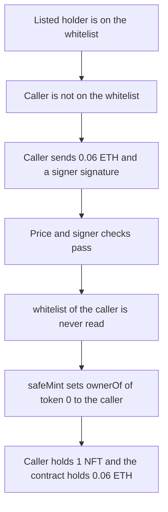

# RunaAGI — FCFSMint does not check the whitelist

> **Vulnerability classes:** vuln/access-control/missing-auth · vuln/logic/missing-check

<!-- non-defihacklabs -->
<!-- source-auditvault: https://github.com/Auditware/AuditVault/blob/main/findings/44183-h-02-fcfsmint-can-be-called-by-anyone-not-only-by-whiteliste.md -->
<!-- date: 2024-04 -->

## Key info

| | |
|---|---|
| **Protocol** | Vallarok (RunaAGI) |
| **Finding** | Shieldify H-02, AuditVault 44183 |
| **Vulnerable code** | `RunaAGI.FCFSMint` |
| **Harm** | A wallet that is not on the whitelist receives NFT 0 and pays only 0.06 ETH, the public sale price |
| **Chain** | local synthetic |

## TL;DR

The project readme says the FCFS phase is two extra NFTs for every whitelisted wallet. `FCFSMint` checks that minting is active, that supply remains, that `msg.value` is `salePrice` (0.06 ETH), that this sender is under the per-wallet limit of 2, and that a project signer signed `(msg.sender, salt)`. It never reads `whitelist[msg.sender]`. A caller who is not on the list, and who has a signer signature, is minted NFT 0. The contract's ETH balance increases by exactly 0.06 ETH. Adding `require(whitelist[msg.sender])` makes the same call revert, and no ETH is taken.

## The vulnerable code

```solidity
function FCFSMint(uint256 _salt, bytes32 _msgHash, bytes memory _signature) external payable {
    require(isFCFSMintingActive, "FCFS minting is not active");
    require(saleSupplyMinted + 1 <= saleSupply, "Maximum supply reached");
    require(msg.value == salePrice, "Incorrect ether amount");
    require(fcfsMinted[msg.sender] + 1 <= 2, "Limit reached");

    bytes32 msgHash = keccak256(abi.encodePacked(msg.sender, _salt));
    bytes32 signedMsgHash = msgHash.toEthSignedMessageHash();

    require(signedMsgHash == _msgHash, "Invalid message hash!");
    require(_msgHash.recover(_signature) == signer, "Invalid signer!");
    signatures[_signature] = true;

    // @> VULN: no whitelist[msg.sender] check. A wallet that is not on the whitelist still receives the NFT and pays only salePrice.
    _safeMint(msg.sender, tokenIdCounter);
    tokenIdCounter++;
    totalSupply++;
    saleSupplyMinted++;
    fcfsMinted[msg.sender] += 1;
}
```

`salePrice` is 0.06 ETH. `whitelist[listed]` is true. `whitelist[caller]` is false. The fixed function adds `require(whitelist[msg.sender], "not whitelisted")` before the mint.

## Root cause

FCFS was specified as an extra allocation for wallets already on the whitelist. The function enforces a signature and a price, and treats those as if they were the whitelist. The boolean mapping that actually records the list is never read on this path, so any address the signer will sign for can mint.

## Preconditions

FCFS minting is active. `saleSupply` is above `saleSupplyMinted`. The caller is a contract or an EOA that is not in `whitelist`, and the project signer has signed `keccak256(abi.encodePacked(caller, salt))` with the ethereum signed-message prefix. The caller sends exactly 0.06 ETH. No whitelist role is required.

## Attack walkthrough

1. A listed holder has `whitelist[holder] == true`. The caller has `whitelist[caller] == false`.
2. The caller sends 0.06 ETH to `FCFSMint` with salt 1 and the signer's signature over `(caller, 1)`.
3. The price check passes. The per-wallet counter is 0, so `fcfsMinted + 1 <= 2` passes. The recovered signer matches.
4. Nothing between the signer check and `_safeMint` reads `whitelist`.
5. `_safeMint` sets `ownerOf(0)` to the caller and `balanceOf(caller)` to 1. The contract now holds 0.06 ETH. `fcfsMinted[caller]` is 1.

The control is the same signature, the same 0.06 ETH, and the same non-whitelisted caller, plus `require(whitelist[msg.sender])`. The call reverts with `not whitelisted`. `balanceOf` stays 0 and the contract's ETH balance stays 0.

## Diagrams



## Impact

A wallet that was not allocated an FCFS spot receives NFT 0. It pays 0.06 ETH, which is `salePrice`, and nothing more. `ownerOf(0)` is that wallet, `balanceOf` is 1, and `fcfsMinted` for it is 1. The whitelisted holder is unchanged. The fixed function reverts for this caller before the mint and before the ETH is kept.

## Remediation

Add `require(whitelist[msg.sender], "not whitelisted")` to `FCFSMint`, as the report asked. The signature can stay as a second check. The control uses that require and the non-whitelisted call reverts.

## How to reproduce

```bash
cd 44183-h-02-fcfsmint-can-be-called-by-anyone-not-only-by-whiteliste_exp
forge test -vv
```

## Sources

- AuditVault finding: https://github.com/Auditware/AuditVault/blob/main/findings/44183-h-02-fcfsmint-can-be-called-by-anyone-not-only-by-whiteliste.md
- Shieldify report: https://github.com/shieldify-security/audits-portfolio-md/blob/main/Vallarok-Security-Review.md
- Audited file: https://github.com/purple-banana/contract-runa/blob/7153c2ffbf3a5e958af921f0ab92e20c5035d9bf/contracts/RunaAGI.sol#L135 (commit 7153c2ff, report dated 2024-04)
