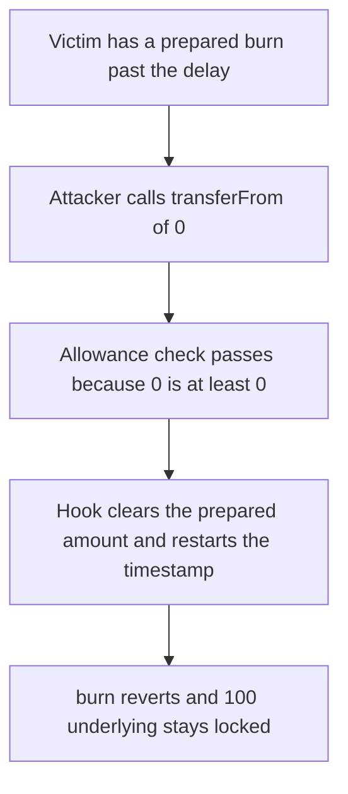

# Teller — a zero-value transferFrom clears a lender's prepared share burn

> **Vulnerability classes:** `vuln/dos/griefing` · `vuln/dos/frozen-funds`

> **Reproduction:** a self-contained Foundry PoC that compiles and runs offline
> with only `forge-std` — no fork and no RPC. Trace: [output.txt](output.txt).
> PoC: [test/44213-h-1-lender-group-members-can-be-prevented-from-burning-their_exp.sol](test/44213-h-1-lender-group-members-can-be-prevented-from-burning-their_exp.sol).

<!-- non-defihacklabs -->
<!-- source-auditvault: https://github.com/Auditware/AuditVault/blob/main/findings/44213-h-1-lender-group-members-can-be-prevented-from-burning-their.md -->
<!-- date: 2024-11 -->

---

## Key info

| | |
|---|---|
| **Impact** | **HIGH** — a prepared withdrawal of **100** underlying reverts, and the tokens stay in the group |
| **Protocol** | Teller `LenderCommitmentGroupShares._afterTokenTransfer` |
| **Vulnerable code** | the hook clears the prepared burn even when `amount` is 0 |
| **Bug class** | ERC-20 4.8 `transferFrom(0)` resets the withdrawal delay |
| **Finding** | Sherlock #24 — Teller lender groups, November 2024 · id 44213 |
| **Report** | [Sherlock issue 24](https://github.com/sherlock-audit/2024-11-teller-finance-update-judging/issues/24) |
| **Source** | [AuditVault finding](https://github.com/Auditware/AuditVault/blob/main/findings/44213-h-1-lender-group-members-can-be-prevented-from-burning-their.md) |
| **Compiler** | solc 0.8.27, cancun, via IR |

---

## TL;DR

Lender group shares cannot be burned until `prepareSharesForBurn` has aged past `withdrawDelay`. Any transfer of those shares calls `_afterTokenTransfer`, which zeroes the prepared amount and stamps `block.timestamp`.

OpenZeppelin ERC-20 4.8 allows `transferFrom(from, to, 0)` with a zero allowance: `0 >= 0` passes, and the hook still runs. No shares move. The victim's burn then reverts with "Shares not prepared for withdraw", and 100 underlying stays in the contract.

The victim's prepare is stored with timestamp 0 so this block stands in for a delay that already elapsed. Repeating the 0-transfer each time the victim prepares again keeps the funds locked. The fixed hook rejects `amount == 0`, and the burn then pays the 100 underlying.

## The vulnerable code

```solidity
function _afterTokenTransfer(address from, address, uint256) internal {
    poolSharesPreparedToWithdrawForLender[from] = 0;
    poolSharesPreparedTimestamp[from] = block.timestamp; // @> VULN: amount 0 still restarts the delay
}
```

```diff
 function _afterTokenTransfer(address from, address, uint256 amount) internal {
+    if (amount == 0) return;
     poolSharesPreparedToWithdrawForLender[from] = 0;
     poolSharesPreparedTimestamp[from] = block.timestamp;
 }
```

## Attack walkthrough

1. The victim has 100 shares prepared, and the timestamp is already older than the delay. The group holds 100 underlying. The attacker has no allowance.
2. The attacker calls `transferFrom(victim, victim, 0)`. The allowance check passes.
3. The hook sets the prepared amount to 0 and the timestamp to now.
4. `burn` reverts. The victim's underlying balance stays 0. The group still holds 100.

## Diagrams



## Impact

Any lender who has prepared a withdrawal can be reset by an unprivileged caller, forever, at the cost of a zero-value transfer. The underlying they were about to receive stays in the group. In this run that is 100 tokens.

## Sources

- [AuditVault 44213](https://github.com/Auditware/AuditVault/blob/main/findings/44213-h-1-lender-group-members-can-be-prevented-from-burning-their.md)
- [Sherlock judging issue 24](https://github.com/sherlock-audit/2024-11-teller-finance-update-judging/issues/24)
- [Contest repo](https://github.com/sherlock-audit/2024-11-teller-finance-update) — `LenderCommitmentGroupShares._afterTokenTransfer`
