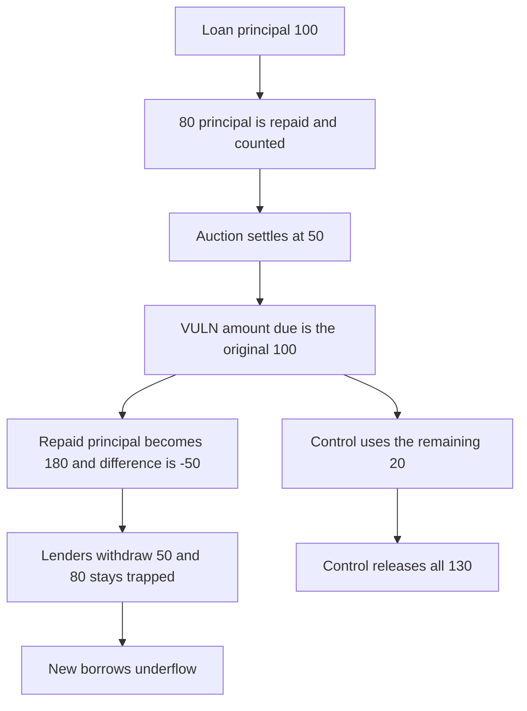

# Teller: liquidation books the original principal after part of it was repaid

> **Vulnerability classes:** `vuln/logic/state-update`

<!-- non-defihacklabs -->
<!-- source-auditvault: https://github.com/Auditware/AuditVault/blob/main/findings/44215-h-3-using-original-principal-amount-as-due-amount-inside-liq.md -->
<!-- date: 2024-11 -->

## Key info

| Field | Value |
|---|---|
| **Loss** | 80 tokens stay trapped. Lenders can withdraw 50 of the 130 held, and new borrows underflow |
| **Vulnerable contract** | `LenderGroup._getAmountOwedForBid` |
| **Attacker EOA** | `0x1111111111111111111111111111111111111111` |
| **Attack contract** | `Exploit` |
| **Attack tx** | `Exploit.run()` |
| **Chain / block / date** | Ethereum model · block 0 · 2024-11 |
| **Compiler** | solc 0.8.27, cancun |
| **Bug class** | amount due is the original principal, not the remainder |

## TL;DR

A loan of 100 is repaid by 80 and then auctioned at 50. `liquidateDefaultedLoanWithIncentive` reads the original principal, 100, as the amount still due. That 100 is added to `totalPrincipalTokensRepaid`, which was already 80, and the liquidation difference is `50 - 100 = -50`. Withdrawable value is `100 + (-50) = 50` while the contract holds 130. The 80 that accounting will not release stays in the group, and `100 - 180` underflows so no new borrow can be opened.

## The vulnerable code

```solidity
function _getAmountOwedForBid(uint256 bidId) internal view returns (uint256 amountDue) {
    amountDue = principal[bidId]; // @> VULN: original principal, not principal minus repaidPrincipal
}
```

Use the remaining principal, `principal[bidId] - repaidPrincipal[bidId]`. On these numbers that is 20. Difference becomes `50 - 20 = +30`, withdrawable becomes 130, and repaid principal ends at 100.

## Root cause

`repayLoanCallback` already added the 80 to `totalPrincipalTokensRepaid`. Liquidation adds the original 100 again because `_getAmountOwedForBid` ignores `repaidPrincipal`. The difference is also taken from the original principal, so the pool looks 50 short instead of 30 ahead.

## Preconditions

- Principal, committed, and lended are 100. Repaid is 0. The contract holds no tokens yet.
- A repayment of 80 arrives and is counted.
- The auction settles at 50, which is pulled into the contract.

## Attack walkthrough

1. `openLoan` records principal 100.
2. `repayLoanCallback` adds 80 to repaid principal and pulls 80 tokens in.
3. Liquidation reads amount due as 100, not 20.
4. It adds 100 to repaid principal, now 180, and sets the difference to -50.
5. `availableToWithdraw` is 50. The withdrawal pays 50 and leaves 80.
6. `getPrincipalAmountAvailableToBorrow` computes `100 - 180` and reverts.
7. The control, using the remaining 20, releases all 130.

## Diagrams



## Impact

Lenders can take only 50 of the 130 tokens the group holds after this repay-and-liquidate. 80 is trapped by the withdraw cap. `totalPrincipalTokensLended - totalPrincipalTokensRepaid` underflows, so the group cannot accept another bid. The report's same root cause also breaks share pricing when the estimated value hits zero.

## How to reproduce

```bash
cd 44215-h-3-using-original-principal-amount-as-due-amount-inside-liq_exp
forge test -vv
```

`output.txt` is the captured passing run. The control test checks the recommended fix.

## Sources

- AuditVault finding: https://github.com/Auditware/AuditVault/blob/main/findings/44215-h-3-using-original-principal-amount-as-due-amount-inside-liq.md
- Report: https://github.com/sherlock-audit/2024-11-teller-finance-update-judging/issues/43
- Provenance: Sherlock Teller Finance update, November 2024, issue 43, found by 0xeix and hash. LenderCommitmentGroup_Smart.liquidateDefaultedLoanWithIncentive and _getAmountOwedForBid.
