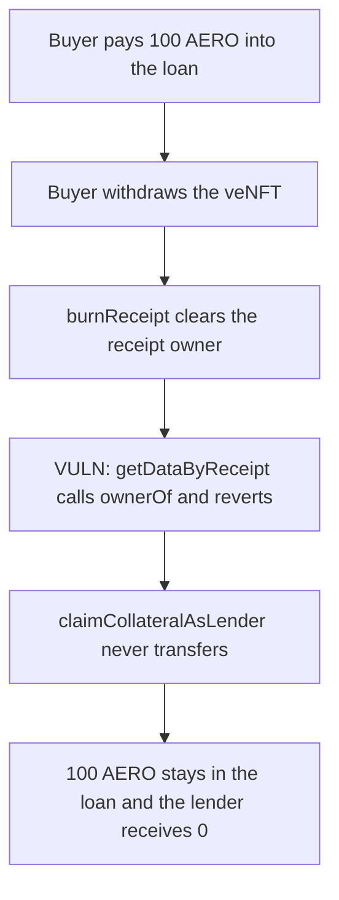

# Debita: burning the veNFT receipt locks 100 AERO that lenders are supposed to claim

> **Vulnerability classes:** vuln/dos/frozen-funds · vuln/logic/missing-check

<!-- non-defihacklabs -->
<!-- source-auditvault: https://github.com/Auditware/AuditVault/blob/main/findings/44224-h-1-lenders-and-borrowers-can-not-claim-liquidation-token-af.md -->
<!-- date: 2024-10 -->

## Key info

| Field | Value |
|---|---|
| **Loss** | 100 AERO of auction proceeds stay in the loan. The lender's balance stays 0 |
| **Vulnerable contract** | `Receipt.getDataByReceipt` |
| **Attacker EOA** | `0x0000000000000000000000000000000000442241` (the auction buyer) |
| **Attack contract** | `Exploit` |
| **Attack tx** | `Exploit.run()` |
| **Chain / block / date** | Ethereum model · block 0 · 2024-10 |
| **Compiler** | solc 0.8.27, cancun, via IR |
| **Bug class** | `ownerOf` on a burned receipt reverts the liquidation claim |

## TL;DR

`claimCollateralAsLender` reads the liquidation token's decimals through `getDataByReceipt`. That view calls `ownerOf`. After the auction buyer withdraws the veNFT, `burnReceipt` destroys the receipt and `ownerOf` reverts with `ERC721NonexistentToken`. The 100 AERO the buyer paid never reaches the lender. Reading decimals from the token, without `ownerOf`, pays the lender in full.

## Background

Sherlock's Debita Finance V3 contest, issue 156 (H-1), reported by 0xc0ffEE. The judging write-up is in `2024-10-debita-judging`. The auction buyer becomes the receipt holder, then `veNFTVault.withdraw` burns the receipt before lenders or the borrower claim.

## The vulnerable code

```solidity
uint256 _decimals = token.decimals();
address manager = vaultContract.managerAddress();
// @> VULN: ownerOf reverts after burnReceipt, and claim only needed the decimals
address currentOwnerOfReceipt = ownerOf(receiptID);
```

`ownerOf` reverts when the stored owner is the zero address. `burnReceipt` writes that zero.

## Root cause

The claim path needs `decimals` and does not need the current receipt owner. `getDataByReceipt` still calls `ownerOf`, so a burned receipt makes every later claim revert. The liquidation balance is left in the loan.

## Preconditions

- The buyer holds receipt id 1 and the vault still has the NFT attached.
- The buyer pays 100 AERO into the loan as the auction proceeds.
- The buyer then calls `withdraw`, which burns the receipt.

## Attack walkthrough

1. `buyAuction` pulls 100 AERO into the loan and records it as the claimable liquidation.
2. `withdraw` checks the buyer still owns the receipt, clears `attached_NFTID`, and calls `burnReceipt`.
3. `claimCollateralAsLender` enters `getDataByReceipt` and reverts on `ownerOf`.
4. The caught revert leaves the 100 AERO in the loan. The lender's balance is 0.
5. The control reads `decimals` from the token and transfers the 100 AERO to the lender.

## Diagrams


