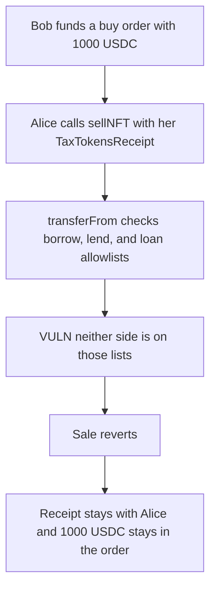

# Debita: TaxTokensReceipt cannot be sold into a buy order

> **Vulnerability classes:** `vuln/access-control/broken-logic` · `vuln/logic/wrong-condition`

<!-- non-defihacklabs -->
<!-- source-auditvault: https://github.com/Auditware/AuditVault/blob/main/findings/44227-h-4-no-one-can-sell-taxtokensreceipts-nft-receipt-to-the-buy.md -->
<!-- date: 2024-11 -->

## Key info

| Field | Value |
|---|---|
| **Loss** | Alice cannot sell receipt 1. Bob's 1000 USDC stays in the buy order |
| **Vulnerable contract** | `TaxTokensReceipt.transferFrom` |
| **Attacker EOA** | `0x1111111111111111111111111111111111111111` |
| **Attack contract** | `Exploit` |
| **Attack tx** | `Exploit.run()` |
| **Chain / block / date** | Ethereum model · block 0 · 2024-11 |
| **Compiler** | solc 0.8.27, cancun, via IR |
| **Bug class** | allowlist omits buy orders |

## TL;DR

`sellNFT` transfers the wanted receipt into the buy order. `TaxTokensReceipt.transferFrom` reverts unless `from` or `to` is a borrow order, a lend order, or a loan. A buy order is none of those. Alice's sale reverts, she is paid 0, and the 1000 USDC Bob escrowed never moves.

## The vulnerable code

```solidity
bool isReceiverAddressDebita = registry.isBorrowOrderLegit(to)
    || registry.isLendOrderLegit(to)
    || registry.isSenderALoan(to);
bool isSenderAddressDebita = registry.isBorrowOrderLegit(from)
    || registry.isLendOrderLegit(from)
    || registry.isSenderALoan(from);
require(
    isReceiverAddressDebita || isSenderAddressDebita,
    "TaxTokensReceipts: Debita not involved"
); // @> VULN
```

The recommended fix also accepts `isBuyOrderLegit` on both sides.

## Root cause

The transfer override was written for the three contracts that already move receipts. Buy orders were added later and were not added to the same allowlist. `sellNFT` has no other way to take the NFT.

## Preconditions

- Alice owns a `TaxTokensReceipt`.
- A buy order for that receipt is active and holds 1000 USDC.
- Alice is not herself a loan, borrow order, or lend order.

## Attack walkthrough

1. Mint receipt 1 to Alice and fund the buy order with 1000 USDC.
2. Mark unrelated borrow, lend, and loan addresses so the allowlist is non-empty.
3. Alice calls `sellNFT(1)`.
4. `transferFrom` reverts with `TaxTokensReceipts: Debita not involved`.
5. The receipt owner is still Alice. Her USDC balance is 0. The order still holds 1000.

## Diagrams



## Impact

The limit-order path for this receipt cannot be used. Buyers who escrowed USDC against a TaxTokensReceipt cannot be filled. A control that marks the seller as a loan pays Alice the 1000 and moves the receipt, which is the transfer the buy-order allowlist was supposed to permit.

## Remediation

Treat a legitimate buy order as a Debita counterparty in both the sender and receiver checks, matching the patch in the Sherlock issue.

## How to reproduce

```bash
cd 44227-h-4-no-one-can-sell-taxtokensreceipts-nft-receipt-to-the-buy_exp
forge test -vv
```

## Sources

- AuditVault finding: https://github.com/Auditware/AuditVault/blob/main/findings/44227-h-4-no-one-can-sell-taxtokensreceipts-nft-receipt-to-the-buy.md
- Sherlock issue 560: https://github.com/sherlock-audit/2024-10-debita-judging/issues/560
- Receipt: https://github.com/sherlock-audit/2024-11-debita-finance-v3/blob/main/Debita-V3-Contracts/contracts/Non-Fungible-Receipts/TaxTokensReceipts/TaxTokensReceipt.sol#L98
- Buy order: https://github.com/sherlock-audit/2024-11-debita-finance-v3/blob/main/Debita-V3-Contracts/contracts/buyOrders/buyOrder.sol#L99
