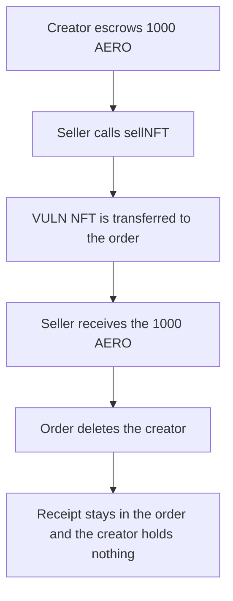

# Debita: a filled buy order never delivers the NFT to its creator

> **Vulnerability classes:** `vuln/logic/incorrect-state-transition` · `vuln/logic/missing-check`

<!-- non-defihacklabs -->
<!-- source-auditvault: https://github.com/Auditware/AuditVault/blob/main/findings/44228-h-5-after-the-buyorder-is-completed-the-order-creator-does-n.md -->
<!-- date: 2024-11 -->

## Key info

| Field | Value |
|---|---|
| **Loss** | Creator paid 1000 AERO. The receipt NFT is owned by the buy-order contract |
| **Vulnerable contract** | `BuyOrder.sellNFT` |
| **Attacker EOA** | `0x1111111111111111111111111111111111111111` |
| **Attack contract** | `Exploit` |
| **Attack tx** | `Exploit.run()` |
| **Chain / block / date** | Ethereum model · block 0 · 2024-11 |
| **Compiler** | solc 0.8.27, cancun |
| **Bug class** | NFT is transferred to the order and the order is then deleted |

## TL;DR

The creator escrows 1000 AERO in a buy order. The seller calls `sellNFT`. The receipt is transferred to the order contract, the seller receives the AERO, and the order deletes `creator`. Nothing sends the NFT to the person who paid. `ownerOf` is the order. The creator's AERO balance is zero.

## Background

Sherlock's November 2024 Debita Finance V3 contest, issue 890, reported by newspacexyz and many others. `sellNFT` in `buyOrder.sol` at commit `1465ba6` transfers the NFT to the order. The order emits and deletes the order. It does not transfer the NFT to the creator. The report's fork test logs the owner changing from the seller to the buy-order contract.

## The vulnerable code

```solidity
function sellNFT(uint256 receiptID) external {
    require(active, "no order");
    nft.transferFrom(msg.sender, address(this), receiptID); // @> VULN: NFT is delivered to the order contract, not the creator
    // FIX: nft.transferFrom(msg.sender, creator, receiptID);
    aero.transfer(msg.sender, price);
    active = false;
    creator = address(0);
    emit OrderFilled(receiptID);
}
```

`sellNFTFixed` captures `creator` before the delete and transfers the NFT there. The control test asserts that owner.

## Root cause

The fill pays the seller and then forgets the buyer. The NFT's destination is `address(this)`, and the only stored buyer is cleared in the same function. There is no later withdrawal.

## Preconditions

- The creator has opened a buy order and escrowed 1000 AERO.
- The seller owns receipt id 1 and has approved the order.

## Attack walkthrough

1. The creator approves and calls `createBuyOrder`. Their AERO balance becomes zero and the order records them.
2. The seller calls `sellNFT(1)`.
3. `transferFrom` moves the NFT to the order.
4. The order pays 1000 AERO to the seller.
5. `creator` is set to the zero address and `active` is cleared.
6. `ownerOf(1)` is the order. The creator still has no AERO and no NFT.

## Diagrams



## Impact

The creator paid 1000 AERO for a receipt they do not own. The seller was paid. The NFT is stuck in a contract whose order record has been deleted, so the buyer cannot claim it. That is the loss the report states: the buy-order creator loses the NFT.

## Remediation

Transfer the NFT to `creator` before clearing the order. The control path does that and the creator becomes `ownerOf`.

## How to reproduce

```bash
cd 44228-h-5-after-the-buyorder-is-completed-the-order-creator-does-n_exp
forge test -vv
```

`test_creator_does_not_receive_nft` asserts the order owns the NFT, the seller holds 1000 AERO, and the creator holds zero. `test_control_fixed_delivers_nft_to_creator` asserts the fixed transfer. Captured output is `output.txt`.

## Sources

- AuditVault finding: https://github.com/Auditware/AuditVault/blob/main/findings/44228-h-5-after-the-buyorder-is-completed-the-order-creator-does-n.md
- Sherlock issue 890: https://github.com/sherlock-audit/2024-10-debita-judging/issues/890
- Blamed lines: https://github.com/sherlock-audit/2024-11-debita-finance-v3/blob/1465ba6884c4cc44f7fc28e51f792db346ab1e33/Debita-V3-Contracts/contracts/buyOrders/buyOrder.sol#L99
