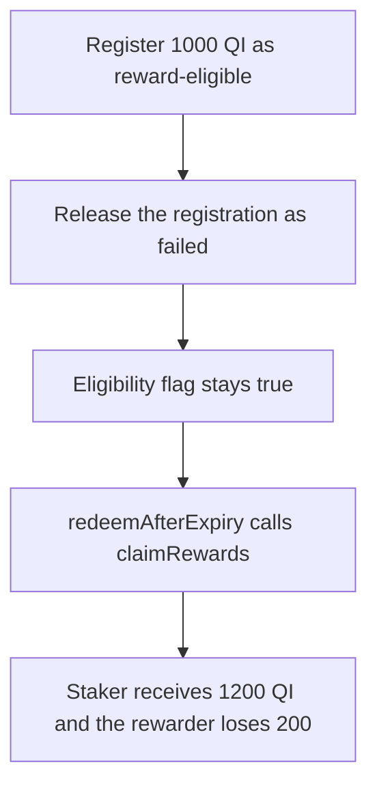

# BENQI Ignite: a failed QI registration still draws ValidatorRewarder funds

> **Vulnerability classes:** `vuln/logic/reward-calculation` · `vuln/logic/missing-check`

<!-- non-defihacklabs -->
<!-- source-auditvault: https://github.com/Auditware/AuditVault/blob/main/findings/44251-zeeve-admin-could-drain-validatorrewarder-by-abusing-off-cha.md -->
<!-- date: 2024-12 -->

## Key info

| Field | Value |
|---|---|
| **Loss** | 200 QI taken from ValidatorRewarder for a registration that failed |
| **Vulnerable contract** | `Ignite.redeemAfterExpiry` |
| **Attacker EOA** | `0x1111111111111111111111111111111111111111` |
| **Attack contract** | `Exploit` |
| **Attack tx** | `Exploit.run()` |
| **Chain / block / date** | Local synthetic · 2024-12 |
| **Compiler** | solc 0.8.27, cancun, via IR |
| **Bug class** | releaseLockedTokens leaves qiRewardEligibility set |

## TL;DR

`registerWithPrevalidatedQiStake` marks the node QI-reward eligible. `releaseLockedTokens(failed=true)` stores the failure and does not clear that flag. `redeemAfterExpiry` still calls `ValidatorRewarder.claimRewards`. The reduced rewarder pays 20% of the 1000 QI stake, so the staker receives 1200 QI and the rewarder loses 200.

## The vulnerable code

```solidity
function releaseLockedTokens(bytes32 nodeId, bool failed) external {
    require(failed, "failed");
    regs[nodeId].failed = true;
}

function redeemAfterExpiry(bytes32 nodeId) external {
    uint256 qiRedemptionAmount = regs[nodeId].qiAmount;
    if (qiRewardEligibilityByNodeId[nodeId]) {
        qiRedemptionAmount += rewarder.claimRewards(regs[nodeId].duration, regs[nodeId].qiAmount);
    }
    token.transfer(msg.sender, qiRedemptionAmount);
}
```

The failed branch should set `qiRewardEligibilityByNodeId[nodeId] = false`.

## Root cause

Failure and reward eligibility are separate flags, and only the failure flag is written.

## Preconditions

- A prevalidated QI stake of 1000 for the report's node id, with a 28 day duration.
- The Zeeve admin path releases that registration as failed. The rewarder is funded.

## Attack walkthrough

1. The staker registers 1000 QI. The node is marked reward-eligible.
2. `releaseLockedTokens` records failure and leaves eligibility true.
3. `redeemAfterExpiry` calls `claimRewards` because the flag is still set.
4. The staker holds 1200 QI. The rewarder holds 800 QI.

## Diagrams



## Impact

QI rewards are paid for a registration the off-chain BLS check rejected. This run drains 200 QI from ValidatorRewarder on top of the returned stake.

## How to reproduce

```bash
cd 44251-zeeve-admin-could-drain-validatorrewarder-by-abusing-off-cha_exp
forge test -vv
```

## Sources

- AuditVault finding: https://github.com/Auditware/AuditVault/blob/main/findings/44251-zeeve-admin-could-drain-validatorrewarder-by-abusing-off-cha.md
- Blamed function: https://github.com/Benqi-fi/ignite-contracts/blob/bbca0ddb399225f378c1d774fb70a7486e655eea/src/Ignite.sol#L580-L583
