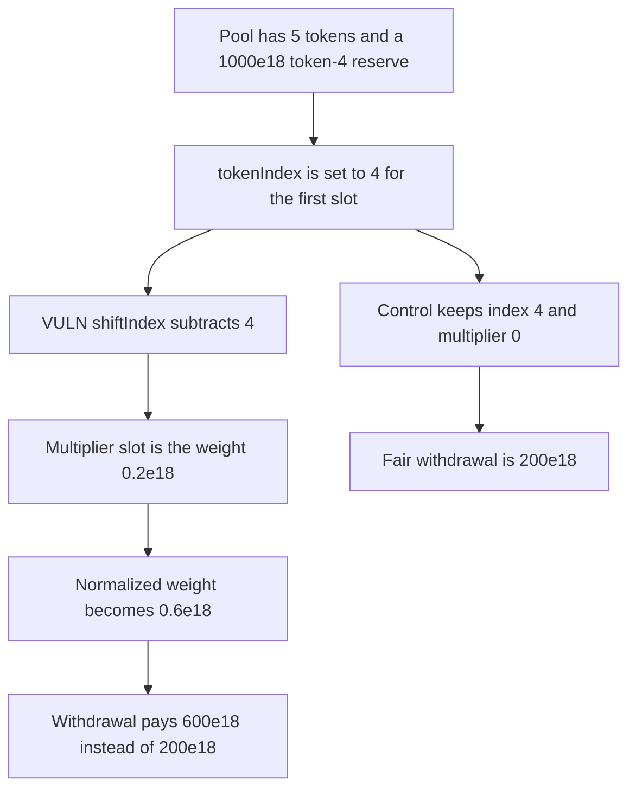

# QuantAMM: tokenIndex minus 4 uses a token weight as its own multiplier

> **Vulnerability classes:** `vuln/logic/wrong-condition`

<!-- non-defihacklabs -->
<!-- source-auditvault: https://github.com/Auditware/AuditVault/blob/main/findings/44295-token-index-error-in-getnormalizedweights-calculates-incorre.md -->
<!-- date: 2024-12 -->

## Key info

| Field | Value |
|---|---|
| **Loss** | A withdrawal pays 600e18 of token 4 instead of the fair 200e18. LPs keep 400e18 instead of 800e18 |
| **Vulnerable contract** | `QuantAMMWeightedPool._getNormalizedWeights` |
| **Attacker EOA** | `0x1111111111111111111111111111111111111111` |
| **Attack contract** | `Exploit` |
| **Attack tx** | `Exploit.run()` |
| **Chain / block / date** | Ethereum model · block 0 · 2024-12 |
| **Compiler** | solc 0.8.27, cancun |
| **Bug class** | second-slot multiplier index is reset to 0 |

## TL;DR

For a pool with more than 4 tokens, the multiplier for token 4 lives at index 4 of the second weight word. The code subtracts 4 from `tokenIndex` first, so the index is 0 and the weight is passed as the multiplier. With weight `0.2e18`, multiplier wrongly `0.2e18`, and 2 blocks elapsed, the normalized weight is `0.6e18` instead of `0.2e18`. A withdrawal of the 1000e18 reserve pays 600e18.

## The vulnerable code

```solidity
tokenIndex = this.shiftIndex(tokenIndex);
// shiftIndex returns tokenIndex - 4
// @> VULN: multiplier index collapses onto the weight slot
```

Do not subtract 4. The finding's mitigation is to leave `tokenIndex` at 4 so `secondFourWeights[tokenIndex]` is the multiplier.

## Root cause

The first slot correctly sets `tokenIndex = 4` and reads multipliers at indices 4 through 7. The second slot then does `tokenIndex - 4`, which the comment in the report calls out as resetting the index to 0. Weight and multiplier become the same stored value, and `calculateBlockNormalisedWeight` treats a 0.2 wad weight as a per-block multiplier.

## Preconditions

- `nTokens` is 5.
- Token 4 weight is `2e17`. The real multiplier at index 4 is 0.
- Time since the last update is fixed at 2 so the result does not depend on the chain clock.
- The pool reserve of token 4 is `1000e18`.

## Attack walkthrough

1. `withdrawToken4` loads normalized weights.
2. `shiftIndex` returns `4 - 4 = 0`.
3. Token 4 is interpolated with `secondFourWeights[0]`, the weight, as the multiplier.
4. The normalized weight is `6e17`.
5. The pool transfers `600e18`. The fair amount at weight `2e17` is `200e18`.
6. The pool is left holding `400e18`.

## Diagrams



## Impact

LPs of token 4 lose `400e18` on this withdrawal: the caller receives 600 where a correct weight pays 200, and 400 remains in the pool instead of 800. Every later swap or join that reads normalized weight 4 is priced off the same wrong index.

## How to reproduce

```bash
cd 44295-token-index-error-in-getnormalizedweights-calculates-incorre_exp
forge test -vv
```

`output.txt` is the captured passing run. The control test checks the recommended fix.

## Sources

- AuditVault finding: https://github.com/Auditware/AuditVault/blob/main/findings/44295-token-index-error-in-getnormalizedweights-calculates-incorre.md
- Report: https://github.com/solodit/solodit_content/blob/main/reports/Cyfrin/2024-12-17-cyfrin-quantamm-v1.2.md
- Provenance: Cyfrin QuantAMM v1.2, 2024-12-17, 0kage. Fixed in QuantAMMProtocol/QuantAMM-V1 commit 60815f2. Vulnerable indexing is in QuantAMMWeightedPool._getNormalizedWeights.
