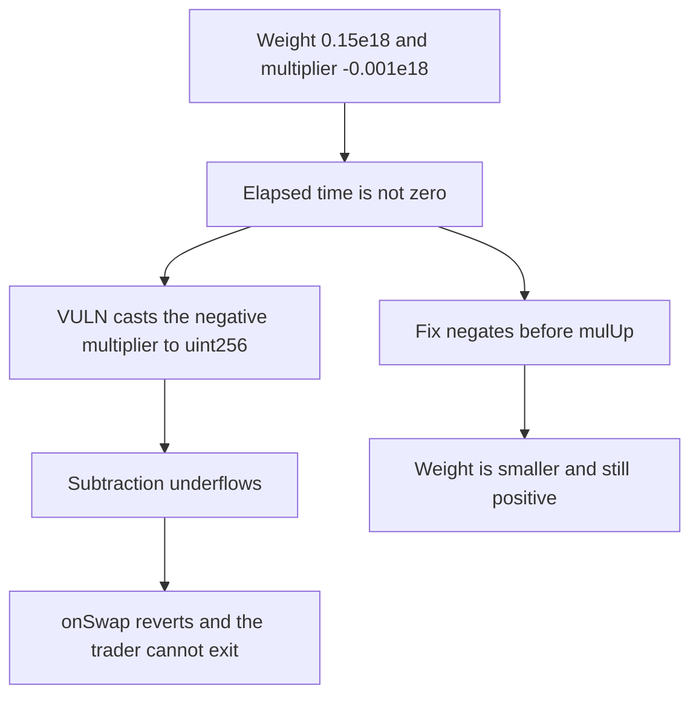

# QuantAMM: a negative weight multiplier underflows and the swap reverts

> **Vulnerability classes:** `vuln/arithmetic/underflow` · `vuln/logic/price-calculation`

<!-- non-defihacklabs -->
<!-- source-auditvault: https://github.com/Auditware/AuditVault/blob/main/findings/44296-incorrect-handling-of-negative-multipliers-in-quantammweight.md -->
<!-- date: 2024-12 -->

## Key info

| Field | Value |
|---|---|
| **Loss** | The swap reverts. No trader can exit through the negative-multiplier weight |
| **Vulnerable contract** | `QuantAMMWeightedPool.calculateBlockNormalisedWeight` |
| **Attacker EOA** | `0x1111111111111111111111111111111111111111` |
| **Attack contract** | `Exploit` |
| **Attack tx** | `Exploit.run()` |
| **Chain / block / date** | Ethereum model · block 0 · 2024-12 |
| **Compiler** | solc 0.8.27, cancun |
| **Bug class** | Negative int256 cast to uint256 before subtraction |

## TL;DR

`calculateBlockNormalisedWeight` adds a positive multiplier and subtracts a negative one. The negative branch casts the multiplier to `uint256` first. The report's value, `-0.001e18`, becomes a word near `2^256`. Subtracting `mulUp` of that word from the `0.15e18` weight underflows, so `onSwap` reverts whenever `timeSinceLastUpdate` is not zero. Negating before `mulUp` returns a smaller positive weight and the swap can proceed.

## Background

Cyfrin's 17 December 2024 QuantAMM V1.2 review. The function is `QuantAMMWeightedPool.calculateBlockNormalisedWeight` at commit `7213401`, lines 505-521. QuantAMM fixed it in commit `31636cf` by multiplying `uint256(-multiplierScaled18)`. The playground timestamp is `1784893842`, so the elapsed time is not zero. `lastUpdate` stays 0.

## The vulnerable code

```solidity
if (_multiplier > 0) {
    return uint256(_weight) + FixedPoint.mulDown(uint256(multiplierScaled18), timeSinceLastUpdate);
} else {
    return uint256(_weight) - FixedPoint.mulUp(uint256(multiplierScaled18), timeSinceLastUpdate); // @> VULN: uint256(negative) is ~2^256, so this subtraction underflows
    // FIX: return uint256(_weight) - FixedPoint.mulUp(uint256(-multiplierScaled18), timeSinceLastUpdate);
}
```

`FixedPoint.mulUp` is the Balancer round-up. The product is taken in assembly so the huge cast still returns a huge quotient instead of aborting inside the multiply, which is the underflow the report describes on the subtraction.

## Root cause

`uint256(negativeInt)` is not the absolute value. It is the two's-complement bit pattern. The following subtraction is then `weight - enormous` and reverts under checked arithmetic. Every swap that needs this weight reverts with it.

## Preconditions

- The second weight from the report: `0.15e18` with multiplier `-0.001e18`.
- `timeSinceLastUpdate` is not zero. Here `lastUpdate` is 0 and the block timestamp is `1784893842`.

## Attack walkthrough

1. Call `onSwap` for 1 token.
2. The pool loads `block.timestamp - lastUpdate`.
3. The negative branch casts the multiplier and the subtraction reverts.
4. The low-level call returns false. Reserves do not move.
5. `calculateFixed` negates the multiplier first. The resulting weight is below `0.15e18` and still positive.

## Diagrams



## Impact

A swap against the falling weight does not execute. The trader who needs to sell that token cannot. The fixed formula at the same timestamp produces a positive weight below the stored `0.15e18`, which is the update the pool should have applied.

## Remediation

Subtract `FixedPoint.mulUp(uint256(-multiplierScaled18), timeSinceLastUpdate)`, which is the change in commit `31636cf`.

## How to reproduce

```bash
cd 44296-incorrect-handling-of-negative-multipliers-in-quantammweight_exp
forge test -vv
```

The test warps to `1784893842` before `run`. `test_negative_multiplier_reverts_swap` asserts the swap reverted and the fixed weight is strictly below `0.15e18`. Captured output is `output.txt`.

## Sources

- AuditVault finding: https://github.com/Auditware/AuditVault/blob/main/findings/44296-incorrect-handling-of-negative-multipliers-in-quantammweight.md
- Report: https://github.com/solodit/solodit_content/blob/main/reports/Cyfrin/2024-12-17-cyfrin-quantamm-v1.2.md
- Blamed lines: https://github.com/QuantAMMProtocol/QuantAMM-V1/blob/7213401491f6a8fd1fcc1cf4763b15b5da355f1c/pkg/pool-quantamm/contracts/QuantAMMWeightedPool.sol#L505-L521
- Fix: https://github.com/QuantAMMProtocol/QuantAMM-V1/commit/31636cf736e9f6eda09f569bceb4e8d9bd3137bb
