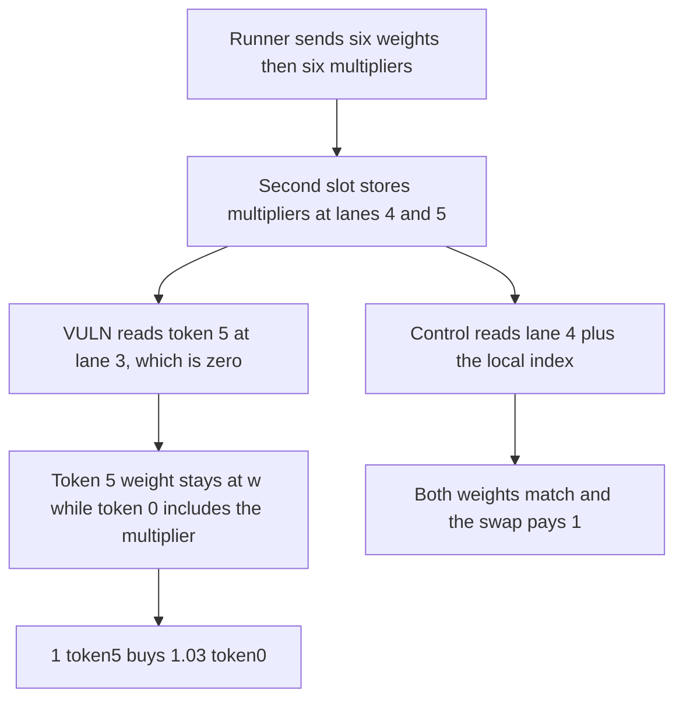

# A six-token QuantAMM swap reads a zero multiplier and pays 1.03 instead of 1

> **Vulnerability classes:** vuln/logic/price-calculation · vuln/logic/state-update

<!-- non-defihacklabs -->
<!-- source-auditvault: https://github.com/Auditware/AuditVault/blob/main/findings/44297-mismatch-in-multiplier-position-causes-incorrect-weight-calc.md -->
<!-- date: 2024-12 -->

## Key info

| Field | Value |
|---|---|
| **Loss** | 0.03 token0 overpaid. 1 token5 in returns 1.03 token0. Equal weights would return 1 |
| **Vulnerable contract** | `WeightedPool.currentWeight` |
| **Attacker EOA** | `0x1111111111111111111111111111111111111111` |
| **Attack contract** | `Exploit` at `0x15452ec016c4dc8c549e7fe6ff4b26324ea8b7a4` |
| **Attack tx** | `Exploit.run()` |
| **Chain / block / date** | Ethereum model · block 0 · 2024-12 |
| **Compiler** | solc 0.8.27, cancun, via IR |
| **Bug class** | Token 5's multiplier is read from padding in the second packed slot |

## TL;DR

`setWeights` for six tokens stores the second slot as `[w5, w6, 0, 0, m5, m6, 0, 0]`. `currentWeight` for token index 5 reads `slot1[1 + (6 - 4)]`, which is lane 3, a zero. After five blocks the multiplier `0.001e18` should have added `0.005e18` to every weight. Token 5 stays at `1e18/6`. Token 0, read from the first slot, includes its multiplier. Selling 1 token5 for token0 pays `1.03` token0. Reading lane `4 + packedIndex`, where `m6` actually sits, pays 1.

## Background

Cyfrin's 17 December 2024 QuantAMM review, reported by 0kage. UpdateWeightRunner sends `[w1..w8, m1..m8]`. The pool wants each storage slot shaped as four weights then four multipliers. The second-slot loop writes multipliers at `i + 4`. The reader adds `(nTokens - 4)` to the local index, which for token 5 is `1 + 2 = 3`, not the multiplier lane.

## The vulnerable code

```solidity
slot1[i] = weights[i4];
slot1[i4] = weights[i4 + tokenLength];
// ...
if (tokenIndex > 4) {
    packedIndex = tokenIndex - 4;
    tokensInTokenWeights = totalTokens - 4;
    base = slot1[packedIndex];
    // @> VULN: packedIndex + (nTokens - 4) reads the zero padding, not the multiplier stored at lane 4 + i
    blockMultiplier = slot1[packedIndex + tokensInTokenWeights];
}
```

`w = 1e18 / 6 = 166666666666666666`. `m * 5 = 5e15`. Fair weight is `171666666666666666`. Buggy token5 weight is `w`. `amountOut = 1e18 * fair / w = 1.03e18`.

`WeightedPoolFixed.setWeights` writes the second-slot multiplier at `4 + i`, and `currentWeight` reads that lane. Both weights match and `onSwap(5, 0, 1 ether)` returns 1 ether.

## Root cause

The pack layout and the unpack index use different strides for the second group of tokens. The first four tokens read `packedIndex + 4`, which is where their multipliers were stored. Tokens past index 4 read `packedIndex + (nTokens - 4)`. For six tokens that is not 4. The lane is the zero padding between w6 and m5.

## Preconditions

- A pool of six tokens. Weights and multipliers are the flat array the runner sends: six equal weights, then six multipliers of `0.001e18`.
- Five blocks of multiplier have elapsed. The model uses a constant `ELAPSED = 5` so the swap does not need a timestamp change.
- The caller sells token index 5 for token index 0. The pool is funded with 10 token0.

## Attack walkthrough

1. `setWeights` fills slot0 as `[w, w, w, w, m, m, m, m]` and slot1 as `[w, w, 0, 0, m, m, 0, 0]`.
2. The caller pays 1 token5 and calls `onSwap(5, 0, 1 ether)`.
3. Token 5's multiplier read is `slot1[3]`, which is 0. Its weight stays at `w`.
4. Token 0's multiplier read is `slot0[4]`, which is `m`. Its weight is `w + 0.005e18`.
5. The pool transfers 1.03 token0.
6. The fixed lane read makes `currentWeight(5) == currentWeight(0)` and pays 1 token0.

## Diagrams



## Impact

The swapper receives 0.03 token0 more than a correct multiplier on both sides would pay. The extra tokens come out of the pool's token0 inventory. The mis-read is specific to tokens stored in the second slot. The fixed index pays 1 token0 for the same 1 token5.

## Remediation

Store the second slot the way the first slot is stored, `splitWeights[1][i + moreThan4Tokens] = weights[i4 + tokenLength]`, and read multipliers at a stride of 4. That is the Cyfrin diff, applied in QuantAMM commits 31636cf and 8a6b3b2. `WeightedPoolFixed` writes and reads lane `4 + i`.

## How to reproduce

```bash
cd 44297-mismatch-in-multiplier-position-causes-incorrect-weight-calc_exp
forge test -vv
```

`test_exploit_token5_swap_pays_1_03` asserts 1.03 token0 received. `test_control_multiplier_lane_pays_1_to_1` asserts the output is 1 and the two current weights are equal. Captured output is `output.txt`.

## Sources

- AuditVault finding: https://github.com/Auditware/AuditVault/blob/main/findings/44297-mismatch-in-multiplier-position-causes-incorrect-weight-calc.md
- Cyfrin report: https://github.com/solodit/solodit_content/blob/main/reports/Cyfrin/2024-12-17-cyfrin-quantamm-v1.2.md
- Fix: https://github.com/QuantAMMProtocol/QuantAMM-V1/commit/31636cf736e9f6eda09f569bceb4e8d9bd3137bb
