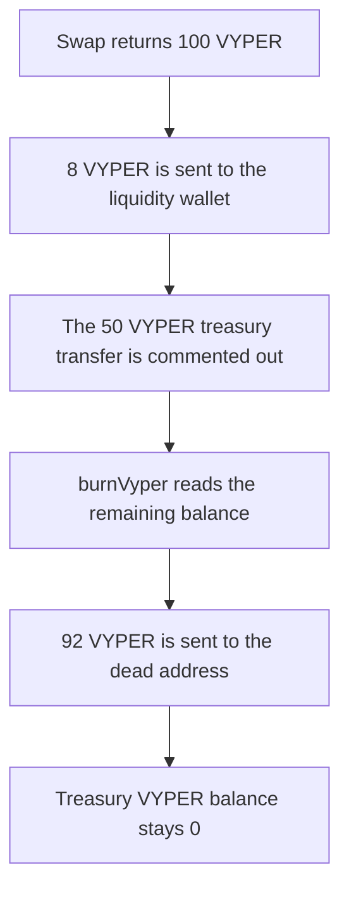

# Vyper Boost — buyAndBurn does not send VYPER to the treasury

> **Vulnerability classes:** vuln/logic/fee-calculation · vuln/logic/incorrect-state-transition

<!-- non-defihacklabs -->
<!-- source-auditvault: https://github.com/Auditware/AuditVault/blob/main/findings/44320-h-01-vyper-is-not-sent-to-the-treasury-in-buyandburnswapdrag.md -->
<!-- date: 2024-12 -->

## Key info

| | |
|---|---|
| **Protocol** | Vyper Boost |
| **Finding** | Shieldify H-01, AuditVault 44320 |
| **Vulnerable code** | `BuyAndBurn.swapDragonXToVyperAndBurn` |
| **Harm** | Of 100 VYPER out of the swap, the treasury receives **0** and **92 VYPER** is burned. The treasury was supposed to receive **50 VYPER** |
| **Chain** | local synthetic |

## TL;DR

`swapDragonXToVyperAndBurn` swaps an interval of DragonX into VYPER, sends 8% to the liquidity wallet, and burns the rest. The line that would send 50% to `vyper.treasury()` is commented out. On a 100 VYPER swap output, liquidity receives 8 VYPER, the dead address receives 92 VYPER, and the treasury balance stays 0. Uncommenting the transfer leaves the treasury with 50 VYPER and the burn with 42 VYPER.

## The vulnerable code

```solidity
vyper.transfer(liquidity, wmul(vyperAmount, uint256(0.08e18)));
// vyper.transfer(address(vyper.treasury()), wmul(vyperAmount, uint256(0.5e18)));
burnVyper();
```

`burnVyper` transfers the contract's whole VYPER balance to the dead address:

```solidity
uint256 bal = vyper.balanceOf(address(this));
// @> VULN: the 50 VYPER treasury transfer is commented out, so this burns the whole remainder. 92 VYPER goes to the dead address and the treasury balance stays 0.
vyper.transfer(DEAD, bal);
```

After the 8% transfer that balance is 92 VYPER, not the 42 VYPER that would remain if 50 had been sent to the treasury.

The fixed function inserts the commented transfer before `burnVyper`. The same 100 VYPER then splits into 8 liquidity, 50 treasury, and 42 burned.

## Root cause

The allocation comment in the audited function shows an 8% liquidity transfer and a 50% treasury transfer, and the treasury transfer was left commented out. `burnVyper` does not know about a reserved treasury share. It burns whatever VYPER is still in the contract, so the treasury's half is burned with the remainder.

## Preconditions

An interval has `amountAllocated` of 1000 DragonX. `INCENTIVE_FEE` is 1%, so 990 DragonX is swapped and 10 DragonX is paid to the caller. The swap returns 100 VYPER. No admin action is required. Anyone can call `swapDragonXToVyperAndBurn` once the interval is funded, which is the normal keeper path.

## Attack walkthrough

1. BuyAndBurn holds 1000 DragonX and the interval records that allocation.
2. `swapExactInput` takes 990 DragonX and mints 100 VYPER to BuyAndBurn.
3. `wmul(100 VYPER, 0.08e18)` is 8 VYPER. That amount is transferred to the liquidity wallet.
4. The 50% treasury transfer does not execute. It is a comment.
5. `burnVyper` reads the contract balance, 92 VYPER, and transfers all of it to the dead address.
6. The treasury's VYPER balance is 0. The dead address holds 92 VYPER. BuyAndBurn holds 0 VYPER. The caller receives the 10 DragonX incentive.

The control runs the same numbers with the treasury transfer restored. The treasury holds 50 VYPER, liquidity holds 8 VYPER, and the dead address holds 42 VYPER.

## Diagrams



## Impact

The treasury receives 0 VYPER. It should have received 50 VYPER, which is half of the 100 VYPER bought. Those 50 VYPER are burned: the dead address receives 92 VYPER instead of 42. Liquidity still receives the correct 8 VYPER. Restoring the transfer gives the treasury 50 VYPER and burns 42.

## Remediation

Uncomment `vyper.transfer(address(vyper.treasury()), wmul(vyperAmount, uint256(0.5e18)))` and call it before `burnVyper`, which is the fix the report recommended and the team applied. `burnVyper` then burns only what remains.

## How to reproduce

```bash
cd 44320-h-01-vyper-is-not-sent-to-the-treasury-in-buyandburnswapdrag_exp
forge test -vv
```

## Sources

- AuditVault finding: https://github.com/Auditware/AuditVault/blob/main/findings/44320-h-01-vyper-is-not-sent-to-the-treasury-in-buyandburnswapdrag.md
- Shieldify report: https://github.com/shieldify-security/audits-portfolio-md/blob/main/Vyper-Boost-Security-Review.md
- Audited file: https://github.com/De-centraX/vyper-boost-contracts/blob/005554b17b2337932cd473603562ef4d4b99606a/src/BuyAndBurn.sol#L116 (commit 005554b1, report dated 2024-12)
