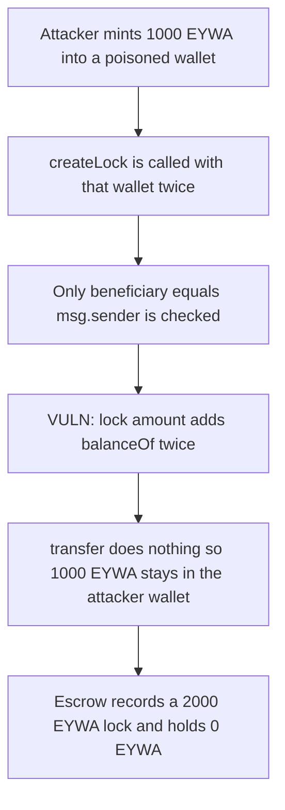

# EYWA — `createLock` credits a poisoned vesting wallet that never sends its tokens

> **Vulnerability classes:** vuln/logic/missing-validation · vuln/access-control/broken-logic · vuln/input-validation/missing

> **Reproduction:** self-contained Foundry PoC, no fork and no cheatcodes in the exploit. Trace: [output.txt](output.txt).

<!-- non-defihacklabs -->
<!-- source-auditvault: https://github.com/Auditware/AuditVault/blob/main/findings/44331-missing-validation-of-vesting-wallets-in-escrowmanagercreate.md -->
<!-- date: 2024-11 -->

## Key info

| | |
|---|---|
| **Impact** | **HIGH** — 1000 EYWA stays in an attacker wallet while a lock is credited 2000 EYWA and the escrow receives 0 |
| **Protocol** | EYWA DAO `EscrowManager` |
| **Vulnerable code** | `EscrowManager.createLock` credits `EYWA.balanceOf(wallet)` without a factory check |
| **Bug class** | Missing vesting-wallet validation |
| **Finding** | MixBytes — EYWA DAO audit · #44331 |
| **Report** | [EYWA DAO Security Audit Report](https://github.com/mixbytes/audits_public/blob/master/EYWA/DAO/README.md#1-missing-validation-of-vesting-wallets-in-escrowmanagercreatelock) |
| **Source** | [AuditVault](https://github.com/Auditware/AuditVault/blob/main/findings/44331-missing-validation-of-vesting-wallets-in-escrowmanagercreate.md) |
| **Audited commit** | `eywa-dao@29465033f28c8d3f09cbc6722e08e44f443bd3b2` `contracts/EscrowManager.sol` |
| **Compiler** | solc 0.8.27, cancun, via_ir |

## TL;DR

`createLock` accepts any contract whose `beneficiary()` is the caller. It adds that contract's EYWA balance to the new lock, then calls `transfer()`. A poisoned wallet implements `transfer()` as a no-op. Passing the same wallet twice credits 2000 EYWA while the escrow balance stays 0 and the attacker still holds the original 1000 EYWA.

## The vulnerable code

```solidity
function createLock(
    uint256 lockDuration_,
    address recipient_,
    address[] calldata vestingWallets_
) external {
    // ...
    for (uint256 i = 0; i < vestingWallets_.length; ++i) {
        m_vestingWallet = IVestingWallet(vestingWallets_[i]);
        // Only beneficiary is checked, but not the wallet address itself
        if (m_vestingWallet.beneficiary() != msg.sender) {
            revert InvalidBeneficiary();
        }
        // @> VULN: no factory/whitelist check; balance is credited even when transfer() moves nothing
        m_lockAmount += EYWA.balanceOf(address(m_vestingWallet));
        // FIX: if (!factoryValid[address(m_vestingWallet)]) revert InvalidVestingWallet();
        m_vestingWallet.transfer(address(this));
    }
}
```

## Root cause

The lock amount is the sum of `EYWA.balanceOf` reads. The wallet address is not checked against the vesting factory, and the code never checks that `transfer()` actually moved tokens. A wallet the attacker deployed can report the attacker as beneficiary, sit on a real EYWA balance, and ignore `transfer()`. Listing it twice adds the same balance twice.

## Preconditions

The caller must be the `beneficiary()` returned by the wallet. That is the only check. No role beyond a normal locker is required. The poisoned wallet is deployed by the attacker in the same transaction batch as the lock.

## Attack walkthrough

1. Mint 1000 EYWA (`1000000000000000000000`) into the poisoned wallet.
2. Call `createLock` with that wallet twice.
3. Each pass adds 1000 EYWA to `m_lockAmount` and calls `transfer()`, which does not move tokens.
4. The escrow records `lastLock = 2000 EYWA` (`2000000000000000000000`). Its EYWA balance is 0. The attacker wallet still holds 1000 EYWA.

An honest wallet whose `transfer()` actually sends tokens escrows exactly 1000 EYWA and is credited 1000. The factory-checked `createLockFixed` reverts on the poisoned wallet and, for a whitelisted honest wallet, escrows 1000 EYWA.

## Diagrams



## Impact

The attacker keeps 1000 EYWA and receives a lock credited 2000 EYWA. The escrow, which is supposed to custody the locked tokens, holds 0. Voting power and any later reward paid against that lock are unbacked by 2000 EYWA.

## Remediation

Reject any `vestingWallets_` entry that the vesting-wallet factory did not issue, before reading the balance or calling `transfer()`. Do not credit `balanceOf` unless the escrow's token balance increased by that amount.

## Sources

- AuditVault finding: https://github.com/Auditware/AuditVault/blob/main/findings/44331-missing-validation-of-vesting-wallets-in-escrowmanagercreate.md
- MixBytes report: https://github.com/mixbytes/audits_public/blob/master/EYWA/DAO/README.md#1-missing-validation-of-vesting-wallets-in-escrowmanagercreatelock
- Audited source: `eywa-dao@29465033f28c8d3f09cbc6722e08e44f443bd3b2` `contracts/EscrowManager.sol` (audit commit 14.11.2024; fix commit `39fba4bee623a3e60a529416f93d76e73658440d` adds `WALLET_FACTORY.isValidWallet`)
