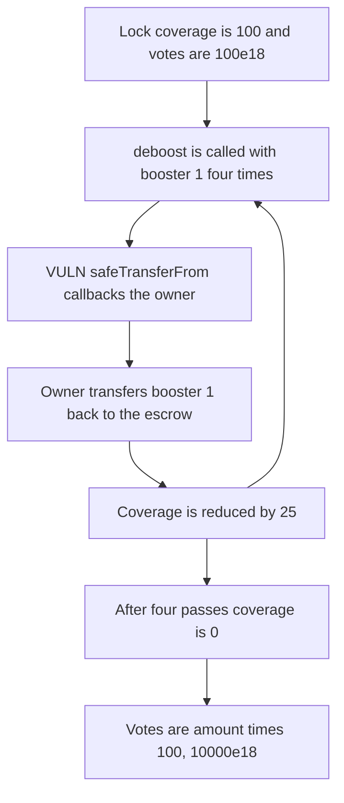

# EYWA: deboost callbacks let one booster wipe coverage and multiply votes by 100

> **Vulnerability classes:** `vuln/reentrancy/single-function` · `vuln/logic/incorrect-state-transition`

<!-- non-defihacklabs -->
<!-- source-auditvault: https://github.com/Auditware/AuditVault/blob/main/findings/44334-reentrancy-in-escrowmanager-mixbytes-none-eywa-markdown.md -->
<!-- date: 2025-01 -->

**AuditVault taxonomy:** `lang/solidity` · `sector/farm` · `sector/governance` · `sector/nft` · `platform/mixbytes` · `has/github` · `has/poc` · `severity/high` · `vuln/reentrancy/single-function` · `novelty/known-pattern` · `misassumption/external-call-is-safe` · `fix/use-reentrancy-guard` · `trigger/reentrancy-callback` · genome: `single-function` · `known-pattern` · `data-corruption/price-manipulation` · `reentrancy-guard`

## Key info

| Field | Value |
|---|---|
| **Loss** | Voting power rises from 100e18 to 10000e18 while booster NFT 1 is back in the escrow and coverage is 0 |
| **Vulnerable contract** | `EscrowManager.deboost` |
| **Attacker EOA** | `0x1111111111111111111111111111111111111111` |
| **Attack contract** | `Exploit` |
| **Attack tx** | `Exploit.run()` |
| **Chain / block / date** | Ethereum model · block 0 · 2025-01 |
| **Compiler** | solc 0.8.27, cancun, via IR |
| **Bug class** | `safeTransferFrom` callback before coverage is reduced, with a duplicated booster id |

## TL;DR

`deboost` safe-transfers each booster id to the lock owner before it subtracts that booster from coverage. The owner is passed `[1, 1, 1, 1]`. On every receipt the owner transfers NFT 1 back to the escrow, so the next iteration can transfer it again. Coverage falls 100, 75, 50, 25, 0. Votes are `amount * 100 / coverage`, and a zero coverage returns `amount * 100`. Votes go from 100e18 to 10000e18. A single id, with no re-deposit, leaves coverage at 75.

## Background

MixBytes' EYWA DAO review, timeline 14 November 2024 to 13 January 2025, finding 4, fixed in commit `4f2b045c507ec910a963cc516e0bc36b183a15cc`. The report's `deboost` proof of concept repeats one booster id and, inside `onERC721Received`, transfers that NFT back to `EscrowManager`. Their full-system run moved votes from 4402998660126770 to 1105121050824042828. This reduction keeps that callback and the duplicate-id loop, with a lock whose votes are `amount * 100 / coverage`.

## The vulnerable code

```solidity
collection.safeTransferFrom(address(this), L.owner, id);
// @> VULN: safeTransferFrom callbacks before this id is removed from coverage, so a duplicate id is counted again
if (L.coverage >= boost) {
    L.coverage -= boost;
}
```

The report's holder does the same return transfer:

```solidity
function onERC721Received(address, address, uint256, bytes memory) public virtual override returns (bytes4) {
    if (exploiting > 0) {
        exploiting--;
        COLLECTION.transferFrom(address(this), address(es), boostId);
    }
    return super.onERC721Received.selector;
}
```

Checks-effects-interactions, or a reentrancy guard, stops the callback from observing a half-updated lock. Rejecting duplicate ids stops one booster from being subtracted more than once.

## Root cause

The external call sits in the middle of the per-id update. Coverage for that id is still counted, and the NFT can be moved back to the escrow before the next loop index. The array is not checked for duplicates, so the same id is a fresh iteration every time.

## Preconditions

- Lock 1 has amount 100e18, coverage 100, and owner equal to the attacker contract.
- Booster NFT 1 is worth 25 of coverage and is owned by the escrow at the start.
- `deboost` is called with that id four times. The receiver sends the NFT back on each of the four callbacks.

## Attack walkthrough

1. Votes before the call are 100e18.
2. `deboost(1, [1, 1, 1, 1])` transfers NFT 1 to the owner.
3. `onERC721Received` transfers it back to the escrow and decrements `exploiting`.
4. Coverage is then reduced by 25. The next three iterations repeat the same transfer.
5. Coverage is 0, the NFT is owned by the escrow, and votes are 10000e18.
6. The control removes id 7 once and does not return it. Coverage is 75 and votes stay under 200e18.

## Diagrams



## Impact

The lock owner has 10000e18 votes instead of 100e18, a 100x increase, while booster 1 is still held by the escrow. The report's full system showed the same shape of inflation, from about 4.40e15 votes to about 1.11e18, and noted that `createLock` and `withdraw` have the same callback window against `totalLocked`.

## Remediation

Update coverage before the NFT transfer, reject duplicate ids, and guard `deboost`, `createLock`, and `withdraw` against reentrancy. Prefer a transfer that does not call the receiver.

## How to reproduce

```bash
cd 44334-reentrancy-in-escrowmanager-mixbytes-none-eywa-markdown_exp
forge test -vv
```

`test_duplicate_deboost_inflates_votes` asserts 100e18 before and 10000e18 after, with the NFT back in the escrow. `test_control_single_id_keeps_coverage` asserts one removal leaves coverage at 75. Captured output is `output.txt`.

## Sources

- AuditVault finding: https://github.com/Auditware/AuditVault/blob/main/findings/44334-reentrancy-in-escrowmanager-mixbytes-none-eywa-markdown.md
- MixBytes report: https://github.com/mixbytes/audits_public/blob/master/EYWA/DAO/README.md#4-reentrancy-in-escrowmanager
- Audited commit: `29465033f28c8d3f09cbc6722e08e44f443bd3b2` on `gitlab.ubertech.dev/blockchainlaboratory/eywa-dao`
- Fix commit noted by MixBytes: `4f2b045c507ec910a963cc516e0bc36b183a15cc`
