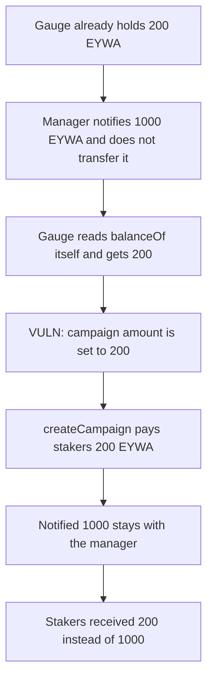

# EYWA — notifyRewardAmount pays stakers 200 EYWA instead of 1,000

> **Vulnerability classes:** vuln/logic/reward-calculation

<!-- non-defihacklabs -->
<!-- source-auditvault: https://github.com/Auditware/AuditVault/blob/main/findings/44335-incorrect-logic-in-gaugev1notifyrewardamount-mixbytes-none-e.md -->
<!-- date: 2025-01 -->

## Key info

| | |
|---|---|
| **Protocol** | EYWA |
| **Finding** | MixBytes EYWA DAO audit, AuditVault 44335 |
| **Vulnerable code** | `GaugeV1.notifyRewardAmount` |
| **Harm** | Stakers receive 200 EYWA instead of the notified 1,000 |
| **Chain** | local synthetic |

## TL;DR

`notifyRewardAmount(amount_)` never pulls `amount_` from the escrow vote manager. It opens a Merkl campaign for `balanceOf(address(this))`. The gauge already holds 200 EYWA. The manager notifies 1,000 and only approves. Stakers receive 200. The 1,000 stays with the manager.

## The vulnerable code

```solidity
function notifyRewardAmount(uint256 amount_) external {
    if (msg.sender != s_escrowVoteManager) {
        revert UnauthorizedCaller();
    }
    IERC20 m_eywa = IERC20(s_eywa);
    uint256 m_balance = m_eywa.balanceOf(address(this));
    if (m_balance * 1 hours / EPOCH_DURATION >= DISTRIBUTION_CREATOR.rewardTokenMinAmounts(address(m_eywa))) {
        m_eywa.approve(address(DISTRIBUTION_CREATOR), m_balance);
        IDistributionCreator.CampaignParameters memory m_campaignParameters = s_campaignParameters;
        // @> VULN: campaign amount is the gauge balance, not amount_, and amount_ is never transferFrom'd
        m_campaignParameters.amount = m_balance;
        DISTRIBUTION_CREATOR.createCampaign(m_campaignParameters);
    }
}
```

`amount_` is unused. The manager's call approves the gauge and does not transfer. The gauge's existing 200 EYWA is above the creator's minimum (`200e18 * 1 hours / 1 weeks` is about 1.19e18, and the minimum is 1e18), so a campaign is created for 200.

The control `transferFrom`s `amount_` into the gauge and sets the campaign amount to `amount_`. Stakers then receive 1,000 EYWA. The pre-existing 200 stays in the gauge.

## Root cause

The campaign is sized off the gauge's token balance at the start of the call, and the function never moves `amount_` in. A gauge with a leftover balance campaigns that leftover. A gauge with a zero balance campaigns nothing, even when `amount_` is large. Either way the notified amount is not what stakers receive. Here the leftover is smaller than the notification, so stakers are underpaid.

## Preconditions

`msg.sender` is the escrow vote manager. The manager has approved the gauge for `amount_` and has not transferred it. The gauge's current EYWA balance, scaled by `1 hours / EPOCH_DURATION`, meets `rewardTokenMinAmounts`. Here that balance is 200 EYWA and `amount_` is 1,000 EYWA.

## Attack walkthrough

1. The gauge holds 200 EYWA. The manager holds 1,000 EYWA.
2. The manager approves the gauge for 1,000 and does not transfer. Its balance stays 1,000.
3. The manager calls `notifyRewardAmount(1000e18)`.
4. The gauge reads `balanceOf(this)` and gets 200. That balance passes the minimum, so the creator is approved for 200.
5. The campaign amount is set to 200. `createCampaign` pulls 200 EYWA from the gauge and pays the stakers.
6. Stakers hold 200 EYWA. The manager still holds the notified 1,000. Stakers were short 800 EYWA.

The control transfers the 1,000 into the gauge and campaigns `amount_`. Stakers receive 1,000 EYWA. The manager's balance ends at 0. The original 200 remains in the gauge, unspent by this campaign.

## Diagrams



## Impact

Stakers receive 200 EYWA from this notification instead of 1,000. The 800 EYWA difference, and the full notified 1,000, never leaves the escrow vote manager. The gauge's leftover 200 is what gets distributed. A later notification repeats the same substitution whenever the gauge balance and `amount_` differ.

## Remediation

`transferFrom` `amount_` from the escrow vote manager into the gauge, then set `m_campaignParameters.amount` to `amount_` (the value that was just pulled), not to the balance from before that transfer.

## How to reproduce

```bash
cd 44335-incorrect-logic-in-gaugev1notifyrewardamount-mixbytes-none-e_exp
forge test -vv
```

## Sources

- AuditVault finding: https://github.com/Auditware/AuditVault/blob/main/findings/44335-incorrect-logic-in-gaugev1notifyrewardamount-mixbytes-none-e.md
- MixBytes report: https://github.com/mixbytes/audits_public/blob/master/EYWA/DAO/README.md#1-incorrect-logic-in-gaugev1notifyrewardamount
- Audited commit: https://gitlab.ubertech.dev/blockchainlaboratory/eywa-dao/blob/29465033f28c8d3f09cbc6722e08e44f443bd3b2/contracts/GaugeV1.sol#L54-69
- Audit window: 14 Nov 2024 to 13 Jan 2025, report dated 15 Jan 2025
